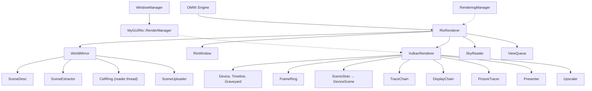

# The ray tracing renderer

How the ray tracer fits into OpenMW: its layers, who owns what, how a frame is made, and the decisions behind each,
with what was refused. The headers hold the detail and `docs/research/` the measurements; a change that keeps the
shape does not change this file. The tree's own words (walk, stand, hand over, hold, slot, run, ring, epoch) are in
[`components/rtx/GLOSSARY.md`](../components/rtx/GLOSSARY.md).

## What the fork is

Upstream OpenMW stays the host engine: cells, references, physics, scripts, animation, weather, GUI logic. The ray
tracer draws the whole picture: visibility, shadows, direct and indirect light, sky, water and fog. Both renderers stand
behind one interface in one binary, but the game starts the ray tracer alone; the OpenGL renderer stays built so
upstream's code merges as it stands, its code upstream's but for what `.notes/UPSTREAM.md` lists. The player's settings
are in [`settings.md`](settings.md).

The target is NVIDIA Turing and AMD RDNA 2 and later, through Vulkan's ray tracing. The light is filtered by the
renderer's own denoiser under AMD's FSR, or by NVIDIA DLSS Ray Reconstruction where the card and the player's library
allow. Vanilla textures reach the trace as they were painted; a PBR replacer's companion maps reach the trace, and a
vanilla scene draws the same whether or not the renderer reads them.

## Layers and libraries

Each layer knows the layer below it and never the one above.

```
apps/openmw                      the game
  │  MWRender::Renderer          the seam          (apps/openmw/mwrender/renderer.hpp)
  ├── GlRenderer                 upstream's rasterizer, gathered behind the seam
  └── RtxRenderer                the game-side owner (apps/openmw/mwrender/rtx/)
        │  Rtx::Renderer         the core's interface to a backend
        ├── components/rtx       the core: what the scene is; no graphics API, no game headers
        └── components/rtxvulkan the backend: everything true of Vulkan

Beside the stack:
  components/contentstore        what is derived from the content, kept across sessions
  components/myguirtx            MyGUI's backend over Rtx::GuiRenderer
  components/crashcatcher        the crash catcher: a Crashpad monitor process
  apps/rtxtool                   the harness: drives a real game headless
```

A Vulkan fact in `components/rtx` or `apps/openmw` is a bug, and the link lines keep it out: the core has no Vulkan
header on its path, and the backend reaches Vulkan privately through volk, which loads the loader at the first instance,
so the game starts on a machine without one and says what is missing. Two places create a backend: `RtxRenderer` and
the harness. OpenSceneGraph stays the content loader: the scene arrives as an `osg::Node` graph.

## The build

`./omw [flavour] <verb>` is the one command line over the CMake presets (`build.md`).

- **A shader's arithmetic is the build's**: every float operation the Vulkan specification leaves open is pinned and
  nothing is fused (`spirv/spirvpin.hpp`), so every compile of a module computes the same frame, at about 4% of the
  frame (`research/2026-10-22-pinned-arithmetic-cost.md`). The structures both
  languages read are headers that compile as C++ and GLSL, and each module's interface is held to the C++ beside it at
  load (`spirvinterface.hpp`).
- **The game's shaders are compiled into it** as word arrays, as ANGLE compiles its internal Vulkan shaders in, so no
  shader file is installed or read at a start; the harness's and the tests' sets stay folders in the build tree.
  Refused: `#embed`, which MSVC lacks; an assembler's `.incbin`, a second route; the with-source sets compiled in, too
  large to compile again at every shader edit.
- **What a start would compute from no content is made by the build** (the blue noise, the fog's field, the specular
  albedo's table), each held to its maker by a test.
- **One program for every step the build runs** (`openmw-rtx-build`, a verb a step), as `llvm-tblgen` is one generator
  with a backend a table. Refused: a program a step; two programs, which saved seconds on rare edits.

## The seam: `MWRender::Renderer`

The one interface the game talks to. Read its header first.

- A pure virtual is a question both renderers answer; a default body is an empty answer one has no work for.
- **Nothing below the seam is abstracted**: contexts, swapchains and acceleration structures belong to one renderer. The
  game is never handed one renderer's mechanism, but for upstream callers that cannot change, which get null.
- **The ray tracer is the one renderer started**: any failure, `Rtx::Unsupported` included, ends the start in the fatal
  error box.
- **The world is attached as an object** (`WorldAttachment`), whose end detaches once, held as `RenderingManager`'s last
  member so a throwing constructor detaches too; the attach carries the engine's unref queue, so a crossing's last
  references drop off the frame thread.
- **One presentation** (`Misc::Presentation`): each renderer draws at `[Video] resolution` and shows it scaled into the
  window; the GUI, the projection, the pointer and Lua read the frame from it.

The game describes each frame as a `SceneFrame` in the content's own numbers; `FrameDescriber` collects the fork's facts
so `RenderingManager` stays upstream's. Pictures away from the eye (the local map, the doll, the world map) are seam
types too (`OffscreenView`, `SubjectView`, `MapOverlay`).

## The game-side owner

`apps/openmw/mwrender/rtx/`. `RtxRenderer` drives each frame itself, with no viewer and no cull, through a phase state
machine every entry point asserts. `WorldMirror` mirrors the scene graph into the core's scene each frame and runs the
cell ring; `SkyReader` turns the game's sky into the core's `WorldReading`; `ViewQueue` and its views make the pictures
in the interface.

- **Two hosts, one renderer**: a played session and a harness run reach it through one record (`RtxSetup`), the host
  answering per frame what to sample, keep and report. `RtxSettings::derive` is the one derivation of the settings; the
  core reads none.
- **Settings apply at the next frame** (`PendingSettings`), so a rebuild that fails is reported there. Refused: a
  rebuild inside the settings window's call, whose failure ended the process.
- **World events take one phase rule** (`expectWorldEvent`): between frames or from the run's hook.
- **Jumps are told by stable identity** (`SceneUtil::StableIdentity`). Refused: the node's address, which a new node can
  reuse.
- **A played session's frame times are a histogram**, the worst kept exactly, logged at each cut and at the end.

## Loading

What the game reads from files (`components/resource`), changed for the handheld's memory and the preloader's re-reads
(`research/2026-11-15-content-reads-and-host-memory.md`), kept in the fork by the user's decision.

- **One load a key in flight** (`GenericObjectCache::getOrLoad`): every thread that asks while a load runs takes its
  value or its exception, as Go's `singleflight` does. Refused: a lock over the whole load, which serialises every
  thread behind the slowest file.
- **An archive is opened once and read by position** (`Platform::File::readAt`), each entry's stream keeping its own
  position over the shared handle. Refused: a memory map, whose file-backed pages count against a handheld's memory.
- **What is read from files is kept by a byte budget, least recently used first** (`Resource::CacheBudget`), across the
  template, NIF, image, shape and keyframe caches; an entry anything holds stays. Refused: a longer `cache expiry
  delay`, still unbounded; a fixed share a cache, as Unreal splits its pools, which is wrong for some content.
- **The budget is derived, and again every second**, from what the system leaves the process, so whatever else takes the
  memory leaves the caches that much less, as a browser's memory-pressure signal does. No setting, so no default that
  is wrong on some machine. Refused: a figure read once at startup.
- **What the system leaves the process is less what of the process is in swap** (`Platform::availableMemory`): the
  kernel counts the memory it freed by swapping the process out as available, so a budget read off `MemAvailable`
  alone grew by what it pushed out, and pushed out more; the handheld's repack held a cache budget of 4.5 GiB beside
  6 GiB swapped. Windows states no figure of what it paged out apart from what nothing touched, so its room stands as
  the system states it.
- **The heap's free memory is the caches' room, and an evicted value dies off the lock and off the frame**
  (`CacheBudget::derive`, `Platform::heapHeld`): what the heap took and holds free is the process's own to take again,
  read with the system's once a second through glibc's `malloc_info`, the one report every glibc writes, since
  `mallinfo` wraps past 2 GiB and the release builds' glibc has no `mallinfo2`; on Windows nothing, whose one
  figure, `HeapSummary`, walks the heap under its lock, 1.2 s a second on a 2.5 GiB heap. The worker that derives the budget
  destroys what was evicted, where upstream had put its own expiry. Refused: a trim on a timer, which walks every
  arena to give back what should never have entered one.
- **A large buffer never reaches an arena, and the arenas are four** (`Platform::tuneHeap`): the mapping threshold is
  pinned at 1 MiB, which turns glibc's own adjustment of it off (`mallopt(3)`), so a large block is given back whole
  whichever thread frees it. The setting that left the heap least free on both machines' Repack tours, and took
  0.86 GiB off the handheld's most (`research/2026-11-17-handheld-allocator-tunables.md`); `GLIBC_TUNABLES` naming the
  allocator overrides it. Refused: the 256 KiB and 4 MiB thresholds, which left more free; huge pages off, which
  swapped a GiB more; a second allocator, proposed only while the heap holds more than a fifth of what it took free.
- **A stream reads a request past its buffer straight into the caller's memory**
  (`ConstrainedFileStreamBuf::xsgetn`), as libstdc++'s `basic_filebuf` does. Refused: a larger buffer, still two
  copies of every byte; positioned reads for the renderer beside the game's streams, two routes to one file.
- **An entry states its own bytes**, shared bytes in the one cache that owns them, as Unreal's `Exclusive` resource size
  counts. **The order of use is a stamp**, the clock algorithm's second chance for a held entry.
- **What the game builds from memory keeps the timer**: the land, the chunks, the physics instances, the materials.
- **A model holds a texture's header, not its texels** (`Resource::ImageHeader`): where the renderer reads texels itself
  they are read through the header when wanted and let go of once the device has its copy, as Unity's textures that are
  not readable drop their host copy (`research/2026-11-16-texture-uploads-and-host-memory.md`). Refused: freeing a
  shared image's texels in place, which every reader would race.
- **A file is keyed once, where its texels are first read** (`Rtx::ImageDerivation`, `Rtx::FileKeys`): the image
  manager hands a renderer the texels before it makes the header, and the header is made carrying the file's key, a
  hash of its levels as described, and every fact a material asks, read in one pass keyed from the file's key
  (`FileFactsPass`), never written again, so any thread reads it without a lock. A chain the store holds whole then
  comes back with no read of its file, and no fact reads one. As
  OpenSceneGraph hooks a read through its registry's `ReadFileCallback`, and as Unreal's derived data keys a texture
  by its source's hash taken at import. Derived on the loader's own thread through a pool of preprocessors, half the
  processors, a loader past them waiting (`Rtx::ImageDerivation`). Refused: a key a pass hashes from the texels each ask,
  which reads the file to key what the store holds; facts made at a material's first ask, which read the file again
  once the texels went; four fact passes, four entries a file, each read at its own ask, which the first read asks
  anyway; a preprocessor a thread (`thread_local`), global state no owner bounds.
- **Residency plans every texture, and the device stands what it is told** (`Rtx::Residency`, `ResidencyDevice`),
  by the user's decision: a texture's level follows its want, its tier and the arena's cap, the least protected and the
  most bytes lowered first, each to a floor of 64 texels a side, as Unreal's streamer takes a level off the textures
  it needs least. The backend chooses nothing: it stands an image in the slot it is handed. A lowering copies the
  shared levels on the device, a raise asks the feed for the finer levels alone, and what stood stays until the
  operation rides. Refused: the backend choosing levels as its pools allowed, which allocated before it freed and
  refused a bake or a composite for good at a full pool, and whose waits, moves and rest each held a part of one
  answer (`.notes/review-rtx-renderer.md`).
- **A sprite's light bake is planned as one with its source**, made from it on the device at its level: a cap that
  holds one and not both lowers both. Refused: the bake planned after its source, which starved the bake beside a
  source that could have stood a level coarser for it.
- **Texels come from a feed, taken in the order asked** (`TextureFeed`, `TextureHands`): residency asks the levels it
  plans, the hands make or read them on their own threads, and a completion lands on the frame after the ones asked
  before it, so two processes stand one image on one frame; one for a tenant that left is dropped as it lands. A run
  that compares frames waits for every texel and block asked. Refused: a table of prepared images the uploader polled,
  whose arrivals landed in the order the threads finished.
- **A texture stands from the level its nearest user asks**, by the user's idea: distant land never loads its finest
  levels, and only the nearest cells load level 0. This is the shape of Unreal's streamer: a UV density per mesh, a
  scale per material texture, and the wanted level from the nearest user. Here the bound is the trace's own: every
  read takes the level its ray cone resolves, and a secondary cone is never narrower than the primary at the eye's
  distance. So a level finer than the primary ray's at that distance is never read, a shadow ray's cutout aside.
  Asks follow the hold chain, placement → material → texture (`MaterialTable::ask`): the walk's placements ask the
  finest, the ring's cells ask by distance in bands that double from a cell's size, one band nearer than their own
  (`CellPlacer::askByDistance`), and a holder that reads a texture itself asks level 0 (`ReadingHold`). A want that
  rises is taken at once, one that falls once it has stood `Residency::sWantHoldHandOvers` hand-overs, so a step back
  and forth lowers nothing. Refused: a scan of the placements each frame, which the frame rule
  forbids, and a feedback pass, which measures what a derived bound already states.
- **A store kind is a number its folders keep, apart from a pass's place among the passes**
  (`Rtx::sStoreKinds`): a retired kind's version is nought, and the store's start after the versions moved removes
  every entry of a version no owner makes, by its trailer, once (`ContentStore::Policy::mVersions`). Refused: kinds
  numbered by the passes' order, which moved every made chain to another kind when a pass before it went.
- **A made chain is handed over in a buffer of a bounded pool, read a segment at a time** (`Rtx::BufferPool`,
  `ContentPreprocessor::chain` into a pool): the store's entry is opened, its form's byte read, and its levels read
  by position into a pooled buffer from the first level the request asks, each segment's digest checked; the buffer goes back to the pool as the made image
  goes, the device having its copy. 256 MiB in use and free, by size class a power of two, so a hand-over allocates
  nothing once warm, as DirectStorage reads into a bounded staging buffer. A job whose slot left before it started is
  cancelled. Refused: a buffer allocated a read, freed on the frame's thread; reading into the staging memory, which
  is write-combined and which a digest would read back.
- **A preload is a guess, skipped past the budget** (`CellPreloader`), and asked again later, a door's destination
  asked before it is found, which loads its references for good. Refused: waiting for room, which stalls the queue.
- **The navigator's tiles stand under the one budget** (`NavMeshTilesCache`), with no cap of their own: a tile is a read
  away in the tile store. Refused: a cap derived once at a start, the fixed share this design refuses.

## The interface

MyGUI draws the whole interface, as upstream; only its backend changes. `MyGUIPlatform::GuiRenderManager` is the seam,
implemented by upstream's OSG manager and by `MyGUIRtx::RenderManager` over `Rtx::GuiRenderer`: an extent, a table of
textures and one call that draws triangles. A picture inside the interface is traced from a scene of its own, with no
history; pictures the game writes in memory reach the renderer through `shareTexture`, which sends what changed. The
settings pages and the launcher take their menu orders from the core.

### A live scale and font size

`[GUI] scaling factor` and `[GUI] font size` apply while the game runs (`research/2026-10-31-mygui-font-lifetimes.md`,
`research/2026-10-31-mygui-list-line-height.md`).

- **Derived, not cached**: the fit is computed at every layout and compared with the last. Refused: one raster for the
  largest scale, always paid; a restart.
- **One owner, one call** (`Gui::InterfaceFonts::fit`) rasterizes the fonts and refits the texts, lists and pages, in
  order. **A font is rebuilt in place**, its handle kept. Refused: loading the fonts again by name, which leaves every
  text holding a deleted font.
- **Every font user is known by construction**: texts and lists stand in MyGUI's factories and enter a registry.
  Refused: a walk of the widget tree, which misses skin children and popups.
- **The font size has one reader**, `WindowManager::getFontSize`, which a test holds file by file.
- **A window that keeps sized rows lays them out again** (`WindowBase::refitText`), and a book is typeset again.
  Refused: rebuilding the whole interface, which loses every window's and Lua element's state.
- **The sliders apply when they settle**, not under a drag.

## The core

`components/rtx/`. What is true of Morrowind's content, of light transport and of what the scene is, written once for
every backend. Its folders stand in an order: a folder includes only the folders before it, and a folder inside another
is part of it. `RtxSourceTreeTest` holds the order against this table.

| folder              | holds                                                                   |
|---------------------|-------------------------------------------------------------------------|
| `shaders/`          | the structures core C++ and GLSL both read                               |
| `common/`           | what knows no scene: contracts, results, slots, runs, threads, the clock |
| `image/`            | a texture file read: its formats, texels, alpha, levels and painted light |
| `scene/`            | `SceneDesc`, its rows and tables, and what makes textures of it          |
| `preprocess/`       | `ContentPreprocessor`, its keys, cache and costs; the passes in `shape/` and `texture/` |
| `frame/`            | what a frame is asked for and sampled with: the camera, the reconstruction |
| `world/`            | the sky, the air and the water a frame is told, and the sea's waves      |
| `renderer/`         | `Rtx::Renderer` and what it hands, reports and writes                    |
| `mirror/`           | the walk from the scene graph, how it reads a surface and a lamp; the cell ring in `cells/` |
| `prepare/`          | the loading screen's walk of every model the content names into the store |
| `environment/`      | the sky read out of the content files                                    |
| `view/`             | the pictures traced away from the eye                                    |
| `tables/`           | what makes the tables the build computes once and compiles in: the blue noise, the fog's noise, the specular albedo |

- **`Rtx::Renderer` is one traced image, whichever API makes it**; each call is worth a whole scene or frame, never an
  instance or a pixel. Each consumer takes the part it calls: `SceneHolder`, `PictureRenderer`, `GuiRenderer`.
- **A null backend** (`OPENMW_RTX_BACKEND=null`) keeps every promise and draws nothing, so CI runs upstream's
  integration tests through the ray tracer's whole game side, as Unreal's `-nullrhi` does; chosen by the environment,
  never a setting. Refused: a third `MWRender::Renderer`, which tests none of it; lavapipe, which lacks an extension the
  backend requires.
- **`Rtx::SceneDesc` is everything a backend needs of a world**: meshes, materials, textures, placements, deformers and
  the per-frame lists. It appends and deduplicates, and a slot is never renumbered, so a hit reads it as its index.
- **A vertex's normal and colour are packed for the device once**, by the user's decisions: an octahedral normal with a
  "present" bit, the colour in half floats, none clamped. Refused: `SNORM` normals with no "none", `UNORM` colours that
  clamp, sRGB bytes.
- **`Rtx::SceneExtractor` mirrors an OSG subtree** into a `SceneDesc`, its identity maps living across walks, so a still
  frame costs what moved; what a walk did not meet is swept after it.
- **The cell ring** (`mirror/cells/`) stands the world past the loaded cells, which rays reach: the ground, the statics
  as instances of their templates, the lamps. A reader thread prepares cells and the frame adopts them a little at a
  time. A reference a local script enables or disables stands behind a gate the game evaluates
  (`MWScript::VisibilityGates`). The size rule thins what reflects light, never what gives it. Refused, by the user's
  decision: a cache of what no cell holds, which the resource cache and the ring's hysteresis already cover.
- **`Rtx::ContentPreprocessor` is the one way anything is computed from the content**, one on each thread that reads
  content. Every pass states everything it reads, which is the key its output is filed under in the content store.
- **`Rtx::SceneUploader` hands a scene to the backend once a frame**, in the cheapest of three ways: place what moved,
  extend with what arrived, or rebuild.
- **The world a frame is told** (`world/`): a `WorldReading` becomes the frame's sun, moons, sky, clouds, fog and water;
  the sky's sheets and meshes are read out of the content once.

### Materials

- **The surface is glTF 2.0's metal-roughness** (`shaders/brdf.h`); a vanilla surface is that model with no specular
  reflectance.
- **A mapped normal's light fades by GGX's shadowing**, as Cycles fades it (Conty Estevez et al. 2019). Refused: Chiang
  et al. 2019, flat patches at a grazing sun; no term (`research/2026-11-07-bump-terminator.md`).
- **A shadow ray leaves from the surface the vertex normals describe only toward the facet's terminator**, the lift
  fading to nought where the facet meets the light at a cosine of a half, as Cycles weighs Hanika's offset, at a cutoff
  Morrowind's coarse rocks need. Refused: the lift on every ray, which took the sun past a ledge to the wall under it;
  Cycles' tenth, which cut hard wedges into the rocks (`research/2026-11-19-shadow-lift-leak.md`).
- **A `_spec` map's blue is an occlusion on indirect diffuse light alone**, as glTF and Filament read it. Refused: in
  the albedo, which darkens the sun (`research/2026-11-07-specular-map-blue-channel.md`).
- **An `_nh` map's relief is marched, as RTX Remix marches it** (Tatarchuk 2006), at OpenMW's parallax depth, once by
  the trace and read back by every later stage, and is a plain shift where it crosses under a texel, so a far surface
  keeps its cost. Only the tuples with maps march, and no setting turns it off. Refused: a max-mip quadtree; true
  displacement (`research/2026-11-08-height-map-range.md`, `research/2026-11-08-parallax-occlusion-techniques.md`,
  `research/2026-11-08-relief-cost-and-noise.md`).
- **A mod's detail, decal, bump and gloss maps are read as `objects.frag` reads them**, behind a material's bit and
  from a row of their own (`MATERIAL_MOD_MAPS`), so no other hit's read moves; compiled into every kernel, which holds
  no more registers on either AMD driver for it (`research/2026-11-19-one-kernel-registers.md`). Refused: under the
  normal maps' constant, which runs their kernels for one detail-mapped bottle; in the material's row, which moved every
  kernel; left unread; a constant of their own, a tuple doubled for nothing
  (`research/2026-11-15-mod-maps-registers.md`).

### Content the renderer cannot use

Never an assert and never the end of a frame: readers answer with a `Result`, every refusal is reported once to
`Rtx::Refusals`, a refused texture draws as a stand-in, and anything else refused is left out.

- **State is read by what it does, not by its presence** (`statereading.cpp`): only a stencil test that can reject is
  unread.
- **Faces a wireframe draws are lines, left out as an `NiLines` is**, by the user's decision: a ray meets no width of a
  line. Refused: thin ribbons; faces, a filled sheet where OpenGL draws lines.

### Reconstruction

- **`RenderProfile` is what a run decides once, and `Reconstruction::resolve` the one rule** for who filters the light,
  the jitter, the noise source and the texture level bias (`frame/reconstruction.hpp`).
- **Who filters the light follows what the upscaler takes**, a capability and never a vendor: the renderer's filter with
  no upscaler and under FSR, the upscaler under DLSS Ray Reconstruction. A frame asked unfiltered under an upscaler that
  filters is refused before its first frame.
- **What a filtering upscaler is handed is what measured cleaner under it**, from NVIDIA's guide's rules, each measured
  (`research/2026-11-11-ray-reconstruction-against-super-resolution.md`).

### The content store

What the preprocessor makes of the content is kept across sessions in `ContentStore::Store` (`components/contentstore`),
filled on the loading screen (`research/2026-11-08-normal-map-chains.md`).

- **The store is the game's input**: every form the renderer reads of a file and every derivation of one is made on the
  loading screen and read in play; the game computes only a miss, through the same pass, and counts it. Refused:
  refusing content the preparation did not see, which a script's spawn breaks; a cheaper second path for a miss.
- **The device's derivations stay at arrival** (the normal spread, the sprite light bake, the ground composite), and no
  acceleration structure is stored, as a driver update invalidates it.
- **The key is the content** (`ContentStore::Key`): the pass's name and version and every byte it reads. Refused: path,
  size and time, which a file inside a BSA makes quietly wrong.
- **One file an entry, and every entry untrusted**, as ccache and Bazel's disk cache keep theirs: a trailer states what
  the entry is with its digest, a file that does not match is a miss and deleted, and a write is a rename. Refused:
  SQLite, by the user's decision; a pack file a pass; a sync before each rename, where the digest finds what a power
  loss left.
- **An entry's file stands in its kind's folder, and holds a digest a segment** (format 3): the start loads one kind's
  small entries and passes a kind held at any size by without opening a file, and a made chain is filed a segment a
  level, its form's byte last, so a range of its levels can be read and checked alone, as KTX 2 indexes its levels.
  Refused: the kind read off each file's trailer at the start; one digest over the payload, which a ranged read
  cannot check.
- **One store, in a component of its own**, which any owner may hold one of, with its kinds and residency stated by the
  owner (`ContentStore::Policy`).
- **The navigator's tiles in the content store** (`DetourNavigator::NavMeshTileStore`), by the user's decision, shared
  by every profile: a tile is keyed by everything Recast builds it from by value, so whatever moves a triangle keys a
  new tile, and a version a test holds stands for the code. Refused: SQLite; a key of model paths and transforms, which
  read one pose back for every pose (`research/2026-11-10-navmesh-cache.md`).
- **The frame reaches the store's memory alone** (`ContentStore::Reach`), so no frame waits on the disk. Refused: a file
  read on the frame's thread.
- **No size cap**, by the user's decision: an evicted entry is one play computes.
- **Every normal and data map's chain is rebuilt, and a colour file keeps its own**, by the user's decision: data maps'
  shipped chains are often wrong below level 0, colour chains rarely.
- **The filter is a box of the level above, a normal averaged as a vector**, in linear light for a colour, weighed by
  alpha only where alpha is coverage, as Unreal's `SimpleAverage`; the spread measured from the finest level (Toksvig).
- **A normal map is whole in BC7, in one encoding**, by the user's decision: the normal in three channels and its height
  in alpha (`research/2026-11-09-content-preparation-cost.md`). Refused: BC3, a normal at 5:6:5.
- **A coarser level is encoded on the host in the file's format**, through rgbcx, approved by the user. Refused: an
  encoder of our own; encoding on the device.
- **Every chain the store keeps is whole**, by the user's decision: a block file's built levels are kept under its
  finest as the file holds it, so a slot reads every level it stands at from the store and none from the file. Some
  700 MiB more over the desk's three profiles, a twentieth of the store. Refused: the coarser levels alone, under
  which every arrival read its file for the finest.
- **A loose chain is whole in BC7**, by the user's decision.
- **rgbcx and bc7enc are made faster where they stand, and make the same blocks**, by the user's decision
  (`research/2026-11-13-preparation-cpu-by-codec.md`). Refused: a painted block made with its file's own selectors,
  faster for worse blocks and every store made again.
- **A vanilla colour reaches the trace as it was painted**, by the user's decision: the OpenGL renderer and RTX Remix
  draw it so. Refused: dividing out an estimate of the light painted in, its brightness blurred on a coarse grid, which
  took out the grime Morrowind paints the same way, Balmora's walls clean.
- **A model's vertex colour tints by its hue and a share of its brightness** (`VERTEX_COLOUR_SHARE`), by the user's
  decision, as RTX Remix's `rtx.vertexColorStrength`: the colours hold both baked shadow, which the trace casts again,
  and grime, which nothing else draws. Refused: the hue alone, which drops the grime; the colour whole, which darkens a
  corner twice.
- **One specular layout, a classic map converted**, by the user's decisions: a `_spec` map whose channels spread little
  is classic, and it and its diffuse are converted per texel as Khronos converts specular-glossiness. Refused: the
  layout as a setting; every map read as metal-roughness.
- **A file is read and its chain built on a worker**, never on the frame or the reader: a slot stands in until both
  land, so the device is handed the file once. Refused: the file drawn as it stands meanwhile, handed over twice.
- **A texture the device stands whole keeps standing while its file is read again**, for a finer want: only a slot
  with nothing whole draws the stand-in. Refused: the stand-in for the read's length, a grey a bake could keep.
- **A ground composite is made only of layers the device stands whole**: a chunk waits on its stack until each has
  arrived, and the device says, in the log a tour reads, any layer that draws the stand-in as a bake is recorded.
  Refused: rebaking a chunk once a late layer lands, a second bake for what waiting never makes wrong.
- **The store is filled on the loading screen, in the game's own process** (`Rtx::ContentPreparation`), by the user's
  decision: every model and land texture the content list names, walked as the cell reader walks them. Refused: a
  child tool behind a pipe protocol; a launcher tab, a second route.
- **The preparation's memory is dispatched**, by the user's decisions: the largest queued chain that fits a budget of
  the available memory goes to the thread whose scratch it grows least, as Ray schedules by stated memory, a chain's
  peak predicted from its header; a head that does not fit is reserved and smaller ones backfill (EASY, Lifka 1995).
  Refused: a semaphore, which blocks on its head; the resident size, which lags.
- **The preparation is incremental by each file's stamp; the lookup is by content**: a manifest trusts a stat, as
  ccache's direct mode does, and every lookup is keyed by the bytes, so a lying stamp costs a miss, never a wrong
  answer. A model stands only where the store holds every entry its walk made, as the Remote Execution API's action
  cache does.
- **A pass's version is held by a test** (`RtxPassVersionsTest`), which digests its outputs over fixed inputs, so a
  forgotten bump fails. Refused: the build's revision in every key, which empties the store at every build.
- **The scene graph stays the renderer's one input**: the store holds what the mirror derives, not models.

## The backend

`components/rtxvulkan/`. `VulkanRenderer` is `Rtx::Renderer` over Vulkan; its members are declared in construction
order. The folders keep the core's rule, in this order, with `VulkanRenderer` and the owners beside it over all of them.

| folder      | holds                                                                                                 |
|-------------|-------------------------------------------------------------------------------------------------------|
| `shaders/`  | the GLSL, by the folder of the pass that dispatches it; `lib/` shared, `shared/` the backend's headers |
| `spirv/`    | the pinning and the kernel digest, a library the build runs                                           |
| `device/`   | the instance, the device, the timeline, the graveyard; `memory/` for buffers and images               |
| `pipeline/` | compute, graphics and ray tracing pipelines, and how a dispatch is sized                              |
| `frame/`    | the G-buffer a frame is traced into, its steps, and the digests and kept texels a test reads          |
| `texture/`  | the bindless array and the passes a texture is made with as it arrives                                |
| `scene/`    | `DeviceScene`: its tables, structures, skinning and sprites                                           |
| `denoise/`  | the denoiser: the accumulator, the wavelet, the shadow's filter and the composite                     |
| `trace/`    | `TraceChain` and its passes, the sea and the fog                                                      |
| `upscale/`  | `Upscaler`: FSR 3.1.4, ported, or NVIDIA DLSS Ray Reconstruction through NGX                          |
| `present/`  | the swapchain and the present                                                                         |
| `display/`  | `DisplayChain` and its passes                                                                         |
| `gui/`      | the interface's pass and textures                                                                     |

### Device and memory

- **The device holds the queue, the command pool, the `Timeline` and the `Graveyard`.** The timeline is the one clock,
  never read by the host on the frame path; the graveyard keeps what a submit may still read until the timeline passes
  it. A missing required feature refuses the device; an optional extension is taken whole or not at all.
- **A call without a device to lose is spelled so** (`checkVkWithoutDevice`), confined to making the instance and the
  device. Refused: one overload with an optional device, which a caller could leave out.
- **Buffer markers in every build, NVIDIA's checkpoints on request** (`OPENMW_RTX_BREADCRUMBS`). Refused: a checkpoint a
  pass.
- **The loader's entry points, not the device's**: `volkLoadDevice` rebinds the process to one device, which the GPU
  tests' second devices would call through.
- **Setup work is a batch written into the device's staging ring**, which the pool lends, riding the next submit.
  Refused: a pool a frame slot, which would stop a deferred batch from riding any submit.
- **The pipeline cache is a file named for the driver and the shaders**, checked by a header of its own before the
  driver sees it, written whole or not at all.
- **What a frame cannot go without is essential and never refused**; content stands in the arena residency plans
  under the cap, and nothing it holds is refused by the device but a block. Refused: a destroyer thread, since the
  graveyard's destroys were measured cheap.
- **Host writes are staged on every card**: written into staging and copied ahead of the submit that reads, as VMA's
  advanced uploading and D3D12's upload heaps split it. Refused: writes mapped into video memory, bounded by a window
  NVIDIA's Windows driver budgets at nought (`research/2026-11-10-host-writes-on-three-machines.md`); a shared device
  copy (Unreal's GPUScene), which makes each write wait out the frame before it; a transfer queue.
- **A texture's image and sampler stand apart, paired at each read**: AMD's Windows driver hung on a combined array
  (`research/2026-11-09-separate-samplers.md`).
- **The frame's targets are counted from what makes them**, and the reserve is the running mode's.
- **The arena's cap keeps room for one essential growth**, by the user's decision: a doubling table owes its next size
  and a blocked stream its next block (`OwedGrowth`), and the cap stands below the budget by the largest of them, as
  Unreal's texture streaming pool takes what the rest leaves. Two growths at once take the heap past its budget for a
  hand-over, and content gives the room back. Refused: every owner's growth summed, which held 410 MiB of the
  handheld's heap from every texture; a second copy of memory that is appended and never made again; no reserve,
  under which a growth past what the card holds, on a driver that refuses it, ends the renderer.
- **On a unified device the device and the caches split the system's memory** (`SystemShare`), by the user's
  decision: the device is held to what it holds and what the system leaves beside it, less half a gigabyte, half the
  caches' reserve, so as the two meet the caches stop first; that bound is an exponential average over a minute, both
  ways, so a host's spike costs the device nothing and a lasting growth takes its room back within the minute. What
  the device gave back lately, the average of what it held above what it holds, the caches leave it
  (`Resource::CacheBudget::yieldTo`), so a block it gives back is its own to take again for about as long. With one
  reserve for both and no claim, every block the device gave back the caches took for good: the handheld's Repack
  tour with the texture pool defragmenting held the device to 680 MiB by its end. Such a device is told by its type
  (`VK_PHYSICAL_DEVICE_TYPE_INTEGRATED_GPU`), which every driver states; Windows says of it that it has one pool
  ([residency](https://learn.microsoft.com/en-us/windows/win32/direct3d12/residency)). Refused: the bound read each
  second against the caches', which let a block given back go to the caches the next second; a fixed split, which a
  host that grows in a long session outruns; a heap both device-local and host-visible as the sign, which a discrete
  card with resizable BAR states too; the kernel's pressure stall figures, which report a stall once it has happened.
- **Device memory is made off the frame where it can be kept**: a buffer that grows with its batch doubles within its
  room (the normal spread's means), and a staging block past the kept size goes back only once idle 600 submits, about
  ten seconds, as jemalloc's dirty pages decay (`StagingRing::shed`). The handheld's PBR tour spent 1.9 s of its
  frames in `vkAllocateMemory` before (`research/2026-11-17-longest-frames.md`). Refused: each made to its batch's
  size and let go past its room, made again at the next crossing.
- **A load's staging is flushed between two whole files once it reaches the kept size**, its texture work recorded
  first, so a flush never hands a staged block back before its copy ran.
- **Images used inside one stretch of the frame share memory** (`ImageArena`), each over its span of the fixed order.
  Refused: a frame graph, whose other gains, scheduling across queues and reordering, a fixed order does not use.
- **`DeviceScene` is everything one scene is traced against**, the world's or a picture's. A table the host rewrites has
  a copy a frame slot; what only arrives is one copy written behind every frame in flight.
- **Content's device memory is one arena of chunks, cut into slabs by size class** (`ContentArena`, `SlotLedger`),
  by the user's decision, as memcached cuts its memory into slabs and moves them between classes: a slot is a range of
  one class's slab, a free slab belongs to no class, and a class with slots to spare drains its emptiest slab for
  another. Chunks of 64 MiB are made and freed on a thread of their own (`ChunkSupply`), answered by an event: the
  handheld spent 1.9 s of a PBR tour's frames in `vkAllocateMemory` (`research/2026-11-17-longest-frames.md`). The
  cap is the budget less what the process holds outside the arena, the frame's gap, the largest growth an essential
  table owes and one chunk in transit. Until structures join it, their storages stand outside and count so. Refused:
  pools a use, which starved one kind at its ceiling beside another's room; a take a texture, whose holes the
  handheld refused a thousand small takes beside (`research/2026-11-16-handheld-content-pool-fragmentation.md`).
- **The transit chunk is where a lowering's destination stands while its source retires**: asked past the plan only
  where an operation found no room and nothing could drain to make it, as a texture lowered into a small slab beside
  the full chunk of medium slabs it leaves; the chunk it emptied goes back once its slot retires.
- **One residency policy for the content**, by the user's decision: textures and static meshes follow one rule, the
  plan's. Content nothing names is kept while it fits nine tenths of what the demand leaves, the most lately held
  first, a texture at the level it stands or a level coarser, and its next take is its slot, as D3D12's residency
  model and VMA's budget treat a card (`research/2026-11-16-texture-uploads-and-host-memory.md`). The scene's row
  rests as long as residency stands it. Refused: textures alone; a limit per kind; a rest limit beside the cap,
  which two figures held to two ceilings.
- **On a unified device the host's caches and the device's rest compete**, by the user's decision: the host's yield to
  the device's memory by their own budget, and content resting on the device keeps no host copy. Refused: a fixed
  split; one order across host and device.
- **Not now: a resting allocation's priority lowered** (`VK_EXT_pageable_device_local_memory`): RADV lacks it, and it
  reaches no content placed in a shared block.
- **The geometry has one host copy, for one hand-over** (`MeshArrivals`): the reader packs a mesh into the device's
  form with its key and bounds on its own thread (`PackedStreams`), adoption copies it into the arrivals, and they let
  go once the device has it, as Unity frees a mesh's system copy once uploaded
  ([`Mesh.UploadMeshData`](https://docs.unity3d.com/ScriptReference/Mesh.UploadMeshData.html)) and Unreal drops a
  static mesh's unless asked
  ([`bAllowCPUAccess`](https://docs.unrealengine.com/4.27/en-US/API/Runtime/Engine/Engine/UStaticMesh/bAllowCPUAccess/)).
  The ground's mask weights follow the same rule (`ArrivedRuns`). What the buffers keep between hand-overs is bounded,
  enough for a crossing. Refused: the copy kept and trimmed to the live runs, which keeps the duplication on unified
  memory.
- **A static mesh is the one its content is**: filed under a digest of its arrays, so a resting mesh is found again by
  whatever reads the same geometry. A skinned or morphed mesh is a copy per instance. Refused: the drawable as the key,
  which matches only while its template lives.
- **The arena's blocks are counted whole**, the `A` of the cap, and what the process holds outside them as the driver
  states it: a block given back is room the cap sees at once, as the system backs it. Refused: ranges as held, which
  read a structure block's free runs as room the system held (`research/2026-11-18-handheld-rooms-and-device-memory.md`).
- **What drains is moved by the plan, a frame's copy share at a time**: a class with slots to spare drains its emptiest
  slab for another, a texture copied at its level and a structure cloned whole (`StructureCopy::Clone`), the
  placements naming a moved structure written again in the hand-over that moved it. A structure is copied only once
  its build has run, so no copy reads what another writes unordered, which hung the handheld's GPU when a move cloned
  a tight copy not yet written. Refused: a new block to move into, which gives nothing back; every block at once, a
  frame's worth of copies; a bias below every texture's want, as Unreal's `MipBias`, which lowers every texture for
  one and reads files again as it comes off.
- **A bottom level is built loose into its slot and copied tight into another once the device answers its size**
  (`BottomLevelStore`, `TightSize`), as RTXMU does; one built to be refitted is built where it stays. The world's
  structures arrive like any other, over hand-overs under the frame's triangle share, from the device's own
  geometry, so no host copy waits on a build. Refused: the world's build compacted before anything else, which held
  the whole world's loose structures at once; storages of their own beside the arena, whose blocks a texture could
  not take.
- Refused, by the user's decision: textures shared across scenes; 16-bit indices; one bottom level
  per template (`research/2026-10-22-instances-per-placed-model.md`).
- **The glossy lobe's images exist on every install**, by the user's decision, since a scan cannot see a map a model
  names in its own file.
- **`FrameRing` keeps two frames in flight.** The swapchain is made again once the drawable settles, and present fences
  are taken in either spelling of the extension, never both, as DXVK takes them.

### Chains and upscalers

- **`TraceChain` is everything one camera's trace writes at one extent**; the world has one, `PictureTracer` one for the
  interface's pictures. The denoiser's images exist only where its filter runs, and a channel only where its reader is.
- **`DisplayChain`**: bloom, exposure, glare, tone, debug lines. The glare fader and Night-Eye's lift come after the
  curve, as the rasterizer adds them, with `[Video] gamma`; the GUI draws after it.
- **`Upscaler` is FSR's passes from AMD's headers or DLSS Ray Reconstruction** through the driver's NGX and the player's
  library: `auto` takes RR where every fact holds and falls back to FSR; an explicit `dlss` refused fails the start.
- **DLSS means Ray Reconstruction**; Super Resolution is gone, as the RR guide says where RR runs SR does not.
- **RR's guides come from one pass**, as RTX Remix hands them, and it traces at the extents NGX gives the mode.
- **What a move makes again is one answer, `FrameTracer::movesTo`**, handed to the renderer, the chain and FSR.
- **What NGX allocates is frame memory the reserve counts**, measured off NGX's stats. Refused: NVIDIA's table as a
  constant.
- **A hazard among NGX's own commands on its own resources is NGX's**: a warning; one naming a resource of the
  renderer's still aborts.
- **Refused for RR**: water left unblended or split at random, and the demodulated channels dropped
  (`research/2026-11-11-ray-reconstruction-against-super-resolution.md`).
- **Not handed to RR, and not measured**: a specular hit distance with its matrices, and the colour before transparency
  (the DLSS-RR programming guide, 4.1.8 and 4.1.9). An A/B under the PBR profile would decide them.

### The bounce

- **No reuse of the bounce**: ReSTIR GI's temporal and spatial reuse gained nothing once the denoiser kept a rare bright
  sample's light, and added bias.
- **Every eye hit traces its bounce**: a rate of a half raised noise and bias everywhere
  (`research/2026-10-03-bounce-rate.md`).
- **Several bounce rays a pixel, averaged** (`[RTX] bounce rays`), as NVIDIA's NRD sample averages its paths
  (`research/2026-11-01-bounce-rays.md`).
- **One bounce, no deeper path**, by the user's choice: a wall's albedo made a second bounce a tenth of the first,
  measured while vanilla colours were delit (`research/2026-11-05-room-ambient.md`).
- **Indirect lighting can be turned off** (`[RTX] indirect lighting`): off, a kernel apart (`unbounced.comp`) stands the
  ambient under one occlusion ray, so the bounce's registers are not paid for.
- **A room's record is not its light where a bounce is traced**: a landing and an unbounced surface take fixed shares of
  the ambient, by the user's choice (`research/2026-11-05-room-ambient.md`).
- **`bounce` and `landing` dispatch a ray in turn**, so one ray holds the memory one bounce did.
- **A bounce's landing reads no normal map and takes its lobe as diffuse** (`lobeAsDiffuse`), a reflection's as well:
  the lobe's directional albedo at the landing's cosine and roughness added to its diffuse, as Unreal's surface cache
  takes every hit as diffuse with a metal's reflectance added in (`EnvBRDFApproxFullyRough`) and its ray-traced path
  drops a material's normal map (the Ray Tracing Quality Switch). Its lobe held the landing a register tier up with a
  scene's maps (`research/2026-11-19-one-kernel-registers.md`). Refused: the lobe dropped, a metal black in the
  bounce; the normal map alone, which saved no register.
- **A frame's rays take the next steps of the golden-ratio turn**, a stratified sample over time (Wolfe et al. 2022).
  Refused: a hash a ray.

### The denoiser

`denoise/` runs where the renderer filters the frame, each history held to the frame before's surfaces.

- **The bounce's diffuse light**: an accumulator held to a fast mean (ReLAX's clamp), a spatial variance for a young
  mean, a disoccluded surface taking the occluder's history (Zeng et al.'s dual motion vector), NRD's history fix,
  then SVGF's and ReLAX's wavelet. The composite puts the bounce back by the diffuse albedo, as the rasterizer's
  `D × lit + A × ambient`.
- **The shadows**: FidelityFX's Shadow Denoiser over the sky's source and the lamps apart, its reach the penumbra's
  (SIGMA). **The glossy light and the layers**: temporal filters holding a slow mean.
- **A rare bright bounce is held to a ceiling of the frame's white and the rest dropped**, as Lumen's `MaxRayIntensity`
  and Omniverse's firefly filter hold it; a glow no lamp stands for lights only through the rays that find it. Refused:
  ReBLUR's ring on every history, which doubled the bias; the excess spread back (Zirr et al. 2018)
  (`research/2026-11-13-a-bright-emitter-in-the-mages-guild.md`).
- **A history store selects each non-finite component to nought**, after the census counts it.
- **A pass declares no shared tile it does not read**: what a workgroup declares is what lets another run beside it
  (`research/2026-11-13-amd-integrated-register-tiers.md`). The shadow filter walks its taps once for both fields.
- **The denoised frame is not bit-exact on every card**: on a high-end NVIDIA laptop GPU under a busy queue, the first
  wavelet dispatch after a pipeline drain sometimes differs by a half-float step at a few texels. Everything before the
  wavelet stays exact, and `FrameHashes` and `shot` allow for it (evidence in `8deca8c8f7`).

### The shaders

The trace is compute stages in one fixed order: `visibility` peels the eye's rays to a pixel's surface, `water` walks
the sea, `direct`, `media` and `panes` add the direct light, the shafts and the layers, `bounce` and `landing` the
bounce (or `unbounced` in their place), then the composite. Every ray is a ray query.

- **Every stage is a compute dispatch on every device**: AMD's Windows driver drew a ray generation stage wrong from its
  second frame (`research/2026-10-19-amd-windows-driver-faults.md`). The fog's and the sprites' traces stay launches.
- **Few places a module starts a ray query** (`queryScene`): AMD's Windows compiler writes a whole traversal at each
  (`research/2026-10-19-amd-windows-trace-compile-memory.md`); a test holds each module's count.
- **A committed triangle's corners are read off the scene's vertices**, since AMD's Windows driver fetches them wrong.
- **No kernel spills past its ceiling, in any tuple** (`RtxVisibilityKernelsTest`): each driver's ceilings only fall,
  a row holding every tuple of its stage it names, as Mesa's CI keeps a driver's expected failures, measured on the
  shipped modules (`research/2026-10-22-amd-integrated-spill-ceilings.md`). Refused: a recorded figure a kernel and
  tuple, as Mesa's shader-db keeps, which keeps no reason and goes stale on the drivers not at hand.
- **Every pipeline captures its statistics**, the game's too, so a player's log names a kernel that spills
  (`research/2026-11-13-pipeline-statistics-cost.md`). A spill is scratch past what its driver holds at no cost, read
  as a lane's bytes (`research/2026-11-14-nvidia-register-spills.md`, `research/2026-11-15-radv-wave-tiers.md`).
  Refused: statistics only in a harness run, which left a spill on a player's card unseen.
- **A stage a kernel, in one fixed order**, the channels between them, as Quake II RTX traces its stages as passes: one
  kernel carrying every walk's record spilled (`research/2026-10-21-amd-integrated-stage-times.md`). Refused: a
  wavefront with queues; every point's light stored.
- **A stage's phases are loops of their own**, so only one walk's records stay live across a traversal
  (`research/2026-10-30-amd-handheld-stage-times.md`).
- **A stage whose rays wait on no other's answer works out its light before the first one**, as NVIDIA's best
  practices ask.
- **A ray is asked at its turn, and what a traversal does not read is not held through it**: a gather keeps where its
  rays leave from and makes each ask at its turn, and a stage stores what it hands on ahead of its ray. A stage's
  registers are its waves (`research/2026-11-15-radv-wave-tiers.md`, `research/2026-11-15-fog-scatter-turns.md`).
- **The eye's peel weighs a layer by its opacity alone and resolves what it ends on once, past its loop**
  (`layerOpacityOf`); the layers' stage asks a hit's opacity the same way. Refused: the hit stored ahead of its resolve
  and read back.
- **A layer under the water takes its column's shafts from `media`**, the medium integrated once along the ray and read
  at each depth, as Frostbite's volumetrics light transparents (Hillaire 2015). Refused: a march a layer, which spilled;
  the closed form alone, which dims the shafts in front of a layer (`research/2026-11-12-panes-column-ratio.md`).
- **The landing and the sea's walk are stages of their own over the pixels and tiles that need them**
  (`research/2026-10-21-nvidia-stage-costs.md`, `research/2026-11-02-water-stage.md`); a walk resolves the surface it
  ends on once, after it (`research/2026-11-09-walks-resolve-once.md`).
- **What a hit fetches stands where it is read, past the ground stack's loop**, where a stage's registers peak; RADV
  sinks no load toward its use (`research/2026-11-13-amd-integrated-register-tiers.md`). Refused: the layers' frame
  made again in every tuple, which slowed the bounce of a scene with maps and no relief.
- **The surface a pixel is the hit the trace stored**, resolved again by later stages, as Falcor's visibility buffer.
  Refused: tracing the eye's ray again; the resolved surface stored, nearly twice the bytes.
- **The trace resolves none of the solid it ends on; `direct` resolves and shades it first**, its relief's march and
  the eye's channels with its light, as Burns and Hunt's visibility buffer shades once from the stored hit: the
  trace's registers are then its traversal's, 96 in every tuple on the handheld where the maps' held 128
  (`research/2026-11-19-one-kernel-registers.md`). Refused: a shading stage of its own, a second resolve a pixel for
  the same registers.
- **Every water pixel splits on two checkerboard fields**, one the mirror and one the bed, as Quake II RTX's
  `reflect_refract.rgen`.
- **The frame stored as two dense half-images** where the denoiser reads (`shaders/shared/fields.h`), and a pixel whose
  surface is one in both reads across them.
- **Work only where there is some**: `media` and `panes` dispatch indirectly over the tiles `visibility` lists,
  FidelityFX's classify and compact.
- **A kernel a class of tile, not a frame**: the trace lists each tile under the most its solids ask, off their
  material rows (neither maps nor a relief, the maps, a relief), and its layers likewise, and `direct`, `panes`, the
  bounce and the ambient's stage run a kernel a class over its list, as Uncharted 4's deferred pass runs a
  permutation a tile by its material features (El Garawany 2016): the Repack's rooms wear maps on a few tiles of
  every frame that compiles them in (`research/2026-11-19-one-kernel-registers.md`). Each class's dispatch waits on
  the one before, which wrote the same images. Refused: a branch on the material in one kernel, which holds the
  maps' registers on every tile.
- **A chain under a written image is one dispatch**: AMD's single-pass downsampler. Refused: a blit a level, whose
  drains raised the p99 (`research/2026-11-13-mip-chains-in-one-pass.md`).
- **Exact numbers over smaller ones**: no f16 arithmetic, no snorm16 normals.
- **No reuse of direct light**: only the held lamps' visibility is noisy, which the shadow denoiser filters. What the
  frame before decides is which lamps each ray is drawn among, never the light.
- **The lamps' draw is two strata, their visibility one fraction**: the lamps the tile's rays reached most often the
  frame before and the rest, as Unreal's MegaLights guides its samples (Narkowicz and Costa 2025), each stratum weighed
  into one fraction by Heitz et al. 2018's ratio estimator, so the shadow denoiser blends across lists. Refused: a bit
  field a stratum, whose meaning moved with the list; ReSTIR's reuse with visibility; more rays, whose noise falls as a
  root (`research/2026-11-13-lamp-strata.md`).
- **8x4 invocations at 32 lanes**, AMD's advice for ray queries on RDNA.
- **Every driver draws its first frames on the full kernels**; the frame's own tuple compiles behind them and takes
  over, as Godot's ubershaders and Dolphin's hybrid mode do. Refused: every tuple ahead of the first frame, minutes and
  gigabytes at a first start.
- **Specialization constants, not branches, remove what a frame or a tile cannot use** (`lib/variants.glsl`), only
  where the code they remove holds registers: the sea for the frame, and the maps and a relief for each class of tile
  past the trace ("A kernel a class of tile, not a frame"); the trace and the water's stage read the maps in every
  tuple, as they resolve no surface. The sun, the moons and a mod's maps are runtime tests, compiled into every kernel
  at no register on RADV and none on AMD's Windows driver but beside the sea
  (`research/2026-11-19-one-kernel-registers.md`). Refused: the sea a runtime test in one kernel, which on AMD's
  Windows driver cost a room a quarter of its landing and a fifth of `panes` for code it never runs.
- **A back face's normal is turned round, and groundcover's mirrored through the card**
  (`MATERIAL_GROUNDCOVER`), as Unity's HDRP sets a double-sided material's back normal by a mode of the material's:
  a groundcover mod authors its cards' normals pointing up as the ground's, nearly in the card's plane, which turned
  round point down on half the cards and drew them black (issue 59); upstream's groundcover shader lights both faces
  by them. Refused: mirroring every surface's, which facets a smooth surface seen from its back where its
  triangles' planes part; a back copy of each card wound the other way, the doubled triangles the fold removes.
- **A see-through hit's coverage is the diffuse's alpha alone**, its cut's too, though `objects.frag` multiplies the
  dark map's in: a dark map whose alpha falls below solid stands on one glow sheet of every content measured, and its
  read held 16 registers in every stage that walks past a pane (`research/2026-11-19-one-kernel-registers.md`). The
  eye's hit still takes the dark map's alpha. Refused: a constant for it, a tuple a frame for one sheet; a runtime
  test, a register tier on both AMD machines; a coverage image baked at load on the diffuse's coordinates, which that
  sheet's map, bound at another unit and size, is not known to share.
- **Every store of an image or float goes through the census** (`lib/census.glsl`): the harness's modules count each
  NaN or infinity a module stores, which `check` asserts away; the game's modules carry none. The device keeps the first
  such frame's images, deciding as the frame runs. Refused: a copy of every frame's images.

## Ownership



Solid arrows own, dashed arrows borrow. `RtxRenderer` outlives the world, attached while `RenderingManager`'s
`WorldAttachment` stands. The interface's pictures are owned by the game's map and preview, and leave the queue with
them.

## A frame

On the host, in order:

1. The engine runs input, simulation and the update traversal as upstream, and describes the frame.
2. **Walk**: `WorldMirror` mirrors the graph into the `SceneDesc`, the cell ring adopts what its thread read, and the
   sweep drops what the walk did not meet.
3. **Hand over**: `SceneUploader` places, extends or rebuilds the backend's scene.
4. **Views**: queued pictures inside the interface are traced.
5. **Trace**: the host asks for the frame; the backend lays the world over the viewpoint and records the frame.
6. **GUI and present**: the host returns without waiting for the device.

On the device: the sea and the ripples, the sprites, the fog, the trace, the denoiser where it runs, the composite, the
upscaler, the display chain, the GUI, the present.

Four clocks drive a frame, each with one source: host time (the wall in play, a stated step in a measured run),
simulation time, game time and the sky's clock. The wall is read only to measure. A cut — a teleport, a worldspace
change, a time skip — resets every history.

## Threads

- **The main thread** makes every seam call, walk, submit and wait.
- **The cell reader** reads cells and lends their models and images to the frame.
- **The kernel compile** builds the full tuple before the first frame, then the other tuples while the game runs; a
  harness run waits for every tuple, so no frame changes kernel.
- **One-shot batches** (`Rtx::runInParallel`) join their hands before they return.

Every thread is a `std::jthread` started named; a pool asks each thread to stop before it joins any, and `OwnedBy`
asserts which thread owns a member. A worker that throws ends the process where it threw; a job carries an expected
failure to the thread that waits for it, as `std::async` does.

## Contracts

The code asserts the order of its steps (`Rtx::Stepped`, the phase machine), which thread owns what, the frames in
flight, that nothing joins a per-frame list after the hand-over, that every hold and slot is counted, and that
descriptor bindings follow their shared header.

Data the world supplies is never an assert. Configuration the renderer cannot run with throws `Rtx::InputError`; a
machine that cannot run the backend throws `Rtx::Unsupported`, naming what is missing; a device that refuses throws
`Rtx::DeviceError`. A lost device or a wait that never ends crashes where it was found, so the report shows it.

- **A hang's dump is taken by the monitor from outside the game**, as Crashpad's `generate_dump` and Firefox's
  `HangMonitorParent` take one. Refused: the game dumping itself through a simulated crash; a signal or thread the
  monitor starts in the game, which waited on a loader lock the stall could hold.
- **Linux runs the monitor's own loop around Crashpad's server and handler**, as `handler_main.cc` builds it; Windows
  keeps `HandlerMain`, whose suspensions nest. The game names the monitor as its tracer (`PR_SET_PTRACER`).
- **The crash notes are a leaf library** (`openmw-crash-notes`): every error the renderer throws carries the thread's
  note, since by the fatal box it has unwound.
- **A replaced crash handler is logged, not taken back**: Crashpad offers no reinstall, and a driver's handler is the
  driver's to chain.
- **Every wait between the game and its monitor ends when the other side is gone**, as Crashpad's `SignalCrashDump`
  does, with a last-resort bound for a side that runs and never answers. Refused: a timeout a slow side passes.
- **A file is read whole and written whole** (`Platform::readWhole`, `writeWhole`), as Rust's `std::fs` and Go's
  `os.ReadFile`: a temporary renamed over the target, as LLVM's `writeToOutput` and Chromium's `ImportantFileWriter`,
  synced for what a person keeps; a cache's entries keep their own digest.

## Harness and tests

`openmw-rtxtool` drives a real game headless. `RtxTool::Session` is both the engine's host and the renderer's run: it
places the world at a stop, moves the camera a frame at a time, holds the clock and the weather, and measures each
frame. The instruments (`instruments/`) know nothing of a world; the model (`model/`) is what a run visits and records,
and includes the instruments, never the reverse. `AGENTS.md` lists the commands.

| binary             | holds                                                    |
|--------------------|----------------------------------------------------------|
| `components-tests` | the core, the harness's parsing, the crash notes; any machine |
| `openmw-tests`     | the game side: the renderer, the mirror, the terrain     |
| `rtx-gpu-tests`    | what opens a device; fails without one                   |
| `crash-tests`      | every way a game ends, and the report the catcher left   |

- **A stop's own time begins on the frame after its world stands whole**: its clock is held from the move and its
  histories reset through the wait, so how long the world took to arrive moves nothing a stop shows. Refused: counting
  from the stop's first frame, under which two runs of one binary drew one place differently.
- **The harness digests a mesh only where the host asks for digests** (`SceneDesc::keepDigests`, a run that hashes or
  describes the scene): each stream's digest and its triangles' are made as the mesh arrives, a mask's as it does, since nothing holds its
  geometry after. Refused: a digest of every mesh the game adds, which a game pays for and never reads; the device's
  buffers read back.
- **Every waiting loop of a test has a bound** (`Testing::WaitBound`), past which it fails naming what it waited for.
- **A content's known findings fail no tour** (`files/rtx/expected/`), by the user's decision: a tour passes what the
  file names and reports each entry nothing met, as web-platform-tests' and Chromium's expectation files. Refused:
  refusals as costs, which a limit met every run would still fail; every refusal a fault, under which no mod list's
  tour could pass.
- **Qt's painting pool is off under ThreadSanitizer**, since Qt is built without the sanitizer. Refused: a suppressions
  file, which hides a race rather than the pool.

## Where to look

| to know                                   | open                                                                                    |
|-------------------------------------------|-----------------------------------------------------------------------------------------|
| what the game asks of a renderer          | `apps/openmw/mwrender/renderer.hpp`, `sceneframe.hpp`                                    |
| how the ray tracer answers it             | `apps/openmw/mwrender/rtx/rtxrenderer.hpp`                                               |
| the walk, the sweep, the hand-over        | `mwrender/rtx/worldmirror.hpp`, `components/rtx/mirror/sceneextractor.hpp`, `components/rtx/renderer/sceneuploader.hpp` |
| what the scene is                         | `components/rtx/scene/scenedesc.hpp`                                                     |
| the cells past the active grid            | `components/rtx/mirror/cells/cellring.hpp`                                               |
| what is computed from content, and cached | `components/rtx/preprocess/contentpreprocessor.hpp`, `contentpass.hpp`                   |
| the sky, the air and the sea              | `components/rtx/world/frameworld.hpp`, `mwrender/rtx/skyreader.hpp`                      |
| the surface model                         | `components/rtx/shaders/brdf.h`                                                          |
| what a frame is on the device             | `components/rtx/shaders/visibility.h`, `scene.h`                                         |
| the backend's frame                       | `components/rtxvulkan/vulkanrenderer.hpp`, `trace/tracechain.hpp`, `display/displaychain.hpp` |
| a scene on the device                     | `components/rtxvulkan/scene/devicescene.hpp`                                             |
| the light transport                       | `components/rtxvulkan/shaders/trace/` (`visibility.comp` and its stages), `lib/`         |
| the denoiser and the upscaler             | `components/rtx/frame/reconstruction.hpp`, `components/rtxvulkan/trace/tracechain.hpp`, `components/rtxvulkan/upscale/upscaler.hpp` |
| the GUI                                   | `components/myguirtx/rendermanager.hpp`, `components/rtx/renderer/guirenderer.hpp`       |
| the two hosts                             | `mwrender/rtx/rtxrun.hpp`, `apps/rtxtool/session.hpp`                                    |
| the pinned arithmetic                     | `components/rtxvulkan/spirv/spirvpin.hpp`                                                |
| the build                                 | `CMakeLists.txt`, `CMakePresets.json`, `tools/omw`                                       |
