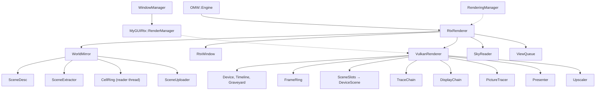

# The ray tracing renderer

How the ray tracer fits into OpenMW: its layers, who owns what, and how a frame is made. The headers hold the detail
and the reasons; a change that keeps the shape does not change this file. The tree's own words (walk, stand, hand
over, hold, slot, run, ring, epoch) are in [`components/rtx/GLOSSARY.md`](../components/rtx/GLOSSARY.md).

## What the fork is

Upstream OpenMW stays the host engine: cells, references, physics, scripts, animation, weather, GUI logic. The ray
tracer draws the whole picture: visibility, shadows, direct and indirect light, sky, water and fog. Both renderers
stand behind one interface in one binary, but the game starts the ray tracer alone; the OpenGL renderer stays built
so upstream's code merges as it stands, its code upstream's but for what `.notes/UPSTREAM.md` lists. The player's
settings are in [`settings.md`](settings.md).

The target is NVIDIA Turing and AMD RDNA 2 and later, through Vulkan's ray tracing. The denoiser is the renderer's own
under AMD's FSR 3.1.4, ported to compute shaders, or NVIDIA DLSS Ray Reconstruction where the card and the player's
installed library allow: one learned pass that denoises and upscales. Vanilla textures are pre-lit, so the content's
preparation estimates the painted light and divides it out; a PBR replacer's companion maps reach the trace, and a
vanilla scene draws the same whether or not the renderer can read them.

## Layers and libraries

Each layer knows the layer below it and never the one above.

```
apps/openmw                      the game
  │  MWRender::Renderer          the seam          (apps/openmw/mwrender/renderer.hpp)
  ├── GlRenderer                 upstream's rasterizer, gathered behind the seam
  └── RtxRenderer                the game-side owner (apps/openmw/mwrender/rtx/)
        │  Rtx::Renderer         the core's interface to a backend
        ├── components/rtx       the core: what the scene is; no graphics API, no game headers
        └── components/rtxvulkan the backend: everything true of Vulkan

Beside the stack:
  components/myguirtx            MyGUI's backend over Rtx::GuiRenderer
  components/crashcatcher        the crash catcher: a Crashpad monitor process
  apps/rtxtool                   the harness: drives a real game headless
```

A Vulkan fact in `components/rtx` or `apps/openmw` is a bug, and the link lines keep it out: the core has no Vulkan
header on its path, and the backend reaches Vulkan privately through volk, which loads the loader at the first
instance, so the game starts on a machine without one and says what is missing. Two places create a backend:
`RtxRenderer` and the harness. OpenSceneGraph stays the content loader: the scene arrives as an `osg::Node` graph.

## The build

`./omw [flavour] <verb>` is the one command line over the CMake presets (`build.md`). Shaders are GLSL, compiled and
validated in one build step. Every float operation the Vulkan specification leaves open is pinned and nothing is
fused (`spirv/spirvpin.hpp`), so every compile of a module computes the same frame. The structures both languages
read are headers that compile as C++ and GLSL (`components/rtx/shaders/*.h`, `components/rtxvulkan/shaders/shared/*.h`),
and each module's interface is held to the C++ beside it at load (`spirvinterface.hpp`).

- **The game's shaders are compiled into it** (`Rtx::shippedVulkanShaders`, made by `openmw-rtx-build embed`) as word
  arrays, as ANGLE compiles its internal Vulkan shaders in, so no shader file is installed or read at a start. The
  harness's census and with-source sets and the tests' stay folders in the build tree (`Rtx::ShaderFolder`). Refused:
  `#embed`, which MSVC lacks; an assembler's `.incbin` beside Windows resources, two routes; the with-source sets
  compiled in, 23 MB each to compile again at every shader edit.
- **What a start would compute from no content is made by the build** and compiled in: the blue noise tile, the
  fog's field and the specular albedo's table, each by its maker, held to the maker by a test.
- **One program for every step the build runs** (`openmw-rtx-build`, a verb a step: the shaders' guard and pinning,
  the embedding, the tables, `omw kernels`' digest), as `llvm-tblgen` is one generator with a backend a table. Every
  shader step depends on it, so any edit to it compiles every shader again, about 8 s on a desk. Refused: a program a
  step, six links and targets for one job; two programs, the SPIR-V's and the tables', which saved those seconds on
  rare edits.

## The seam: `MWRender::Renderer`

The one interface the game talks to. Read its header first.

- A pure virtual is a question both renderers answer; a default body is an empty answer one has no work for.
- Nothing below the seam is abstracted: contexts, swapchains and acceleration structures belong to one renderer. The
  game is never handed one renderer's mechanism, but for upstream callers that cannot change, which get null.
- `startRenderer` asks for the ray tracer alone; any failure, `Rtx::Unsupported` included, ends the start in the
  fatal error box with `describeStartFailure`'s words.
- The base keeps what both share: the resources, the frame clock, the screenshot writer, the camera, the traversal
  root, the view mask and the presentation.
- **The world is attached as an object**: `attachWorld` returns a `WorldAttachment`, whose end detaches once, held as
  `RenderingManager`'s last member so a throwing constructor detaches too.
- The attach carries the engine's `SceneUtil::UnrefQueue`, onto which the mirror hands what its sweeps let go of
  (`Rtx::Released`), so a crossing's last references drop off the frame thread.
- **One presentation** (`Misc::Presentation`): each renderer draws at `[Video] resolution x/y` (the window's size at
  Native) and shows it scaled into the window with black beside it; the GUI, the projection, the pointer and Lua read
  the frame from it.

The game describes each frame as a `SceneFrame` (`sceneframe.hpp`): the scene root, sky and weather, the eye, the
water, the ground, in the content's own numbers; `FrameDescriber` collects the fork's facts so `RenderingManager`
stays upstream's. Pictures away from the eye (the local map, the doll, the world map) are seam types too
(`OffscreenView`, `SubjectView`, `MapOverlay`).

## The game-side owner

`apps/openmw/mwrender/rtx/`. `RtxRenderer` drives each frame itself, with no viewer and no cull, through a phase state
machine every entry point asserts.

- `WorldMirror` mirrors the scene graph into the core's scene each frame (the walk), places the sea, runs the cell
  ring and hands the result to the backend; `SkyReader` turns the game's sky into the core's `WorldReading`;
  `RippleEmitters` says what disturbs the water; `ViewQueue`, `TracedView` and `TracedOverlay` make the pictures in
  the interface; `TracedGround` is a ground with no chunks; `classmasks.hpp` maps node masks to ray classes.
- **Two hosts, one renderer**: a played session and a harness run reach it through one record, `RtxSetup`
  (`rtxrun.hpp`), the host answering per frame what to sample, keep and report. `RtxSettings::derive` is the one
  derivation of the settings; the core reads none.
- **Settings apply at the next frame** (`PendingSettings`), so a rebuild that fails is reported there. Refused: a
  rebuild inside the settings window's call, whose failure ended the process.
- **World events take one phase rule** (`expectWorldEvent`): between frames or from the run's hook.
- **Jumps are told by stable identity, sorted** (`SceneUtil::StableIdentity`). Refused: the node's address, which a
  new node can reuse.
- **Ripple candidates are a bounded max-heap**, the farthest given up for a nearer one.
- **A played session's frame times are a histogram** of 0.1 to 250 ms (`Rtx::FrameTimeHistogram`), the worst kept
  exactly, logged at each cut and at the end.

## The interface

MyGUI draws the whole interface, as upstream; only its backend changes. `MyGUIPlatform::GuiRenderManager` is the seam,
implemented by upstream's OSG manager and by `MyGUIRtx::RenderManager`, which needs an extent, a table of textures and
one call that draws triangles: `Rtx::GuiRenderer`. A picture traced into a GUI texture is the renderer's
(`Rtx::PictureRenderer::traceGuiTexture`); pictures the game writes in memory (fog of war, world map, save thumbnails,
video) reach it through `shareTexture`, which sends what changed. A picture inside the interface is traced from a scene
of its own, with no history. The settings pages and the launcher take their menu orders from the core, and a mode
with no label on a page stops the build.

### A live scale and font size

`[GUI] scaling factor` and `[GUI] font size` apply while the game runs
(`research/2026-10-31-mygui-font-lifetimes.md`, `research/2026-10-31-mygui-list-line-height.md`).

- **Derived, not cached**: `Gui::FontFit` is computed in `WindowManager::layOut` and compared with the last. Refused:
  one raster for the largest scale, always paid; a restart.
- **One owner, one call**: `Gui::InterfaceFonts::fit` rasterizes the fonts and refits the texts, lists and pages, in
  order, so no caller can do one step.
- **A font is rebuilt in place** (`textureInvalidate`), its `IFont*` kept and its file's bytes held. Refused: loading
  the fonts again by name, which leaves every text holding a deleted font.
- **Every font user is known by construction**: texts and lists stand in MyGUI's factories and enter a
  `Gui::FontUsers` registry. Refused: a walk of the widget tree, which misses skin children and popups.
- **A book cannot outlive its fonts**: a page drops its book at a refit and asks its owner to typeset again.
- **The font size has one reader**, `WindowManager::getFontSize`, which `InterfaceFontSizeTest` holds file by file.
- **A list's line height is MyGUI master's `setItemHeight`, ported** into `Gui::ListBox`, a `static_assert` holding it
  to 3.4.3.
- **A window that keeps sized rows lays them out again** (`WindowBase::refitText`). Refused: rebuilding the whole
  interface, which loses every window's and Lua element's state.
- **Lua follows through an internal `_onFontSizeChanged`**, not a public handler that would bump the API revision.
- **The pointer is kept in frame pixels**, and every window is held inside the view after a layout.
- **The local map follows the raster**: a tile whose resolution moved is described again.
- **The sliders apply when they settle** (`Gui::SettlingScrollBar`), not under a drag.

## The core

`components/rtx/`. What is true of Morrowind's content, of light transport and of what the scene is, written once for
every backend. Its folders stand in an order: a folder includes only the folders before it, and a folder inside
another is part of it. `RtxSourceTreeTest` holds the order.

| folder              | holds                                                                   |
|---------------------|-------------------------------------------------------------------------|
| `shaders/`          | the structures core C++ and GLSL both read                               |
| `common/`           | what knows no scene: contracts, results, slots, runs, threads, the clock |
| `image/`            | a texture file read: its formats, texels, alpha, levels and painted light |
| `preprocess/`       | `ContentPreprocessor`, its keys, cache and costs; the passes in `shape/` and `texture/` |
| `scene/`            | `SceneDesc`, its rows and tables, and what makes textures of it          |
| `frame/`            | what a frame is asked for and sampled with: the camera, the reconstruction |
| `world/`            | the sky, the air and the water a frame is told                           |
| `renderer/`         | `Rtx::Renderer` and what it hands, reports and writes                    |
| `mirror/`           | the walk from the scene graph, how it reads a surface and a lamp; the cell ring in `cells/` |
| `prepare/`          | the loading screen's walk of every model the content names into the store |
| `environment/`      | the sky read out of the content files, and the sea's waves               |
| `view/`             | the pictures traced away from the eye                                    |

- **`Rtx::Renderer`** (`renderer/renderer.hpp`) is one traced image, whichever API makes it; each call is worth a
  whole scene or frame, never an instance or a pixel. Each consumer takes the part it calls: `Rtx::SceneHolder`,
  `Rtx::PictureRenderer`, `Rtx::GuiRenderer`.
- **A null backend** (`Rtx::NullRenderer`, `OPENMW_RTX_BACKEND=null`) keeps every promise and draws nothing, so CI runs
  upstream's integration tests through the ray tracer's whole game side, as Unreal's `-nullrhi` does. Chosen by the
  environment, never a setting. Refused: a third `MWRender::Renderer`, which tests none of it; lavapipe, which lacks
  an extension the backend requires.
- **`Rtx::SceneDesc`** (`scene/scenedesc.hpp`) is everything a backend needs of a world: meshes, materials, textures,
  placements, deformers and the per-frame lists. It appends and deduplicates; a slot is never renumbered, so a hit
  reads it as its index; `shaders/scene.h` states the device layout for both languages. Lights are ordered by
  position each walk, about 17 µs a frame at the heaviest places (`research/2026-10-22-light-ordering-share.md`).
- **A vertex's normal and colour are packed for the device once** (`MeshTable::writeVertices`), by the user's
  decisions: the normal on an octahedral map in fifteen bits a coordinate and a "present" bit, the colour as three
  half floats, none clamped. Positions and texture coordinates stay floats, which a bottom level is built from.
  44 MiB less at the ship, frames within the noise. Refused: `SNORM` normals with no "none", `UNORM` colours that
  clamp, sRGB bytes.
- **`Rtx::SceneExtractor`** mirrors an OSG subtree into a `SceneDesc`, its identity maps living across walks, so a
  still frame costs what moved; what a walk did not meet is swept after it.
- **The cell ring** (`mirror/cells/`) stands the world past the loaded cells, which rays reach: the ground, the
  statics as instances of their templates, the lamps. A reader thread prepares cells, and the frame adopts them a
  little at a time. A reference a local script enables or disables stands behind a gate the game evaluates
  (`MWScript::VisibilityGates`); a `NightDaySwitch` is read in every branch. The size rule thins what reflects light,
  never what gives it. Refused, by the user's decision: a cache of what no cell holds, which upstream's resource cache
  and the ring's hysteresis already cover.
- **`Rtx::ContentPreprocessor`** is the one way anything is computed from the content: a shape's fold, a texture's
  alpha and mean. One lives on each thread that reads content (`Rtx::ThreadContent`). Every pass states everything it
  reads, which is the key its output is filed under in the `ContentStore::Store` ("The content store"); the frame's
  thread reaches the store's memory alone, so no frame waits on the disk.
- **`Rtx::SceneUploader`** hands a scene to the backend once a frame, in the cheapest of three ways: place what moved,
  extend with what arrived, or rebuild.
- **The world a frame is told** (`world/`): a `WorldReading` becomes the frame's sun, moons, sky, clouds, fog and
  water; the sky's sheets and meshes are read out of the content once (`environment/`).
- **Materials**: `ShadingMap` estimates the light painted into a vanilla texture, which the host divides out of the
  chain it stores. Companion maps (`_n`, `_nh`, `_spec`) and tangents reach the material as data slots. The surface is
  glTF 2.0's metal-roughness (`shaders/brdf.h`); a vanilla surface is that model with no specular reflectance.
- **A mapped normal's light fades by GGX's shadowing**, as Cycles fades it (`bumpShadowing`, Conty Estevez et al.
  2019). Refused: Chiang et al. 2019, flat hard-edged patches at a grazing sun; no term, a terminator 5.2 times its dark
  side (`research/2026-11-07-bump-terminator.md`).
- **A `_spec` map's blue is an occlusion on indirect diffuse light alone**, as glTF and Filament read it, put back by
  the composite and held to one bounce by Jimenez et al. 2016's fit. Refused: the blue unread, since these low meshes
  hold no such detail; in the albedo, which darkens the sun (`research/2026-11-07-specular-map-blue-channel.md`). No
  specular occlusion, and none from a height.
- **An `_nh` map's relief is marched, as RTX Remix marches it** (`reliefToward`, Tatarchuk 2006), at OpenMW's
  parallax depth and middle height (`research/2026-11-08-height-map-range.md`), and is the shift wherever it crosses
  under one texel, so a far surface keeps its cost. Refused: a max-mip quadtree, a byte a texel more; true
  displacement, 20 to 60 ms a frame (`research/2026-11-08-parallax-occlusion-techniques.md`).
  - Bounded by each map's own heights (`alphaRange`), marched once by the trace and read back by every later stage
    (`STAGE_RELIEF`), at most 32 steps (`RELIEF_STEPS`), measured to the texel it shows so a history follows it
    (`research/2026-11-08-relief-cost-and-noise.md`).
  - A ground stack is marched once through its layers' summed heights (`ReliefMaps`); a bounce's landing shifts and
    does not march (`Hit::mMarches`); a relief shadows the sky's source and the held lamp (`reliefLit`).
  - Only the tuples with maps march (`HAS_RELIEF`), and no setting turns it off: 3 to 5% of a close wall's frame.
    `--relief` is the harness's A/B alone.
- **Reconstruction** (`frame/reconstruction.hpp`): `RenderProfile` is what a run decides once, and
  `Reconstruction::resolve` the one rule for who filters the light, the jitter, the noise source and the texture
  level bias.
- **Who filters the light follows what the upscaler takes**, a capability and never a vendor (`UpscalerInput`): the
  renderer's filter with no upscaler and under FSR, the upscaler under DLSS Ray Reconstruction. A frame asked
  unfiltered under an upscaler that filters is refused before its first frame (`SessionRequest::refusalUnder`).
- **What a filtering upscaler is handed is what measured cleaner under it**, from NVIDIA's guide's rules, each measured
  (`research/2026-11-11-ray-reconstruction-against-super-resolution.md`): an unbounded jitter, the soft edge cut and not
  dithered, the blue-noise tile kept, the water's interleave kept. A run may name each.

Content the renderer cannot use is never an assert and never the end of a frame: readers answer with a `Result`,
every refusal is reported once to `Rtx::Refusals`, a refused texture draws as a stand-in, and anything else refused is
left out.

### The content store

What the preprocessor makes of the content is kept across sessions in `ContentStore::Store`, filled on the loading
screen (`research/2026-11-08-normal-map-chains.md`).

- **The store is the game's input**: every form the renderer reads of a file and every derivation of one is made on
  the loading screen and read in play; the game computes only a miss, through the same pass, and counts it. Refused:
  refusing content the preparation did not see, which a script's spawn breaks; a cheaper second path for a miss.
- **The device's derivations stay at arrival** (the normal spread, the sprite light bake, the ground composite: 0.02 to
  0.10 ms in a median frame), and no acceleration structure is stored, as a driver update invalidates it.
- **The key is the content** (`ContentStore::Key`): the pass's name and version and every byte it reads, one 128-bit
  MurmurHash3 at about 9.5 GB/s. Refused: path, size and time, which a file inside a BSA makes quietly wrong.
- **One file an entry, every entry untrusted**: 256 folders by the key's first byte, as ccache and Bazel's disk cache
  keep theirs; a trailer states the format, pass, version, key and the payload's length and digest, and a file that
  does not match is a miss and deleted; written to a temporary name and renamed. Refused: SQLite, by the user's
  decision; a pack file a pass; a sync before each rename, where the digest finds what a power loss left.
- **One store, in a component of its own** (`components/contentstore`), which any owner may hold one of, with its kinds
  and its residency stated by the owner (`ContentStore::Policy`).
- **The navigator's tiles in a content store** (`DetourNavigator::NavMeshTileStore`), by the user's decision, in
  `<cache>/navmesh`, which every profile shares: a tile is keyed by everything Recast builds it from by value — the
  mesh's sorted triangles, the water, the heights, the settings, the agent and the tile — so whatever moves a triangle
  keys a new tile, an animated part's pose included. `sTileVersion` stands for the code between the bytes and the
  tile, which `DetourNavigatorTileVersionTest` holds, and Recast is pinned. Refused: SQLite; a key of model paths and
  transforms, which read one pose back for every pose (`research/2026-11-10-navmesh-cache.md`).
- **The frame reaches the store's memory alone** (`ContentStore::Reach`): small entries held once read and loaded at
  the start's sweep, shapes held up to 512 MiB; the start loads no shape, the preparation reading each as it finds its
  model. Resident entries are shared and copied outside the lock. Refused: a file read on the frame's thread.
- **No size cap**, by the user's decision: an entry stays until refused or deleted by hand, as an evicted chain is one
  play computes.
- **Every normal and data map's chain is rebuilt, and a colour file keeps its own**, by the user's decision: hundreds of
  data maps turn metal and normal maps go black below level 0, where colour chains are rarely faulty.
- **The filter is a box of the level above, a normal averaged as a vector** (`ChainBuild`), in linear light for a
  colour, weighed by alpha only where alpha is coverage, as Unreal's `SimpleAverage`; the spread measured from the
  finest level (Toksvig).
- **A normal map is whole in BC7, in one encoding**, by the user's decision: the unit normal in three channels and its
  height in alpha, one mode a block (5 with a height, 6 without) as DirectXTex narrows its search, least squares on
  (`research/2026-11-09-content-preparation-cost.md`). Refused: BC3, a normal at 5:6:5.
- **A coarser level is encoded on the host in the file's format** (BC1 to BC5), through rgbcx at level 10, approved by
  the user ([bc7enc_rdo](https://github.com/richgel999/bc7enc_rdo_devel/)); **a loose chain is whole in BC7**, by the
  user's decision. Refused: an encoder of our own; encoding on the device.
- **A painted colour is stored delit, keyed by use** (`TextureEncoding::Painted`), by the user's decisions: a diffuse
  with no metal-roughness map and an unauthored ground layer are divided by `ShadingMap`'s estimate at every level and
  encoded again in the file's format; a file used both ways is two slots. Refused: every colour delit, which flattens
  the replacers' base colours.
- **One specular layout, a classic map converted**, by the user's decisions: a `_spec` map whose channels spread less
  than 0.1 is classic (`SpecularKind`), and it and its diffuse are converted per texel as Khronos converts
  specular-glossiness (`ConversionPass`). Refused: the layout as a setting; every map read as metal-roughness.
- **A chain is built on a worker**, never on the frame or the reader: a slot draws its file until its chain lands.
- **The store is filled on the loading screen, in the game's own process** (`Rtx::ContentPreparation`, inside
  `Renderer::prepareContent`), by the user's decision: every model and land texture the content list names and the
  siblings the game loads by its own rule, walked as the cell reader walks them, on every CPU but one. Refused: a child
  tool behind a pipe protocol; a launcher tab, a second route.
- **The preparation's memory is dispatched** (`Rtx::PreparationDispatcher`), by the user's decisions: the largest
  queued chain that fits a budget of the available memory less 1 GiB goes to the thread whose scratch it grows least,
  as Ray schedules by stated memory. A chain's peak is predicted from its header (`ChainPass::scratchOf`), as Unreal's
  `GetRequiredMemory` states a build's; a head that does not fit is reserved and smaller ones backfill (EASY, Lifka
  1995); the loader lets go of each file as its last job ends (`Resource::SceneManager::letGo`). Refused: a semaphore,
  which blocks on its head; the resident size, which lags.
- **The preparation is incremental by each file's stamp; the lookup is by content**: a manifest names each model's
  files and a digest of their sizes and times, as ccache's direct mode trusts a stat, and every lookup is keyed by the
  bytes, so a lying stamp costs a miss, never a wrong answer. A model stands only where the store holds every entry
  its walk made, by the user's decision, as the Remote Execution API's action cache does; models no run named for 30
  days drop out.
- **A pass's version is held by a test** (`RtxPassVersionsTest`), which digests its outputs over fixed inputs, so a
  forgotten bump fails. Refused: the build's revision in every key, which empties the store at every build.
- **The store's format is its folder** (`rtx-content/v2/`), a manifest that does not parse is refused whole, and a
  store that cannot be written is one that misses, logged once.
- **The scene graph stays the renderer's one input**: the store holds what the mirror derives, not models.

## The backend

`components/rtxvulkan/`. `VulkanRenderer` is `Rtx::Renderer` over Vulkan; its members are declared in construction
order. The folders keep the core's rule, in this order, with `VulkanRenderer` and the owners beside it over all of
them.

| folder      | holds                                                                                                 |
|-------------|-------------------------------------------------------------------------------------------------------|
| `shaders/`  | the GLSL, by the folder of the pass that dispatches it; `lib/` shared, `shared/` the backend's headers |
| `spirv/`    | the pinning and the kernel digest, a library the build runs                                           |
| `device/`   | the instance, the device, the timeline, the graveyard; `memory/` for buffers and images               |
| `pipeline/` | compute, graphics and ray tracing pipelines, and how a dispatch is sized                              |
| `texture/`  | the bindless array and the passes a texture is made with as it arrives                                |
| `scene/`    | `DeviceScene`: its tables, structures, skinning and sprites                                           |
| `trace/`    | `TraceChain` and its passes, the sea and the fog; the denoiser in `denoise/`                          |
| `upscale/`  | `Upscaler`: FSR 3.1.4, ported, or NVIDIA DLSS Ray Reconstruction through NGX                          |
| `display/`  | `DisplayChain` and its passes                                                                         |
| `present/`  | the swapchain and the present                                                                         |
| `gui/`      | the interface's pass and textures                                                                     |

### Device and memory

- **The device** holds the queue, the command pool, the `Timeline` and the `Graveyard`. The timeline is the one clock,
  never read by the host on the frame path; the graveyard keeps what a submit may still read until the timeline passes
  it. A missing required feature refuses the device; an optional extension is taken whole or not at all.
- **A call without a device to lose is spelled so**, `checkVkWithoutDevice`, confined by `RtxSourceTreeTest` to
  making the instance and the device. Refused: one overload with an optional device, which a caller could leave out.
- **Buffer markers in every build, NVIDIA's checkpoints on request** (`OPENMW_RTX_BREADCRUMBS`, or a validating
  build); uncached markers through `VK_AMD_device_coherent_memory` where offered. Refused: a checkpoint per pass.
- **`Retiring` is a growable ring**, grown only past the busiest frame.
- **The loader's entry points, not the device's**: `volkLoadDevice` rebinds the process to one device, which the GPU
  tests' second devices would call through.
- **The command pool** (`device/commands.hpp`): commands recorded again and again are lent (`LentCommands`), a scope's
  span to its submit is a `Recording`, setup work with its staging a `Batch`. Refused: a pool a frame slot, which would
  stop a deferred batch from riding any submit.
- **The pipeline cache** is a file named for the driver and the shaders, checked by a header of its own before the
  driver sees it, written whole or not at all.
- **Memory**: what a frame cannot go without is essential and never refused; content (structures, textures) is taken
  against the driver's budget, and a refusal leaves the mesh out or draws the stand-in. Refused: an arrival scheduler,
  a destroyer thread, blocks made ahead, since a crossing's worst frames are the engine's update
  (`research/2026-10-22-crossing-worst-frames.md`); a defragmentation, as the pool holds at its high-water mark
  (`research/2026-10-22-content-pool-after-a-long-walk.md`).
- **Host writes are staged on every card** (`device/memory/uploads.hpp`): written into staging and copied by a batch
  deferred ahead of the submit that reads, as VMA's advanced uploading and D3D12's upload heaps split it. Refused:
  writes mapped into video memory, 0.1 ms faster with resizable BAR and bounded by a window NVIDIA's Windows driver
  budgets at nought (`research/2026-11-10-host-writes-on-three-machines.md`,
  `research/2026-11-09-host-written-window-on-windows.md`); a shared device copy (Unreal's GPUScene); a transfer
  queue; a compute scatter, where a copy region a run of rows does.
- **What is written once is video memory**: the block address tables, the constant floats, a shader binding table,
  uploaded through a batch deferred ahead of its first launch.
- **A texture's image and sampler stand apart, paired at each read by the wrap its texel word carries**
  (`TEXTURE_WRAP_SHIFT`): AMD's Windows driver hung on a combined array, and an anisotropy change writes eight samplers
  (`research/2026-11-09-separate-samplers.md`). A texture stands at 16384 a side at most.
- **The frame's targets are made at `createTargets` and counted from what makes them** (`bytesAt`); the pictures'
  chain at the room its views asked (`PictureRenderer::reservePicture`). The reserve is the running mode's; a run
  whose stops move between modes reserves the largest from the start (`RunProfile::mReservedUpscales`).
- **Images used inside one stretch of the frame share memory** (`ImageArena`), each over its span of the fixed order
  (`FrameStep`), resting on one queue and the barrier every command buffer opens with. Refused: a frame graph, whose
  other gains are scheduling across queues and reordering, neither of which a fixed order uses.
- **`DeviceScene`** is everything one scene is traced against, the world's or a picture's. A table the host rewrites
  and the poses have a copy a frame slot; what only arrives is one copy written behind every frame in flight.
  - A texture's side is chosen from the room left when it arrives, the file standing the most bytes coming down a level
    first, as Unreal's streamer does (`TextureArray::chooseLevels`). Refused: one side for a whole arrival, which left
    1344 MiB unused.
  - A bottom level is built loose in storage of its own and copied out tight, so that storage empties whole, as RTXMU
    does (`BottomLevelStore`); the world's build compacts before its textures are made (`BuildCompaction`), as NVIDIA's
    `buildBlas` does.
  - Refused, by the user's decision: textures shared across scenes; a residency manager; 16-bit indices; white vertex
    colours elided; one bottom level per template (`research/2026-10-22-instances-per-placed-model.md`); a static
    mesh's bottom level shared across scenes.
- **`FrameRing`** keeps two frames in flight.
- **The swapchain is made again once the drawable settles** (`RtxWindow::fit`), so a drag makes it once.
- **Present fences in either spelling** (`VK_KHR_surface_maintenance1` or the `EXT` one, never both chained), as DXVK
  takes them. A lost surface answers nothing, and the presenter makes it again.
- **The glossy lobe's images exist on every install**, by the user's decision: 37 MB at a 720p trace, since a scan
  cannot see a map a model names in its own file.

### Chains and upscalers

- **`TraceChain`** is everything one camera's trace writes at one extent; the world has one, `PictureTracer` one for
  the interface's pictures. The denoiser's images exist only where its filter runs (`RendererFilter`), and a channel
  only where its reader is (`ChannelKeeping`), a texel wide elsewhere.
- **`DisplayChain`**: bloom, exposure, glare, tone, debug lines. The glare fader and Night-Eye's lift come after the
  curve, as the rasterizer adds them, with `[Video] gamma`; the GUI draws after it, and the frame is blitted scaled to
  fit (`Misc::present`).
- **`Upscaler`** is FSR 3.1.4's passes from AMD's headers (`extern/fidelityfx/`), its masks the trace's own, or DLSS
  Ray Reconstruction through the driver's NGX and the player's library: `auto` takes it where every fact holds
  (`DlssAvailability`) and falls back to FSR where NGX refuses; an explicit `dlss` refused fails the start.
- **DLSS means Ray Reconstruction**; Super Resolution is gone, as the DLSS-RR guide says where RR runs SR does not.
- **RR's guides come from one pass** (`rrguides.comp`): depth, motion, both albedos, the normal with roughness, in the
  frame's order, as RTX Remix hands them; every key the SDK's helpers set is set (`ngx.cpp`).
- **RR traces at the extents NGX gives the mode** (`Upscaler::extentsFor`), as NVIDIA's guides ask; FSR's arithmetic
  holds only for a library that takes any extent.
- **The upscalers' constants are written inline in queue order** (`Buffer::updateInline`).
- **What a move makes again is one answer, `FrameTracer::movesTo`**, handed to the renderer, the chain and FSR.
- **What NGX allocates is frame memory the reserve counts** (`Upscaler::prepare`, `MemoryAllocator::holdOutside`),
  measured off NGX's stats once per mode the run keeps room for. Refused: NVIDIA's table as a constant.
- **A hazard among NGX's own commands on its own resources is NGX's** (`ValidationLog::disown`): a warning; one naming
  a resource of the renderer's still aborts.
- **Refused for RR** (`research/2026-11-11-ray-reconstruction-against-super-resolution.md`): water left unblended or
  split at random, a specular hit distance, the colour before the layers, and the demodulated channels dropped.

### The bounce

- **No reuse of the bounce**: ReSTIR GI's temporal and spatial reuse gained nothing once the denoiser kept a rare
  bright sample's light, and added bias (removed in `c86bcea363`).
- **Every eye hit traces its bounce**: a rate of a half saved 4–6% and raised noise and bias everywhere
  (`research/2026-10-03-bounce-rate.md`).
- **Several bounce rays a pixel, averaged** (`[RTX] bounce rays`, 1 to 4), as NVIDIA's NRD sample averages its
  paths: raw noise falls with the count while the denoised frame barely moves (`research/2026-11-01-bounce-rays.md`).
- **One bounce, no deeper path**, by the user's choice: a delighted wall's albedo near a tenth makes a second bounce a
  tenth of the first, for up to 4 ms (`research/2026-11-05-room-ambient.md`).
- **A box for path tracing and the rays' slider under it** (`[RTX] indirect lighting`): off, `unbounced.comp` stands
  the ambient under one occlusion ray, a kernel apart from the bounce's, whose registers every lane would pay for;
  the denoiser runs one wavelet level and keeps no fill apart (`ACCUMULATE_HOLDS_FILL`).
- **A room's record is not its light where a bounce is traced**: a landing takes 0.18 of the ambient and 0.14 of the
  sunlight, an unbounced surface 0.035, the water half the record (`Skylight::mWaterAmbient`), by the user's choice
  (`research/2026-11-05-room-ambient.md`). A room's landing takes the fill with no occlusion ray; an exterior's keeps it
  (`landingLightOf`).
- **`bounce` and `landing` dispatch a ray in turn** (`StageConstants::mRay`), the landing's hit stored apart for every
  ray but the last (`STAGE_LANDING_HIT`), so one ray holds the memory one bounce did; each ray is worth one over the
  count, added into the bounce's own channels.
- **A frame's rays take the next steps of the golden-ratio turn** (`unitPairOfRay`), a stratified sample over time
  (Wolfe et al. 2022). Refused: a hash a ray.

### The denoiser

`trace/denoise/` runs where the renderer filters the frame (`LightFilter::Renderer`), each history held to the frame
before's surfaces (`GBuffer::getHeld`).

- The bounce's diffuse light: an accumulator held to a fast mean (ReLAX's clamp), a spatial variance for a young mean,
  a disoccluded surface taking the occluder's history (Zeng et al.'s dual motion vector), NRD's history fix, then
  SVGF's and ReLAX's wavelet. The composite puts the bounce back by the diffuse albedo and the fill by the ambient
  one, as the rasterizer's `D × lit + A × ambient`.
- The shadows: FidelityFX's Shadow Denoiser over the sky's source and the lamps apart, its reach the penumbra's (SIGMA).
- The glossy light and the layers: temporal filters holding a slow mean (`historyclamp.comp`).
- **A rare bright bounce is held to forty times the frame's white and the rest dropped**
  (`ACCUMULATE_FIREFLY_CEILING`), the white the exposure the frame before was shown at, as Lumen's
  `MaxRayIntensity` and Omniverse's per-sample firefly filter hold it. A glow no lamp stands for, a mod's or a
  replacer's, lights only through the bounce rays that find it, and is never made a lamp. Refused, each still blotched
  on every frame at the Mages Guild (`docs/research/2026-11-13-a-bright-emitter-in-the-mages-guild.md`): ReBLUR's ring
  on every history, which doubled the bias; its excess spread back energy-conserving (Zirr et al. 2018). The price is
  the light of a glow found rarely, dropped for good.
- **A history store selects each non-finite component to nought** (`finiteOrNought`), after the census counts it.
- **The denoised frame is not bit-exact on every card**: on a high-end NVIDIA laptop GPU under a busy queue, the first
  wavelet dispatch after a pipeline drain sometimes differs by a half-float step at a few texels. Everything before
  the wavelet stays exact; `FrameHashes` and `shot` allow for it (`sDenoiserNoiseLevels`; evidence in `8deca8c8f7`).

### The shaders

The trace is compute stages in one fixed order: `visibility` peels the eye's rays to a pixel's surface, `water` walks
the sea, `direct`, `media` and `panes` add the direct light, the shafts and the layers, `bounce` and `landing` the
bounce (or `unbounced` in their place), then the composite. Every ray is a ray query.

- **Every stage is a compute dispatch on every device**: AMD's Windows driver drew a ray generation stage wrong from
  its second frame and answers no ray query beside `traceRayEXT`
  (`research/2026-10-19-amd-windows-driver-faults.md`). The fog's and the sprites' traces stay launches.
- **Few places a module starts a ray query** (`queryScene`): AMD's Windows compiler writes a whole traversal at each,
  and fifty did not compile in 52 GB (`research/2026-10-19-amd-windows-trace-compile-memory.md`); a test holds each
  module's count.
- **A committed triangle's corners are read off the scene's vertices** (`committedHit`), since AMD's Windows driver
  fetches them wrong.
- **No kernel spills past its ceiling** (`RtxVisibilityKernelsTest`): each driver's ceilings only fall, a register
  ceiling rising only inside the waves it allowed (`research/2026-10-22-amd-integrated-spill-ceilings.md`). Measured
  on the shipped modules, as a measured run of the harness reads them: the census's counting, which the test devices
  carry, cost every AMD kernel up to five registers more and is no part of what the game runs.
- **A stage a kernel, the channels between them**, as Quake II RTX traces its stages as passes: one kernel carrying
  every walk's record spilled 67 KB a lane (`research/2026-10-21-amd-integrated-stage-times.md`). Refused: a wavefront
  with queues, records in a buffer, every point's light stored.
- **A stage's phases are loops of their own**, so only one walk's records stay live across a traversal; a stage whose
  rays wait on no other's answer works out its light first, as NVIDIA's best practices ask
  (`research/2026-10-30-amd-handheld-stage-times.md`).
- **A layer under the water takes its column's shafts from `media`**: its column in the closed form, the beam scaled
  by the ratio `media` marched over the eye's whole column (`STAGE_SHAFTS`), the medium integrated once along the ray
  and read at each depth, as Frostbite's volumetrics light transparents (Hillaire 2015); exact where the shafts' share
  is even along the ray. Refused: a march a layer, which held `panes` at AMD's 256 registers and spilled up to 272
  bytes (`research/2026-11-12-panes-column-ratio.md`); the closed form alone, which dims the shafts in front of a layer.
- **The landing and the sea's walk are stages of their own over the pixels and tiles that need them**
  (`research/2026-10-21-nvidia-stage-costs.md`, `research/2026-11-02-water-stage.md`); a walk resolves the surface it
  ends on once, after it (`research/2026-11-09-walks-resolve-once.md`).
- **The surface a pixel is the hit the trace stored**, 48 bytes resolved again by later stages (`storedSolidOf`), as
  Falcor's visibility buffer. Refused: tracing the eye's ray again; the resolved surface stored, about 80 bytes.
- **Every water pixel splits on two checkerboard fields**, one the mirror and one the bed, as Quake II RTX's
  `reflect_refract.rgen`; the frame is stored as two half-images where the denoiser reads (`shaders/shared/fields.h`),
  and a pixel whose surface is one in both reads across them (`HistoryFields`).
- **Work only where there is some**: `media` and `panes` dispatch indirectly over the tiles `visibility` lists
  (`StageTiles`), FidelityFX's classify and compact.
- **Exact numbers over smaller ones**: no f16 arithmetic, no snorm16 normals.
- **No reuse of direct light**: only the held lamp's visibility is noisy, which the shadow denoiser filters.
- **8x4 invocations at 32 lanes** (`SubgroupSize::ThirtyTwo`), AMD's advice for ray queries on RDNA.
- **First frames run the full kernels; the frame's own tuple compiles behind them and takes over**, as Godot's
  ubershaders and Dolphin's hybrid mode do (`TupleQueue`). Refused: every tuple ahead of the first frame, a minute and
  about 5 GB at a first start.

Specialization constants, not branches, remove what a frame cannot use (`lib/variants.glsl`). Every store of an image
or float goes through the census (`lib/census.glsl`): the harness's modules count each NaN or infinity a module stores,
which `check` asserts away and `view` stops at; the game's modules carry none. Each counts where it first stored one,
and the device keeps the first such frame's images around the first texel not finite, deciding as the frame runs
(`NotFiniteKeep`): the report comes back frames late, after later frames wrote over them. Refused: a copy of every
frame's images, a cost on every frame of every census run.

## Ownership



Solid arrows own, dashed arrows borrow. `RtxRenderer` outlives the world, attached while `RenderingManager`'s
`WorldAttachment` stands. The interface's pictures are owned by the game's map and preview, and leave the queue with
them.

## A frame

On the host, in order:

1. The engine runs input, simulation and the update traversal as upstream, and describes the frame.
2. **Walk**: `WorldMirror` mirrors the graph into the `SceneDesc`, the cell ring adopts what its thread read, and the
   sweep drops what the walk did not meet.
3. **Hand over**: `SceneUploader` places, extends or rebuilds the backend's scene.
4. **Views**: queued pictures inside the interface are traced.
5. **Trace**: the host asks for the frame (`Rtx::FrameRequest`); the backend lays the world over the viewpoint
   (`describeWorld`) and records the frame.
6. **GUI and present**: the host returns without waiting for the device.

On the device: the sea and the ripples, the sprites, the fog, the trace, the denoiser where it runs, the composite,
the upscaler, the display chain, the GUI, the present.

Four clocks drive a frame, each with one source: host time (the wall in play, a stated step in a measured run),
simulation time, game time and the sky's clock. The wall is read only to measure. A cut — a teleport, a worldspace
change, a time skip — resets every history.

## Threads

- **The main thread** makes every seam call, walk, submit and wait.
- **The cell reader** (`CellSupply`) reads cells and lends their models and images to the frame.
- **The kernel compile** (`VisibilityPass`) builds the full tuple before the first frame, behind a "Compiling
  Shaders" step, then the other tuples on half the hands while the game runs; a harness run waits for every tuple
  (`Rtx::KernelSet`), so no frame changes kernel.
- **One-shot batches** (`Rtx::runInParallel`) join their hands before they return.

Every thread is a `std::jthread` started named (`Platform::startThread`); a pool asks each thread to stop before it
joins any, and `OwnedBy` asserts which thread owns a member. A worker that throws ends the process where it threw; a
job carries an expected failure to the thread that waits for it, as `std::async` does.

## Contracts

The code asserts the order of its steps (`Rtx::Stepped`, the phase machine), which thread owns what, at most two
frames in flight, that nothing joins a per-frame list after the hand-over, that every hold and slot is counted, and
that descriptor bindings follow their shared header.

Data the world supplies is never an assert. Configuration the renderer cannot run with throws `Rtx::InputError`; a
machine that cannot run the backend throws `Rtx::Unsupported`, naming what is missing; a device that refuses throws
`Rtx::DeviceError`. A lost device or a wait that never ends crashes where it was found, so the report shows it.

- **A hang's dump is taken by the monitor from outside the game** (`dumpHang`), as Crashpad's `generate_dump` and
  Firefox's `HangMonitorParent` take one: ptrace on Linux under the lock every crash dump takes, the game suspended on
  Windows. Refused: the game dumping itself through a simulated crash; a signal or thread the monitor starts in the
  game, which waited on a loader lock the stall could hold.
- **Linux runs the monitor's own loop around Crashpad's server and handler**, as `handler_main.cc` builds it, one
  lock around the stock handler. Windows keeps `HandlerMain`, whose suspensions nest.
- **The game names the monitor as its tracer** (`PR_SET_PTRACER`), as Crashpad's `ScopedPrSetPtracer` does; Yama
  scope 2 without root, and 3, refuse the catcher at install.
- **The note table holds 64 slots**, the most under Crashpad's 20 KiB annotation value, and counts each thread that
  met it full.
- **The crash notes are a leaf library**, `openmw-crash-notes`: every error the renderer throws carries the thread's
  note (`Rtx::withNote`), since by the fatal box it has unwound.
- **The monitor's lines before the game names its log wait for it**, or go to `<application>-monitor.log` beside the
  reports, which the package holds.
- **A replaced crash handler is logged, not taken back**: Crashpad offers no reinstall, and a driver's handler is the
  driver's to chain.
- **Every wait between the game and its monitor ends when the other side is gone** (`Client::monitorRuns`,
  `GameProcess::isGone`), as Crashpad's `SignalCrashDump` does; `sLastResort` bounds a side that runs and never
  answers. Refused: a timeout a slow side passes.
- **A file is read whole and written whole** (`Platform::readWhole`, `writeWhole`), as Rust's `std::fs` and Go's
  `os.ReadFile`: a temporary in the target's folder renamed over it, as LLVM's `writeToOutput` and Chromium's
  `ImportantFileWriter`. `Durability::Synced` syncs the file and its folder for what a person keeps; a cache's entries
  keep their own digest. A failure is an `IoError` of cases.

## Harness and tests

`openmw-rtxtool` drives a real game headless (`info`, `scene`, `shot`, `view`, `bench`, `check`, `film`, `noise`).
`RtxTool::Session` is both the engine's host and the renderer's run: it places the world at a stop, moves the camera a
frame at a time, holds the clock and the weather, and measures each frame. What a verb does with a place is a row of
`VerbPolicy` (`verbs.hpp`). The instruments (`instruments/`) know nothing of a world; the model (`model/`) is what a
run visits and records, and includes the instruments, never the reverse.

| binary             | holds                                                    |
|--------------------|----------------------------------------------------------|
| `components-tests` | the core, the harness's parsing, the crash notes; any machine |
| `openmw-tests`     | the game side: the renderer, the mirror, the terrain     |
| `rtx-gpu-tests`    | what opens a device; fails without one                   |
| `crash-tests`      | every way a game ends, and the report the catcher left   |

- **The harness chooses its settings source once** (`overLine`): the registry for a window, `measuredSettings` for a
  measured run.
- **Every waiting loop of a test has a bound** (`Testing::WaitBound`), past which it fails naming what it waited for.
- **The GPU suite keeps its own pipeline cache** in its build folder (`OPENMW_RTX_TEST_PIPELINE_CACHE_DIR`).
- **Qt's painting pool is off under ThreadSanitizer** (`QT_NO_GUI_THREADPOOL`), since Qt is built without the
  sanitizer. Refused: a suppressions file, which hides a race rather than the pool.

Rendering changes are checked without a window; `AGENTS.md` lists the commands.

## Where to look

| to know                                   | open                                                                                    |
|-------------------------------------------|-----------------------------------------------------------------------------------------|
| what the game asks of a renderer          | `apps/openmw/mwrender/renderer.hpp`, `sceneframe.hpp`                                    |
| how the ray tracer answers it             | `apps/openmw/mwrender/rtx/rtxrenderer.hpp`                                               |
| the walk, the sweep, the hand-over        | `mwrender/rtx/worldmirror.hpp`, `components/rtx/mirror/sceneextractor.hpp`, `components/rtx/renderer/sceneuploader.hpp` |
| what the scene is                         | `components/rtx/scene/scenedesc.hpp`                                                     |
| the cells past the active grid            | `components/rtx/mirror/cells/cellring.hpp`                                               |
| what is computed from content, and cached | `components/rtx/preprocess/contentpreprocessor.hpp`, `contentpass.hpp`                   |
| the sky, the air and the sea              | `components/rtx/world/frameworld.hpp`, `mwrender/rtx/skyreader.hpp`                      |
| the surface model                         | `components/rtx/shaders/brdf.h`                                                          |
| what a frame is on the device             | `components/rtx/shaders/visibility.h`, `scene.h`                                         |
| the backend's frame                       | `components/rtxvulkan/vulkanrenderer.hpp`, `trace/tracechain.hpp`, `display/displaychain.hpp` |
| a scene on the device                     | `components/rtxvulkan/scene/devicescene.hpp`                                             |
| the light transport                       | `components/rtxvulkan/shaders/trace/` (`visibility.comp` and its stages), `lib/`         |
| the denoiser and the upscaler             | `components/rtx/frame/reconstruction.hpp`, `components/rtxvulkan/trace/tracechain.hpp`, `components/rtxvulkan/upscale/upscaler.hpp` |
| the GUI                                   | `components/myguirtx/rendermanager.hpp`, `components/rtx/renderer/guirenderer.hpp`       |
| the two hosts                             | `mwrender/rtx/rtxrun.hpp`, `apps/rtxtool/session.hpp`                                    |
| the pinned arithmetic                     | `components/rtxvulkan/spirv/spirvpin.hpp`                                                |
| the build                                 | `CMakeLists.txt`, `CMakePresets.json`, `tools/omw`                                       |
