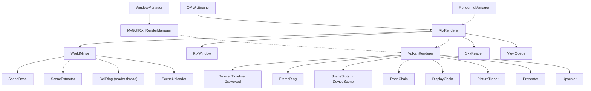

# The ray tracing renderer

How the ray tracer fits into OpenMW: its layers, who owns what, and how a frame is made. This
document describes the shape of the design. The headers hold the detail and the reasons, and a
change that keeps the shape does not change this file.

The tree's own words (walk, stand, hand over, hold, slot, run, ring, epoch) are listed beside the
field's words in [`components/rtx/GLOSSARY.md`](../../components/rtx/GLOSSARY.md).

## What the fork is

Upstream OpenMW stays the host engine: cells, references, physics, scripts, animation, weather,
GUI logic. A second renderer stands beside the OpenGL rasterizer and replaces the whole picture:
primary visibility, shadows, direct and indirect light, sky, water and fog are ray traced. The
rasterizer's picture is upstream's but for the corrections `AGENTS.md` lists under "Accepted diff".
Both renderers stand behind one interface, one binary ships both, and the one not chosen never
starts. `[RTX] enabled` chooses; the player's settings are in
[`rtx.rst`](../source/reference/modding/settings/rtx.rst).

The target is NVIDIA RTX, Turing and later, and AMD RDNA 2 and later, through Vulkan's ray tracing.
The denoiser is the renderer's own, and the upscaler is AMD's FSR 3.1.4 ported to compute shaders:
at `native` it is the anti-aliasing, and every other mode traces fewer pixels than the window
shows. Vanilla textures are pre-lit, so the renderer estimates the painted light and divides it
out; a PBR replacer's companion maps reach the trace, and a vanilla scene draws the same whether or
not the renderer can read them.

## Layers and libraries

Each layer knows the layer below it and never the one above.

```
apps/openmw                      the game
  │  MWRender::Renderer          the seam          (apps/openmw/mwrender/renderer.hpp)
  ├── GlRenderer                 upstream's rasterizer, gathered behind the seam
  └── RtxRenderer                the game-side owner (apps/openmw/mwrender/rtx/)
        │  Rtx::Renderer         the core's interface to a backend
        ├── components/rtx       the core: what the scene is; no graphics API, no game headers
        └── components/rtxvulkan the backend: everything true of Vulkan

Beside the stack:
  components/myguirtx            MyGUI's backend over Rtx::GuiRenderer
  components/crashcatcher        the fork's crash catcher: a Crashpad monitor process
  apps/rtxtool                   the harness: drives a real game headless
```

A Vulkan fact that reaches `components/rtx` or `apps/openmw` is a bug, and the link lines keep
it out: the core has no Vulkan header on its include path, and the backend reaches Vulkan
privately, through volk, which loads the loader when the first instance is made. No program links
the loader, so the game starts on a machine without one and draws with OpenGL there. Two places
create a backend: `RtxRenderer` and the harness. OpenSceneGraph stays the
content loader whatever draws: the scene arrives as an `osg::Node` graph, and the core reads it.

## The build

Every build has the renderer. The core is part of `components`; the Vulkan backend is a library
of its own, because it links Vulkan; the harness stands beside the game in `apps/rtxtool`.
`./omw [flavour] <verb>` is the one command line over the CMake presets, on the desk and in CI.

Shaders are GLSL, compiled and validated in one build step, so an invalid module fails the build.
Every float operation the Vulkan specification leaves open is pinned and no fusion is allowed
(`components/rtxvulkan/spirv/spirvpin.hpp`), so every compile of a module, the driver's recompiles
included, computes the same frame. The structures both languages read are headers that compile as
C++ and as GLSL: `components/rtx/shaders/*.h` for what the core reads, and
`components/rtxvulkan/shaders/shared/*.h` for what only the backend reads. Each module's interface
is read once and held to what the C++ beside it states (`spirvinterface.hpp`); a disagreement ends
the process and names the module.

## The seam: `MWRender::Renderer`

The one interface the game talks to. Read its header first.

- A pure virtual is a question both renderers answer. A default body is an empty answer that one
  renderer has no work for.
- Nothing below the seam is abstracted: contexts, swapchains, render bins and acceleration
  structures belong to one renderer outright.
- The game is never handed one renderer's mechanism. The exceptions are the upstream callers
  that cannot change, and they get null under the ray tracer.
- `createRenderer` takes a `RendererKind`, and every build has both: the one not chosen never
  starts. The one fallback is `startRenderer`'s: a ray tracer that throws `Rtx::Unsupported` gives
  way to the OpenGL renderer, and the game tells the player why. Every other failure ends the
  start.
- The base keeps what both renderers share: the resource system, the frame clock, the
  screenshot writer, the camera, the traversal root, the view mask and the presentation.
- The world is attached as an object. `attachWorld` returns a `WorldAttachment`, and its end
  calls the renderer's `onDetachWorld` once. `RenderingManager` holds it as its last member, so
  a constructor that throws after the attach detaches too. The base asserts the pairing for
  both renderers.
- The attach carries the engine's `SceneUtil::UnrefQueue`, which the game releases what it
  unloads through, off the frame thread. The mirror's sweeps, the world's and each picture's, keep
  what they let go of in a sink (`Rtx::Released`) and the world mirror hands it to that queue after
  each, so a crossing's last references and a doll's old clothes are dropped on the queue's worker
  too.
- The presentation (`Misc::Presentation`) is the one answer to the screen's size. Each renderer
  draws the world and the interface at its frame, `[Video] resolution x/y` or the window's size at
  Native, and shows the frame scaled into the window with black beside it. The GUI, the
  projection, the pointer and Lua read the frame from it.

The game describes each frame as a `SceneFrame` (`sceneframe.hpp`): the scene root, the sky and
weather state, the eye, the water, the ground, in the content's own numbers and undecoded.
`FrameDescriber` collects the fork's per-frame facts so `RenderingManager` stays upstream's.
Pictures taken away from the eye (the local map, the inventory doll, the world map overlay) are
seam types too (`OffscreenView`, `SubjectView`, `MapOverlay`), and each renderer makes them its
own way.

## The game-side owner

`apps/openmw/mwrender/rtx/`. `RtxRenderer` is the ray tracer as the game sees it. There is no
viewer and no cull or draw traversal, because rays go everywhere. It drives each frame itself,
through a phase state machine that every entry point asserts.

- `WorldMirror` mirrors the scene graph into the core's scene description each frame (the walk),
  places the sea, runs the cell ring, and hands the result to the backend.
- `SkyReader` turns the game's sky and weather into the core's `WorldReading`, and keeps the sky's
  clock. What a reading comes to, and the air carried across frames, are the backend's.
- `RippleEmitters` says what disturbs the water, by the rasterizer's own rule.
- `ViewQueue`, `TracedView` and `TracedOverlay` make the pictures inside the interface.
- `TracedGround` is the seam's ground with no chunks: the ray tracer draws terrain itself.
- `classmasks.hpp` is the one mapping from the game's node masks to the ray classes.

**Two hosts, one renderer.** A played session and a harness run reach the renderer through one
record, `RtxSetup` (`rtxrun.hpp`). The host answers per frame what to sample, what to keep and
what to report. A played session installs nothing and gets the played answers.
`RtxSettings::derive` is the one derivation of the ray tracer's settings, and the harness fills
it from its command line. The core reads no settings.

## The interface

MyGUI draws the whole interface, as upstream. Only its backend changes.
`MyGUIPlatform::GuiRenderManager` is the seam into MyGUI, implemented by upstream's OSG manager
and by `MyGUIRtx::RenderManager`, so `WindowManager` never asks which backend it got.

`MyGUIRtx::RenderManager` is written once for every backend. It needs the extent, a table of
textures and one call that draws a list of triangles, which is the whole of `Rtx::GuiRenderer`; a
picture traced into one of those textures is the renderer's (`Rtx::Renderer::traceGuiTexture`),
because it is a picture of a scene. Pictures
the game writes in main memory (the fog of war, the world map, save thumbnails, video frames)
reach the interface through `shareTexture`: the game marks the image dirty, and the backend
sends what changed.

Pictures inside the interface (a map tile, the doll, the race preview) are traced straight into a
GUI texture from a scene of their own, with no reconstruction and no history. With the world
hidden, a frame draws the interface only. The settings pages and the launcher take their menu
orders from the core, and a mode added without a label on each page stops the build.

## The core

`components/rtx/`. What is true of Morrowind's content, of light transport, and of what the
scene is. Written once and read by every backend.

The files stand in folders by what they are for, in an order: a folder includes only the folders
before it, and a folder inside another is a part of it, which the two may both reach into. A
source-tree test holds the order.

| folder              | holds                                                                   |
|---------------------|-------------------------------------------------------------------------|
| `shaders/`          | the structures core C++ and GLSL both read                               |
| `common/`           | what knows no scene: contracts, results, slots, runs, threads, the clock |
| `image/`            | a texture file read: its formats, texels, alpha, levels and painted light |
| `preprocess/`       | `ContentPreprocessor`, its keys, cache and costs; the passes in `shape/` and `texture/` |
| `scene/`            | `SceneDesc`, its rows and tables, and what makes textures of it          |
| `frame/`            | what a frame is asked for and sampled with: the camera, the reconstruction |
| `world/`            | the sky, the air and the water a frame is told                           |
| `renderer/`         | `Rtx::Renderer` and what it hands, reports and writes                    |
| `mirror/`           | the walk from the scene graph, what it reads a surface and a lamp as; the cell ring in `cells/`, which runs inside it |
| `environment/`      | the sky read out of the content files, and the sea's waves               |
| `view/`             | the pictures traced away from the eye                                    |

- **`Rtx::Renderer`** (`renderer/renderer.hpp`) is one traced image, whichever API makes it. Each
  call is worth a whole scene or a whole frame, never an instance or a pixel: build, extend or
  place a scene; render, collect and present a frame; the reports.
- **`Rtx::SceneDesc`** (`scene/scenedesc.hpp`) is everything a backend needs to know about a world:
  meshes, materials, textures, placements, deformers, and the per-frame lists (lights, sprites,
  emitters, ripples). It appends and deduplicates. A slot is a name and is never renumbered, so a
  hit reads it back as its index. `shaders/scene.h` states the device layout once for both
  languages. The lights are ordered by position each walk. Refused: lights ordered by a stable
  identity, or a slotted light table, since the ordering costs about 17 µs a frame at the
  lamp-heaviest places (`research/2026-10-22-light-ordering-share.md`).
- **`Rtx::SceneExtractor`** mirrors an OSG subtree into a `SceneDesc`. Its identity maps live
  across walks, so an object met again resolves to what was already uploaded, and a still frame
  costs what moved. What a walk did not meet is swept after it. Refused: a sweep kept to what it
  drops (an intrusive list by epoch), since the walk already visits every entry it keeps each frame
  and an open-addressing table moves its entries as it grows.
- **The cell ring** (`mirror/cells/`) stands the world past the loaded cells, because rays reach
  it: the ground from the land records, the statics as instances of their templates, the lamps.
  A reader thread prepares cells, and the frame adopts them a little at a time. A reference a
  local script enables or disables — its own, or one it names in its cell — stands behind a gate
  the game evaluates (`MWScript::VisibilityGates`), because in a cell no one has loaded that
  script has never run. A model's `NightDaySwitch` is read in every branch, and the game's
  day-night mode picks the one that stands, as it picks the one a loaded cell shows. The size rule
  thins what reflects light and never what gives its own: a lit window is a point of light long
  after it is a pixel. A `PreparedModel` keeps its vertex arrays for as long as the reader files the
  model, since an adoption again without them would walk the template or read the file again.
  Refused, by the user's decision: a cache of what the reader read and no cell holds, since
  upstream's resource cache keeps a given-back model for `[Cells] cache expiry delay` and the ring's
  hysteresis keeps the cells a walk comes back to.
- **`Rtx::ContentPreprocessor`** is the one way anything is computed from what the content files
  hold — a shape's fold and the normals it smoothed across a hard edge split, a texture's alpha and
  mean. One lives on each thread that reads content (`Rtx::ThreadContent`): the frame's, which the
  world's walk, the sky and every picture's walk share inside the frame thread's `Rtx::WalkContext`
  beside the traversal numbers and the specular layout, and the ring's reader's. Every
  pass states everything it reads, which is the key a cache would file its output under; the
  cache (`ContentCache`) holds nothing yet, so no key is made, every pass runs, and what each costs
  is counted into the walk's stats and the `preprocess` row of a frame. The empty cache stays as a
  staged design, by the user's decision.
- **`Rtx::SceneUploader`** hands a scene to the backend once a frame, in the cheapest of three
  ways: place what moved, extend with what arrived, or rebuild.
- **The world a frame is told** (`world/`) turns a `WorldReading` into the frame's
  constants: sun, moons, sky, clouds, fog, water. What it draws with, the sky's sheets and the
  meshes they are laid on, is read out of the content once (`environment/`).
- **Materials.** `ShadingMap` estimates the light painted into a vanilla texture, to divide it
  out. Companion maps (`_n`, `_nh`, `_spec`) and tangents reach the material as data slots. The
  surface model is glTF 2.0's metal-roughness (`shaders/brdf.h`), shared with the host, which
  integrates it once into the table the shader reads for energy compensation. A vanilla surface
  is that model with no specular reflectance.
- **Reconstruction** (`frame/reconstruction.hpp`). `RenderProfile` is what a run decides once.
  `Reconstruction::resolve` is the one rule for everything that follows from how a frame is put
  back together: the denoiser, the jitter, the noise source, the texture level bias.

Content the renderer cannot use is never an assert and never the end of a frame. Readers answer
with a `Misc::Result`, and every refusal is reported once to `Rtx::Refusals`. A texture that is
refused draws as a stand-in, and anything else refused is left out.

## The backend

`components/rtxvulkan/`. `VulkanRenderer` is `Rtx::Renderer` over Vulkan. Members are declared
in construction order, and everything is built on the device.

The folders keep the core's rule, in this order. `VulkanRenderer` and the owners beside it stand
at the top, over all of them.

| folder              | holds                                                                   |
|---------------------|-------------------------------------------------------------------------|
| `shaders/`          | the GLSL, by the folder of the pass that dispatches it; `lib/` shared, and `shared/` the headers only the backend and its shaders read |
| `spirv/`            | the pinning and the kernel digest, a library of its own the build runs  |
| `device/`           | the instance, the device, the timeline, the graveyard; `memory/` for buffers and images |
| `pipeline/`         | compute, graphics and ray tracing pipelines, and how a dispatch is sized |
| `texture/`          | the bindless array and the passes a texture is made with as it arrives |
| `scene/`            | `DeviceScene`: its tables, structures, skinning and sprites             |
| `trace/`            | `TraceChain` and its passes, the sea and the fog; the denoiser in `denoise/` |
| `upscale/`          | `Upscaler`: FSR 3.1.4, ported, and `FsrFrame`, its constants            |
| `display/`          | `DisplayChain` and its passes                                           |
| `present/`          | the swapchain and the present                                           |
| `gui/`              | the interface's pass and textures                                       |

- **The device.** `Device` holds the queue, the command pool, the `Timeline` and the `Graveyard`.
  The timeline is the one clock: each submit signals it, each wait is the device's, and the host
  never reads it on the frame path. The graveyard keeps what a submit may still read until the
  timeline passes it, so a buffer replaced or a scene let go is safe with frames in flight. A
  missing required feature refuses the device; an optional extension is taken whole or not at all.
- **The command pool** (`device/commands.hpp`): commands recorded again and again are lent
  (`LentCommands`), one scope's span to its submit is a `Recording`, setup work with its staging is
  a `Batch`, and no other submit is made while a recording is open. Refused: a pool a frame slot,
  which saves microseconds and would stop a deferred batch from riding any submit.
- **The pipeline cache** (`device/pipelinecache.hpp`) is a file named for the driver and the
  shaders, checked by a header of its own before the driver sees it, and written whole or not at
  all.
- **Memory.** What a frame cannot go without is essential and never refused. Content (acceleration
  structures, textures) is taken against the driver's budget and can be refused, and a refusal
  leaves the mesh out or draws the texture's stand-in. Host-written memory holds the tables the
  host rewrites, at the world's room (`sceneroom.hpp`). Refused: a staged path for those rows, since
  they hold 123 MiB live in 184 MiB of blocks against an RTX 20's 246 MiB window
  (`research/2026-10-22-host-written-window.md`); an arrival scheduler with a frame budget, a
  destroyer thread and blocks made ahead by a worker, since the crossing's worst frames are the
  engine's update (`research/2026-10-22-crossing-worst-frames.md`); a defragmentation, since the
  pool holds at its high-water mark and does not creep
  (`research/2026-10-22-content-pool-after-a-long-walk.md`).
- **The frame's targets are made at `createTargets` and counted from what makes them.** The
  reserve sums each owner's `bytesAt`, read off the descriptions it makes its images of, and the
  pictures' chain is made at the room its views asked (`Renderer::reservePicture`), never on the
  frame a picture is first traced.
- **The images a frame uses inside one stretch of it share memory** (`ImageArena`): the stage
  images, the denoiser's scratch and the upscaler's own, each over its span of the fixed order
  (`FrameStep`), laid over each other where their spans do not meet. It rests on one queue and the
  barrier every command buffer opens with; an image whose memory an earlier span used discards
  from `Use::sAliased`. The world's arena is the renderer's and spans the upscaler; a picture's is
  its own. Refused: a frame graph (O'Donnell, GDC 2017), whose other gains are scheduling across
  queues, which was declined, and reordering, which a fixed order has no use for.
- **`DeviceScene`** is everything one scene is traced against, the world's or a picture's: the
  instance records, the acceleration structures, the buffers a hit reads, the skinning tables and
  the bindless texture array. A table the host rewrites has one copy a frame slot, and the poses
  one a slot as well, since a frame's motion is measured against the copy it does not trace; what
  only arrives — the vertices, the mesh table, the posed normals — is one copy written on the queue
  behind every frame in flight. A static structure is built over the positions its hits read.
  Each scene owns its textures and structures, and a texture's side is chosen from the room left
  when it arrives. The top level and its scratch are made at the world's room, tens of MiB against
  a structure made on a crossing frame. Refused, by the user's decision after a measurement or an
  estimate:
  - textures shared across scenes: a doll's 12–17 textures are 0.2 MB and 0.4–1.1 ms on vanilla,
    and a PBR pack could raise that to an estimated 50–280 MB and 5–25 ms;
  - a residency manager that moves each texture's side by priority under a budget;
  - a completed chain past `sLargestLooseChainSide` kept in its file's format, and BC5 for its
    normal maps, both for files a pack may not hold;
  - 16-bit indices, about 22 MB on each side against an unpack in the candidate loop;
  - white vertex colours stored only where a mesh brings colours, about 1 MB live;
  - one bottom level per template model, whose top-level gain is about 0.17 ms
    (`research/2026-10-22-instances-per-placed-model.md`);
  - a static mesh's bottom level shared across scenes, since a doll's static parts are a few meshes.
- **`FrameRing`** keeps two frames in flight. The host places frame N+1 while the device traces N.
- **The swapchain is made again once the window's drawable settles** (`RtxWindow::fit`), so a
  drag makes it once. Refused: a swapchain made over `oldSwapchain`, for a resize that comes a few
  times a session.
- **The glossy lobe's images exist on every install**, by the user's decision: 37 MB at a 720p
  trace. Refused: making them only where the content wears a map, since a scan of the file index
  cannot see a map a model names in its own file, and a missed map costs a drain or a wrong picture.
- **`TraceChain`** is everything one camera's trace writes at one extent: the G-buffer, the fog
  volume, the sprite bins and the denoiser's history. The world has one, and `PictureTracer` has
  one for the pictures inside the interface; the passes are shared.
- **`DisplayChain`** runs after the trace and the upscaler: bloom, exposure, glare, tone, debug
  lines. The tone pass adds the glare fader and Night-Eye's lift after the curve, where the meter
  never sees them, as the rasterizer adds both, and applies `[Video] gamma`. The GUI draws after
  it, at the frame's size, so the gamma does not reach it, and the frame is blitted to the
  swapchain scaled to fit (`Misc::present`).
- **`Upscaler`** is FSR 3.1.4's seven passes, from AMD's own headers in `extern/fidelityfx/`, with
  the renderer's callbacks; it needs no extension. Its reactive and composition masks are the
  trace's own (`CHANNEL_UPSCALE_MASKS`).
- **No reuse of the bounce.** ReSTIR GI's reservoirs ran here as a temporal and a spatial reuse,
  and were removed: once the denoiser kept a rare bright sample's light, they gained nothing at any
  place and added bias in the room they were kept for (`.notes/reuse.md`).
- **The denoiser** (`trace/denoise/`) runs where a run filters the frame, in families recorded
  stage by stage, a dispatch of each behind one barrier, since none reads what another writes.
  Every history is held to the frame before's surfaces (`GBuffer::getHeld`) and matched from the
  eye it was measured from.
  - The bounce's diffuse light: an accumulator whose slow mean is held to a fast one (ReLAX's
    clamp), so light that changes on a still surface is followed; a mean too young for a variance
    of its own takes its neighbours' (ReLAX's spatial estimate); a surface just uncovered takes the
    occluder's history along its motion (Zeng et al.'s dual motion vector), and a mean of a few
    frames is rebuilt from the surface around it (NRD's history fix). Then the wavelet, SVGF's
    5×5 first level and ReLAX's variance-weighted 3×3 levels. The fill is filtered beside it by
    the same weights, and the composite puts the bounce back by the diffuse albedo and the fill by
    the ambient one, as the rasterizer has `D × lit + A × ambient`. ReBLUR's anti-firefly is off
    by default: with a lamp's own model out of the bounce it held no firefly, and took a rare
    bright bounce's light with it.
  - The shadows: FidelityFX's Shadow Denoiser over two fields, the sky's source
    (`CHANNEL_SHADOWED`) and the lamps (`CHANNEL_LAMPED`), since one bit a pixel for both carried a
    lamp's open ray across an edge into the sun's light. Its reach is the penumbra's (NVIDIA
    SIGMA's rule).
  - The glossy light and the see-through layers: temporal filters, each holding its slow mean as
    the accumulator does (`historyclamp.comp`).

  **The denoised frame is not bit-exact on every card, and that is the card's.** On the RTX 4090
  Laptop, the first wavelet dispatch after a pipeline drain sometimes computes the last bit of its
  weights differently on the same input, one half-float step at a few texels, while the queue
  keeps the card busy with no idle gap. Everything before the wavelet stays exact. `FrameHashes`
  reports a difference in a denoised composed frame beside the verdict, and `shot` holds a
  denoised picture to within `sDenoiserNoiseLevels`. The evidence is in `6b3978a065`
  (`.notes/denoiser-nondeterminism.md`).

**The shaders** (`shaders/`, in the folders of the passes that dispatch them, shared pieces in
`shaders/lib/`). The trace is six compute stages in one fixed order: `trace/visibility.comp`
peels the eye's rays down to the surface a pixel shows, shades it and stores its hit;
`direct.comp`, `media.comp` and `panes.comp` add its direct light, the shafts in the water and the
layers in front of it; `bounce.comp` traces its bounce and `landing.comp` visits where the bounce
landed; and the composite puts the frame together from the channels. Every ray is a ray query, and
no trace pipeline has a hit, miss or any-hit stage: AMD's Windows driver answers no ray query in a
pipeline that also calls `traceRayEXT` (`research/2026-10-19-amd-windows-driver-faults.md`).

- **Every stage is a compute dispatch, on every device.** As a ray generation stage alone, AMD's
  Windows driver drew the trace wrong from its second frame on, and the same module as a dispatch
  draws right (`research/2026-10-19-amd-windows-driver-faults.md`). Refused: a ray generation
  launch on every other driver and a dispatch on AMD's, two builds of one kernel. On an RTX 4090
  Laptop the stages drew 23% slower than the launch at the median, and 29% at the p99, where another
  context's time slices land inside their dispatches (`research/2026-10-21-nvidia-stage-costs.md`).
- **The fog's and the sprites' traces stay launches**, because a ray query answers repeatably only
  inside a launch there (`TracePipeline`).
- **Few places a module starts a ray query** (`queryScene`): each loop of a kernel answers the
  rays its walks ask at one, a stage's phases a loop each. AMD's Windows compiler writes a whole
  software traversal at every such place left after inlining, and a stage that held fifty did not
  compile in 52 GB (`research/2026-10-19-amd-windows-trace-compile-memory.md`).
  `RtxSpirvInterfaceTest.noModuleStartsARayQueryAtMorePlacesThanItsCeiling` counts them in every
  module the build ships, each held at what it has. Refused: a callable stage
  around the traversal, which fixed the compile alone.
- **What the hit and miss stages did is done in the candidate loop and the kernel.** A
  see-through surface is met as a solid by the eye's rays (`MEET_AS_SOLID`) and cut at the eye's
  dither (`softEdgeDither`); which shading a hit takes is its instance's material kind, written as
  the instance's shader-table offset (`SceneAcceleration::placeRow`) and read back off the
  committed hit; the sky is a function the kernel calls.
- **A committed triangle's corners are read off the scene's own vertices** (`committedHit`,
  `GpuTables::mPositionBlocks`), the numbers its structure was built over, on every driver: AMD's
  Windows driver fetches a committed triangle's corners wrong
  (`research/2026-10-19-amd-windows-driver-faults.md`), and passing every triangle through the
  candidate loop for its candidate's, which read right, cost the bounce a tenth of its time on a
  Radeon 680M (`research/2026-10-21-amd-680m-stage-times.md`). A candidate's are fetched, for the
  test that takes it. Refused: the hit cast again over a slab about it for a candidate's corners,
  which cost near what the whole ray costs; the fetch where the driver reads it right, which draws
  one picture a driver.
- **No kernel spills past its ceiling** (`RtxVisibilityKernelsTest.noKernelSpillsPastItsCeiling`):
  no scratch memory where the driver reports it and a dispatch at 128 registers at most, but the
  trace's stages at what they spill, and a launch's ray generation stack at what it holds, each
  ceiling one that only falls: at 128 registers an RDNA SIMD runs eight waves, at 256 four. A
  spill is a cost measured and cut where it shows in the frame, as NVIDIA cut Indiana Jones' path
  tracer's; held at nought, it kept the gate red until a redesign and hid a new regression behind
  the old failure.
- **A stage a kernel, in one fixed order, the channels between them**: `visibility`, `direct`,
  `media`, `panes`, `bounce`, `landing`, then the composite, one memory barrier between each. A
  stage that covers every pixel writes a channel first; one dispatched over some tiles adds to it;
  the direct channel is a sum of each stage's term times the throughput `visibility` stores
  (`rgba32f`, the layers' share in its fourth). Quake II RTX traces its stages as passes
  (`path_tracer.c`), and Laine, Karras and Aila (2013) name the cost of the alternative: one kernel
  carrying every walk's record spilled 67 KB a lane on the 680M and drew an 80x45 frame in 650 ms
  (`research/2026-10-21-amd-680m-stage-times.md`). Refused: one kernel under the register file,
  which cannot reach it without dropping light; the walk's records in a buffer each turn, 16–48 KB
  of traffic a pixel; every point's light stored for a composing pass, 8.5 GB at a 4K trace; a
  wavefront with queues (Cycles), which pays for long divergent paths where a frame's are short and
  fixed; an image a stage for the terms that share a channel.
- **A stage's phases are loops of their own**: each loop keeps only its own walk's records live
  across its traversal, as Quake II RTX writes each stage as straight code around a trace helper
  (`path_tracer_rgen.h`). `visibility` peels one ray a turn and leaves with the hit, shading after
  the loop, and `panes` lights each layer and marches its column in loops of their own: a 480x270
  frame at Seyda Neen went from 412 ms to under 46 (`research/2026-10-21-amd-680m-stage-times.md`).
  Refused: one loop over every walk, whose union of records spilled; the records trimmed inside it,
  which moved the spill by under 300 bytes of 2 304.
- **The bounce's landing a stage of its own, over the pixels that landed** (`landing.comp`):
  `bounce` stores the hit its ray met and lists the pixel (`appendLandings`), and writes what
  arrived itself where the ray met nothing; `landing` runs over the list. On an RTX 4090 Laptop the
  one kernel took 255 registers and kept 12 of 32 lanes busy; the two took 1.03 ms against 1.37, the
  frame 3.7% less at the median, and drew the same pictures
  (`research/2026-10-21-nvidia-stage-costs.md`). Refused: the visit in the bounce's own loop; the
  landing over every pixel, 1.15 ms, whose warps waited out the visit for the lanes whose bounce
  escaped.
- **The surface a pixel is the hit the trace stored**, resolved again by a stage with no traversal
  (`storeStageSolid`, `storedSolidOf`): the instance, the triangle and the barycentrics, with the
  ray's start, direction, footprint and distance, 48 bytes, as Falcor's visibility buffer keeps a
  hit (`HitInfo.slang`). The transforms come off the instance's row (`GpuInstance::mToWorld`,
  `mToObject`) and the corners off the scene's vertices, so every stage resolves the trace's surface
  to the bit. Refused: tracing the eye's ray again, which cost `direct` and `bounce` a quarter of a
  frame on the 680M; the resolved surface stored, as Quake II RTX keeps it, about 80 bytes a pixel
  and every picture moved by its packing, for a few milliseconds more. `media` alone traces again,
  over its tiles, for the water's walk it marches.
- **Every water pixel splits, on two checkerboard fields that each replace the surface**, as Quake
  II RTX's first water bounce does (`reflect_refract.rgen`): one field follows the mirror and the
  other the bed, each path carrying twice its Fresnel share, and the composite blends a split pixel
  half its own and half its four split neighbours' (`checkerboard_interleave.comp`), the lift as
  well — by `panes` under the layers where a layer stands and by `bounce` elsewhere. A replaced
  surface keeps the water's motion and its guides stand where its image does (`WaterImage`); the
  shore's ground stands in the bed's path. Refused: a Fresnel threshold past which both fields
  follow one path, whose edge is a seam; the water kept as the surface and the checkerboard filtered
  as noise; both paths at every pixel, twice the water's work; a random choice a frame.
- **The frame stored as two dense half-images, one a field** (`shaders/shared/fields.h`, read by the
  shaders and the host alike), as Quake II RTX's `flat_to_checker`, the halves swapping every frame;
  a stage's workgroup stays inside one field, so a water wave follows one path. **Fields only where
  the denoiser reads** (`channelInFields`); the composite returns the frame to its order once.
  Refused: every channel in fields, which made later passes filter over pixels that are not
  neighbours; copies in the frame's order, about 40 bytes a pixel.
- **A pixel whose surface is one in both fields reads across them**: its history and its spatial
  taps are found in the frame's coordinates, and only a split pixel stays in its own field
  (`HistoryFields`), as Quake II RTX's temporal pass (`sample_across_fields`).
- **Work only where there is some**: `visibility` lists the tiles a column the shafts change or a
  layer stands in (`StageTiles`), and `media` and `panes` dispatch indirectly over their lists,
  AMD's classify, compact and dispatch (FidelityFX). Refused: a branch per pixel in a full dispatch,
  which pays every wave of the frame; a mark a tile and a dispatch over every tile.
- **One copy of each stage buffer**, since every stage of a frame runs before the next frame's
  first. Quake II RTX keeps its visibility buffer twice for the gradients its denoiser traces from
  last frame's surfaces; this denoiser takes none. Refused: the bounce's weight folded into
  `STAGE_THROUGHPUT`, since `bounce.comp` reads its neighbours' throughput in the same dispatch.
- **Exact numbers over smaller ones.** Refused: f16 arithmetic, which the pinning refuses and which
  moves every converted value for stages bound by rays and memory; octahedral snorm16 normals
  (Cigolle et al. 2014), 8 B a vertex less, approximate.
- **No reuse of direct light.** At a seen pixel only the held lamp's visibility is noisy, which the
  shadow denoiser filters. Refused: ReSTIR DI; candidates drawn from a power table a cell (RTXDI's
  local-light PDF), which matters only where candles and braziers mix and moves pictures.
- **A trace dispatch runs 8x4 invocations at 32 lanes** (`SubgroupSize::ThirtyTwo`), AMD's advice
  for ray queries on RDNA; RADV traces at 32 lanes for the same reason, and measured Quake II RTX
  12% faster for it.
- **Every driver draws its first frames on the full kernels, and the frame's own tuple compiles
  behind them and takes over when it is ready**, as Godot's ubershaders and Dolphin's hybrid mode
  do: the tuples made AMD's stages about 9% faster, and all of them took 61 s at a first start where
  the full kernels take about 10. **A kernel a work item, the tuple a frame waits on taken first**
  (`TupleQueue`), so a stop waits for one compile and the frame's tuple is not behind the others.
  Refused: the full kernels alone on AMD; every tuple ahead of the first frame, a minute and about
  5 GB at a first start.

The rest are compute passes — the fog's integration, the sprites' bins, the bounce's temporal
merge, the denoiser, the composite, the display chain, skinning, texture preparation, the sea and
the ripples — but for the fog's depth and scatter, the sprites' composite, shelter and emitters,
and the harness's probe, each a launch of a ray generation stage alone (`TracePipeline`).
Specialization constants, not branches, remove what a frame cannot use (`lib/variants.glsl`).
Every store of an image goes through the census (`lib/census.glsl`), as does every float a shader
writes into a buffer. Every shader is built twice: the game's modules carry no census, and the
harness's, which every run but a measured one reads (`Rtx::ShaderSet`), count each NaN or infinity
a module stores against that module. `check` asserts none, and `view` stops at one.

## Ownership



Solid arrows own, dashed arrows borrow. `RtxRenderer` outlives the world, which is attached to it
while `RenderingManager`'s `WorldAttachment` stands (the seam). The pictures inside the interface
are owned by the game's map and preview, and they leave the queue when they go.

## A frame

On the host, in order:

1. The engine's loop runs input, simulation and the update traversal as upstream. The game
   describes the frame.
2. **Walk.** `WorldMirror` mirrors the graph into the `SceneDesc`, the cell ring collects what its
   thread read, and the sweep drops what the walk did not meet. A row of the scene goes with the
   last hold on it: the identity the walk met it under, each placement standing on it, a ground
   cell the ring stood.
3. **Hand over.** The frame before last is collected where the ring is full. `SceneUploader`
   places, extends or rebuilds the backend's scene.
4. **Views.** Queued pictures inside the interface are traced.
5. **Trace.** The host asks for the frame (`Rtx::FrameRequest`): the eyes, what they draw, the
   world as `SkyReader` read it, and the options. The backend lays the world over the viewpoint
   (`describeWorld`), carries the air on, samples the result, and records the frame.
6. **GUI and present.** The host returns without waiting for the device.

On the device, in record order: the sea and the ripples, the sprites, the fog, the trace, the
denoiser where it runs (the temporal passes, the clamps, the shadow filter's levels, and the
wavelet, whose last level composes the frame where nothing sums it), the composite where a sum
needs one, the upscaler where one runs, the display chain, the GUI, the present.

Four clocks drive a frame, each with one source: host time (the wall in play, the frame count
times a stated step in a measured run), simulation time, game time (the hour), and the sky's
clock. The wall is read only to measure. A cut (a teleport, a worldspace change, a time skip: a
rest, a wait, travel, or a script's write that moves the hour past the frame's step) resets every
history. A setting that changes the extent or the upscaler takes effect at once.

## Threads

- **The main thread** makes every seam call, every walk, every submit and every wait.
- **The cell reader** (`CellSupply`) reads cells and lends their models and images to the frame.
- **The kernel compile** (`VisibilityPass`) builds the full tuple over every hand, which a played
  start waits for behind a "Compiling Shaders" step, then every other tuple over half the hands
  while the game runs ("Every driver draws its first frames on the full kernels"). A run of the
  harness waits for every tuple (`Rtx::KernelSet`), so two runs change kernel at no frame.
- **One-shot batches** (`Rtx::runInParallel`) build what is made once over parallel hands and join
  them before they return: the specular albedo's table (`SpecularAlbedo`), at its first use.
- **The driver** recompiles launches on its own threads. The pinned arithmetic makes both codes
  trace the same frame.

`OwnedBy` asserts which thread owns a member. A worker that throws ends the process where it
threw, and the crash report keeps its stack.

## Contracts

The code asserts the order of its steps (`Rtx::Stepped`, the phase machine), which thread owns
what, at most two frames in flight, that nothing joins a per-frame list after the hand-over, that
every hold and slot is counted, and that descriptor bindings follow the names their shared header
declares.

Data the world supplies is never an assert. Configuration or an installation the renderer cannot
run with throws `Rtx::InputError`. A machine that cannot run the backend — no loader, no driver,
no device with the features — throws `Rtx::Unsupported`, and the game starts the OpenGL renderer
in its place. A device that refuses throws `Rtx::DeviceError`. A lost device or a wait that never
ends crashes where it was found, so the crash report shows it.

## Harness and tests

`openmw-rtxtool` drives a real game headless: `info`, `scene`, `shot`, `view`, `bench`, `check`,
`film`, `noise`. `RtxTool::Session` is both the engine's host and the renderer's run. It places the
world where a stop stands, moves the camera a frame at a time, holds the clock and the weather, and
measures each frame. What a verb does with a place is one row of `VerbPolicy` (`verbs.hpp`). The
instruments (`apps/rtxtool/instruments/`) measure frames and know nothing of a world. The model
(`apps/rtxtool/model/`) is what a run visits and what it recorded, and includes the instruments,
never the reverse.

| binary             | holds                                                          |
|--------------------|----------------------------------------------------------------|
| `components-tests` | the core, the harness's parsing, the crash notes; any machine    |
| `openmw-tests`     | the game side: the renderer, the mirror, the terrain              |
| `rtx-gpu-tests`    | what opens a device; fails without one                           |
| `crash-tests`      | every way a game ends, and the report the catcher left           |

Rendering changes are checked without a window. `AGENTS.md` lists the commands.

## Where to look

| to know                                   | open                                                                                  |
|-------------------------------------------|---------------------------------------------------------------------------------------|
| what the game asks of a renderer          | `apps/openmw/mwrender/renderer.hpp`, `sceneframe.hpp`                                  |
| how the ray tracer answers it             | `apps/openmw/mwrender/rtx/rtxrenderer.hpp`                                             |
| the walk, the sweep, the hand-over        | `mwrender/rtx/worldmirror.hpp`, `components/rtx/mirror/sceneextractor.hpp`, `components/rtx/renderer/sceneuploader.hpp` |
| what the scene is                         | `components/rtx/scene/scenedesc.hpp`                                                   |
| the cells past the active grid            | `components/rtx/mirror/cells/cellring.hpp`                                             |
| what is computed from content, and cached | `components/rtx/preprocess/contentpreprocessor.hpp`, `contentpass.hpp`                 |
| the sky, the air and the sea              | `components/rtx/world/frameworld.hpp`, `mwrender/rtx/skyreader.hpp`                    |
| the surface model                         | `components/rtx/shaders/brdf.h`                                                        |
| what a frame is on the device             | `components/rtx/shaders/visibility.h`, `scene.h`                                       |
| the backend's frame                       | `components/rtxvulkan/vulkanrenderer.hpp`, `trace/tracechain.hpp`, `display/displaychain.hpp` |
| a scene on the device                     | `components/rtxvulkan/scene/devicescene.hpp`                                           |
| the light transport                       | `components/rtxvulkan/shaders/trace/` (`visibility.comp` and its stages), `lib/`       |
| the denoiser and the upscaler             | `components/rtx/frame/reconstruction.hpp`, `components/rtxvulkan/trace/tracechain.hpp`, `components/rtxvulkan/upscale/upscaler.hpp` |
| the GUI                                   | `components/myguirtx/rendermanager.hpp`, `components/rtx/renderer/guirenderer.hpp`     |
| the two hosts                             | `mwrender/rtx/rtxrun.hpp`, `apps/rtxtool/session.hpp`                                  |
| the pinned arithmetic                     | `components/rtxvulkan/spirv/spirvpin.hpp`                                              |
| the build                                 | `CMakeLists.txt`, `CMakePresets.json`, `tools/omw`                                     |
