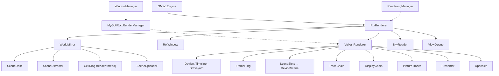

# The ray tracing renderer

How the ray tracer fits into OpenMW: its layers, who owns what, and how a frame is made. This
document describes the shape of the design. The headers hold the detail and the reasons, and a
change that keeps the shape does not change this file.

The tree's own words (walk, stand, hand over, hold, slot, run, ring, epoch) are listed beside the
field's words in [`components/rtx/GLOSSARY.md`](../../components/rtx/GLOSSARY.md).

## What the fork is

Upstream OpenMW stays the host engine: cells, references, physics, scripts, animation, weather,
GUI logic. The ray tracer draws the whole picture: primary visibility, shadows, direct and indirect
light, sky, water and fog are ray traced. Both renderers stand behind one interface and one binary
ships both, but the game starts the ray tracer alone and nothing reaches the OpenGL renderer, which
stays built so upstream's code merges as it stands. Its code is upstream's but for the corrections
`AGENTS.md` lists under "Accepted diff". The player's settings are in
[`rtx.rst`](../source/reference/modding/settings/rtx.rst).

The target is NVIDIA RTX, Turing and later, and AMD RDNA 2 and later, through Vulkan's ray tracing.
The denoiser is the renderer's own, and the upscaler is AMD's FSR 3.1.4 ported to compute shaders:
at `native` it is the anti-aliasing, and every other mode traces fewer pixels than the frame
holds. Vanilla textures are pre-lit, so the renderer estimates the painted light and divides it
out as it prepares the content; a PBR replacer's companion maps reach the trace, and a vanilla scene draws the same whether or
not the renderer can read them.

## Layers and libraries

Each layer knows the layer below it and never the one above.

```
apps/openmw                      the game
  │  MWRender::Renderer          the seam          (apps/openmw/mwrender/renderer.hpp)
  ├── GlRenderer                 upstream's rasterizer, gathered behind the seam
  └── RtxRenderer                the game-side owner (apps/openmw/mwrender/rtx/)
        │  Rtx::Renderer         the core's interface to a backend
        ├── components/rtx       the core: what the scene is; no graphics API, no game headers
        └── components/rtxvulkan the backend: everything true of Vulkan

Beside the stack:
  components/myguirtx            MyGUI's backend over Rtx::GuiRenderer
  components/crashcatcher        the fork's crash catcher: a Crashpad monitor process
  apps/rtxtool                   the harness: drives a real game headless
```

A Vulkan fact that reaches `components/rtx` or `apps/openmw` is a bug, and the link lines keep
it out: the core has no Vulkan header on its include path, and the backend reaches Vulkan
privately, through volk, which loads the loader when the first instance is made. No program links
the loader, so the game starts on a machine without one and its error box says what is missing.
Two places create a backend: `RtxRenderer` and the harness. OpenSceneGraph stays the
content loader whatever draws: the scene arrives as an `osg::Node` graph, and the core reads it.

## The build

Every build has the renderer. The core is part of `components`; the Vulkan backend is a library
of its own, because it links Vulkan; the harness stands beside the game in `apps/rtxtool`.
`./omw [flavour] <verb>` is the one command line over the CMake presets, on the desk and in CI.

Shaders are GLSL, compiled and validated in one build step, so an invalid module fails the build.
Every float operation the Vulkan specification leaves open is pinned and no fusion is allowed
(`components/rtxvulkan/spirv/spirvpin.hpp`), so every compile of a module, the driver's recompiles
included, computes the same frame. The structures both languages read are headers that compile as
C++ and as GLSL: `components/rtx/shaders/*.h` for what the core reads, and
`components/rtxvulkan/shaders/shared/*.h` for what only the backend reads. Each module's interface
is read once and held to what the C++ beside it states (`spirvinterface.hpp`); a disagreement ends
the process and names the module.

- **What the program would compute at every start from no content is made by the build** and compiled
  in, as the kernels are compiled: the blue noise tile and the fog's field, 136 ms and 53 ms of a
  start's main thread, each written by a tool that runs its maker (`openmw-rtx-tablemakers`, which the
  game does not link), and held to the maker by a test.

## The seam: `MWRender::Renderer`

The one interface the game talks to. Read its header first.

- A pure virtual is a question both renderers answer. A default body is an empty answer that one
  renderer has no work for.
- Nothing below the seam is abstracted: contexts, swapchains, render bins and acceleration
  structures belong to one renderer outright.
- The game is never handed one renderer's mechanism. The exceptions are the upstream callers
  that cannot change, and they get null under the ray tracer.
- `createRenderer` takes a `RendererKind`, and every build has both, but `startRenderer` asks for
  the ray tracer alone. Any failure, `Rtx::Unsupported` included, ends the start with
  `describeStartFailure`'s words in the fatal error box: no other renderer takes its place.
- The base keeps what both renderers share: the resource system, the frame clock, the
  screenshot writer, the camera, the traversal root, the view mask and the presentation.
- The world is attached as an object. `attachWorld` returns a `WorldAttachment`, and its end
  calls the renderer's `onDetachWorld` once. `RenderingManager` holds it as its last member, so
  a constructor that throws after the attach detaches too. The base asserts the pairing for
  both renderers.
- The attach carries the engine's `SceneUtil::UnrefQueue`, which the game releases what it
  unloads through, off the frame thread. The mirror's sweeps, the world's and each picture's, keep
  what they let go of in a sink (`Rtx::Released`) and the world mirror hands it to that queue after
  each, so a crossing's last references and a doll's old clothes are dropped on the queue's worker
  too.
- The presentation (`Misc::Presentation`) is the one answer to the screen's size. Each renderer
  draws the world and the interface at its frame, `[Video] resolution x/y` or the window's size at
  Native, and shows the frame scaled into the window with black beside it. The GUI, the
  projection, the pointer and Lua read the frame from it.

The game describes each frame as a `SceneFrame` (`sceneframe.hpp`): the scene root, the sky and
weather state, the eye, the water, the ground, in the content's own numbers and undecoded.
`FrameDescriber` collects the fork's per-frame facts so `RenderingManager` stays upstream's.
Pictures taken away from the eye (the local map, the inventory doll, the world map overlay) are
seam types too (`OffscreenView`, `SubjectView`, `MapOverlay`), and each renderer makes them its
own way.

## The game-side owner

`apps/openmw/mwrender/rtx/`. `RtxRenderer` is the ray tracer as the game sees it. There is no
viewer and no cull or draw traversal, because rays go everywhere. It drives each frame itself,
through a phase state machine that every entry point asserts.

- `WorldMirror` mirrors the scene graph into the core's scene description each frame (the walk),
  places the sea, runs the cell ring, and hands the result to the backend.
- `SkyReader` turns the game's sky and weather into the core's `WorldReading`, and keeps the sky's
  clock. What a reading comes to, and the air carried across frames, are the backend's.
- `RippleEmitters` says what disturbs the water, by the rasterizer's own rule.
- `ViewQueue`, `TracedView` and `TracedOverlay` make the pictures inside the interface.
- `TracedGround` is the seam's ground with no chunks: the ray tracer draws terrain itself.
- `classmasks.hpp` is the one mapping from the game's node masks to the ray classes.

**Two hosts, one renderer.** A played session and a harness run reach the renderer through one
record, `RtxSetup` (`rtxrun.hpp`). The host answers per frame what to sample, what to keep and
what to report. A played session installs nothing and gets the played answers.
`RtxSettings::derive` is the one derivation of the ray tracer's settings, and the harness fills
it from its command line. The core reads no settings.

## The interface

MyGUI draws the whole interface, as upstream. Only its backend changes.
`MyGUIPlatform::GuiRenderManager` is the seam into MyGUI, implemented by upstream's OSG manager
and by `MyGUIRtx::RenderManager`, so `WindowManager` never asks which backend it got.

`MyGUIRtx::RenderManager` is written once for every backend. It needs the extent, a table of
textures and one call that draws a list of triangles, which is the whole of `Rtx::GuiRenderer`; a
picture traced into one of those textures is the renderer's
(`Rtx::PictureRenderer::traceGuiTexture`), because it is a picture of a scene. Pictures the game
writes in main memory (the fog of war, the world map, save thumbnails, video frames) reach the
interface through `shareTexture`: the game marks the image dirty, and the backend sends what
changed.

Pictures inside the interface (a map tile, the doll, the race preview) are traced straight into a
GUI texture from a scene of their own, with no reconstruction and no history. With the world
hidden, a frame draws the interface only. The settings pages and the launcher take their menu
orders from the core, and a mode added without a label on each page stops the build.

### A live scale and font size

`[GUI] scaling factor` and `[GUI] font size` apply while the game runs. The facts are in
`research/2026-10-31-mygui-font-lifetimes.md` and `research/2026-10-31-mygui-list-line-height.md`.

- **Derived, not cached.** `Gui::FontFit` (the raster, the view, the font size) is computed in
  `WindowManager::layOut` and compared with the last one. Refused: one raster for the largest scale
  at start, which costs its atlas always and is wrong after a resolution change; and a restart.
- **One owner, one call.** `Gui::InterfaceFonts::fit` rasterizes the fonts and refits the texts,
  the lists and the pages, in that order. Refused: separate calls, which let a caller do one step
  and not the rest, and leave a text drawing a destroyed atlas.
- **A font is rebuilt in place.** Its `IFont*` stays, and `textureInvalidate` rebuilds it, at load
  as after; its file's bytes are held. Refused: loading the fonts again by name, which leaves every
  text holding a deleted font; a TrueType font of the fork's own; and a resource path set around
  each rebuild.
- **Every font user is known by construction.** The texts and the lists stand in MyGUI's factories
  under MyGUI's names, and each enters a `Gui::FontUsers` registry as it is made. Refused: a walk
  of the widget tree, which misses skin children, popups and widgets on no layer; and an assert at
  the draw, which cannot see a text drawn from vertices laid out before.
- **A book cannot outlive its fonts.** A page drops its book at a refit and asks its owner to
  typeset again (`BookPage::adviseRetypeset`); a book is typeset and drawn at one stated size.
  Refused: typesetting again from each window's `onResChange`, which a new owner could forget.
- **A size never reads the raster, and the font size has one reader.** A text with no height of
  its own takes its registry's, and every size computed from the font size asks
  `WindowManager::getFontSize`, which `InterfaceFontSizeTest` holds file by file. Refused:
  `FontWrapper`'s stamped heights, a second record of one number.
- **A list's line height is MyGUI master's `setItemHeight`, ported.** MyGUI 3.4.3 fixes it as the
  list is made, in private members; `Gui::ListBox` reaches them through an explicit instantiation
  and a `static_assert` holds it to 3.4.3. Refused: vendoring unreleased MyGUI; and lists that
  follow at the next start.
- **A window that keeps sized rows lays them out again** (`WindowBase::refitText`), run over every
  window and the character creation's dialogs; a service window lays its rows out as it opens.
  Refused: one rebuild of the whole interface, which loses every window's state and every Lua
  element.
- **Lua follows through `omw/mwui`.** An internal handler, `_onFontSizeChanged`, has its templates
  still at the old size take the new one. Refused: a public handler, which raises the Lua API
  revision against upstream's at every merge.
- **The pointer is kept in frame pixels**, so a press after a layout lands where it is drawn.
  Refused: rescaling a stored position at each fit, a second copy of the scale.
- **Every window is held inside the view after a layout**, not only the tracked ones: a larger
  scale otherwise leaves a window partly off the frame.
- **The local map follows the raster.** A tile is described again where its resolution moved, and a
  fit that moves the raster draws the player's cell again. Refused: keeping the old tiles, which
  leaves the map at one sharpness and the text beside it at another.
- **The sliders apply when they settle** (`Gui::SettlingScrollBar`), in the Video page under Window
  Border. Refused: applying on every move, which rescales the window under a drag; and a user
  string beside the type, a second statement of one fact.

## The core

`components/rtx/`. What is true of Morrowind's content, of light transport, and of what the
scene is. Written once and read by every backend.

The files stand in folders by what they are for, in an order: a folder includes only the folders
before it, and a folder inside another is a part of it, which the two may both reach into. A
source-tree test holds the order.

| folder              | holds                                                                   |
|---------------------|-------------------------------------------------------------------------|
| `shaders/`          | the structures core C++ and GLSL both read                               |
| `common/`           | what knows no scene: contracts, results, slots, runs, threads, the clock |
| `image/`            | a texture file read: its formats, texels, alpha, levels and painted light |
| `preprocess/`       | `ContentPreprocessor`, its keys, cache and costs; the passes in `shape/` and `texture/` |
| `scene/`            | `SceneDesc`, its rows and tables, and what makes textures of it          |
| `frame/`            | what a frame is asked for and sampled with: the camera, the reconstruction |
| `world/`            | the sky, the air and the water a frame is told                           |
| `renderer/`         | `Rtx::Renderer` and what it hands, reports and writes                    |
| `mirror/`           | the walk from the scene graph, what it reads a surface and a lamp as; the cell ring in `cells/`, which runs inside it |
| `prepare/`          | the loading screen's walk of every model the content names into the store |
| `environment/`      | the sky read out of the content files, and the sea's waves               |
| `view/`             | the pictures traced away from the eye                                    |

- **`Rtx::Renderer`** (`renderer/renderer.hpp`) is one traced image, whichever API makes it. Each
  call is worth a whole scene or a whole frame, never an instance or a pixel: build, extend or
  place a scene; render, collect and present a frame; the reports. Each consumer takes the part
  it calls: a scene's owner `Rtx::SceneHolder`, a picture inside the interface
  `Rtx::PictureRenderer`, MyGUI's backend `Rtx::GuiRenderer`.
- **A null backend, for the game on a machine with no device** (`Rtx::NullRenderer`, chosen by
  `OPENMW_RTX_BACKEND=null`): every promise kept and nothing drawn, so CI runs upstream's
  integration tests through the ray tracer's whole game side, the mirror, the ring, the interface
  and the pictures, as Unreal's `-nullrhi` and Godot's headless display server do. Refused: a third
  `MWRender::Renderer` that draws nothing, which tests none of the ray tracer's game side; the
  rasterizer under Xvfb, which no player starts; and Mesa's lavapipe, which lacks
  `VK_KHR_pipeline_executable_properties`, an extension the backend requires. Chosen by the
  environment and not a setting, so a game that draws nothing is no menu away from a player.
- **`Rtx::SceneDesc`** (`scene/scenedesc.hpp`) is everything a backend needs to know about a world:
  meshes, materials, textures, placements, deformers, and the per-frame lists (lights, sprites,
  emitters, ripples). It appends and deduplicates. A slot is a name and is never renumbered, so a
  hit reads it back as its index. `shaders/scene.h` states the device layout once for both
  languages. The lights are ordered by position each walk. Refused: lights ordered by a stable
  identity, or a slotted light table, since the ordering costs about 17 µs a frame at the
  lamp-heaviest places (`research/2026-10-22-light-ordering-share.md`).
- **`Rtx::SceneExtractor`** mirrors an OSG subtree into a `SceneDesc`. Its identity maps live
  across walks, so an object met again resolves to what was already uploaded, and a still frame
  costs what moved. What a walk did not meet is swept after it. Refused: a sweep kept to what it
  drops (an intrusive list by epoch), since the walk already visits every entry it keeps each frame
  and an open-addressing table moves its entries as it grows.
- **The cell ring** (`mirror/cells/`) stands the world past the loaded cells, because rays reach
  it: the ground from the land records, the statics as instances of their templates, the lamps.
  A reader thread prepares cells, and the frame adopts them a little at a time. A reference a
  local script enables or disables — its own, or one it names in its cell — stands behind a gate
  the game evaluates (`MWScript::VisibilityGates`), because in a cell no one has loaded that
  script has never run. A model's `NightDaySwitch` is read in every branch, and the game's
  day-night mode picks the one that stands, as it picks the one a loaded cell shows. The size rule
  thins what reflects light and never what gives its own: a lit window is a point of light long
  after it is a pixel. A `PreparedModel` keeps its vertex arrays for as long as the reader files the
  model, since an adoption again without them would walk the template or read the file again.
  Refused, by the user's decision: a cache of what the reader read and no cell holds, since
  upstream's resource cache keeps a given-back model for `[Cells] cache expiry delay` and the ring's
  hysteresis keeps the cells a walk comes back to.
- **`Rtx::ContentPreprocessor`** is the one way anything is computed from what the content files
  hold — a shape's fold and the normals it smoothed across a hard edge split, a texture's alpha and
  mean. One lives on each thread that reads content (`Rtx::ThreadContent`): the frame's, which the
  world's walk, the sky and every picture's walk share inside the frame thread's `Rtx::WalkContext`
  beside the traversal numbers, and the ring's reader's. Every
  pass states everything it reads, which is the key its output is filed under in the process's
  `Rtx::ContentStore`, a folder of files under the user's cache directory kept across sessions
  ("The content store" below); a pass whose key would cost more than its run keeps nothing there
  (`ContentPass::sStored`), and what each costs is counted into the walk's stats and the
  `preprocess` row of a frame. The frame's thread reaches the store's memory alone, so no frame
  waits on the disk.
- **`Rtx::SceneUploader`** hands a scene to the backend once a frame, in the cheapest of three
  ways: place what moved, extend with what arrived, or rebuild.
- **The world a frame is told** (`world/`) turns a `WorldReading` into the frame's
  constants: sun, moons, sky, clouds, fog, water. What it draws with, the sky's sheets and the
  meshes they are laid on, is read out of the content once (`environment/`).
- **Materials.** `ShadingMap` estimates the light painted into a vanilla texture, which the host
  divides out of the chain it stores. Companion maps (`_n`, `_nh`, `_spec`) and tangents reach the material as data slots. The
  surface model is glTF 2.0's metal-roughness (`shaders/brdf.h`), shared with the host, which
  integrates it once into the table the shader reads for energy compensation. A vanilla surface
  is that model with no specular reflectance.
- **A mapped normal's light fades by GGX's shadowing, as Cycles fades it** (`bumpShadowing`, Conty Estevez et
  al. 2019). Refused: Chiang et al. 2019, which held the facet line on the round wall at (-2, -9) 15% lower at
  15:00, and drew a sun grazing that wall as flat, hard-edged patches with bright rims; and no term at all, under
  which that line stood at 5.2 times its dark side (`research/2026-11-07-bump-terminator.md`). And normals square
  or more apart keep what normals just short of square keep: a nought there, which Cycles returns, drew hard black
  patches.
- **A `_spec` map's blue is an occlusion, on indirect diffuse light alone** (`indirectVisibility`, `occludedAlbedo`),
  under `metal roughness` alone: a ray stops at the mesh, so no ray finds the relief a replacer's map holds. glTF,
  Filament, Lumen and Wareya's shaders use it so. Refused: the blue unread, as Cycles, Falcor and RTX Remix have no
  such input, since their geometry holds the detail and these low meshes do not; and in the albedo, which glTF forbids
  because it darkens the sun and the lamps (`research/2026-11-07-specular-map-blue-channel.md`).
- **Put back by the composite, in the two albedo channels it reads**, as the albedo is, so the filter blurs none of
  it and no channel is added. A pane's response keeps its albedo, since `CHANNEL_PANE_ALBEDO` multiplies a pane's direct
  light too, and Night-Eye's lift has nothing to occlude it. The fill at a path's end takes the occlusion itself.
- **Jimenez et al. 2016's multi-bounce fit, held to one.** A crack's own bounce is light no ray stands for. Filament's
  form makes light over an albedo of 0.8 on an open surface, hence the hold. Refused: the blue as it is, which a bright
  plaster's cracks read too dark.
- **No specular occlusion and no occlusion from a height.** `CHANNEL_SPECULAR` holds the lamps and the bounce together,
  so the composite cannot occlude one, and only 71 of the 3396 maps measured hold metal. A height stands behind only 65
  of the 436 flat maps, and a flat white blue states no occlusion. A land layer's `_diffusespec` has no blue, so ground
  takes none.
- **An `_nh` map's relief is marched, as RTX Remix marches it** (`reliefToward`, Tatarchuk 2006): at the depth and
  the middle height OpenMW's parallax states, since the replacers paint their mean height at the one the shift puts on
  the triangle (`research/2026-11-08-height-map-range.md`). The march is the shift where it crosses under one texel
  at the level the cone reads, so a far surface keeps its picture and its cost. Refused: a max-mip quadtree, Remix's
  default, whose chain is a byte a texel more, as much as the maps, for heights that are broad shapes; relaxed cone
  stepping, which BC3 has no channel for; the relief under the triangle, as classic POM puts it, which moves every
  texture off where the rasterizer draws it; and true displacement, 20 to 60 ms a frame or NVIDIA's alone
  (`research/2026-11-08-parallax-occlusion-techniques.md`).
- **Bounded by the heights each map holds**, read at load as an image fact (`alphaRange`), so the march spans 0.62 of
  the scale at the median map and not all of it. Refused: the bounds off each block's endpoints alone, which the
  walk over the palette's indices makes exact at no allocation.
- **Marched once, by the trace, and read back by every stage after it** (`STAGE_RELIEF`), 4 bytes a pixel whatever
  the tuple, since the stage images are made at the chain's extent and a scene's relief comes and goes. Refused: a
  march in each stage that resolves the solid.
- **The eye's motion and distance are measured to the texel the march shows** (`Surface::mReliefDepth`), and the shift
  stands its texel at the triangle: a history fetched by the triangle's motion doubled the fireflies at a close wall,
  and measured to the texel they stood 23% over the shift's (`research/2026-11-08-relief-cost-and-noise.md`). Unity's
  POM writes a depth offset for the same reason. Rays still leave from the triangle, which a ray from under it would
  meet.
- **A ground stack's relief is marched once, through the heights its layers show summed by their shares**
  (`ReliefMaps`), a layer with no height standing at the middle one, and every layer read where the march stood: the
  stack draws the sum of its layers' albedos, and all of a chunk's layers lie on one sheet. Bounded by the heights its
  layers span together, on the chunk's material. Refused: a march for each layer, a relief no layer's albedo shows, at a
  cost a layer; the dominant layer's alone, with a seam where it changes.
- **A bounce's landing shifts its relief once and does not march it** (`Hit::mMarches`), as RTX Remix leaves an
  indirect hit's relief unmarched: marched, the landing's stage cost a close wall 0.13 ms of a 6.4 ms frame.
- **A relief shadows the sky's source and the held lamp** (`reliefLit`): a march from the texel toward the light, soft by
  the light's own size and at least a texel of the level read, multiplying the light whole and not its bit, so the
  shadow filter blurs no shadow the size of a texel. Only a height over the light's ray takes light, so flat ground
  lights itself whole. Refused: the bounce's, which a `_spec` map's blue already occludes; horizon maps, several bytes
  a texel for each direction.
- **A march takes at most 32 steps** (`RELIEF_STEPS`), and a wider crossing reads a coarser level: 16 saved a close
  wall 0.07 ms of its frame and 64 cost it 0.15, and only the nearest grazing texels cross past the cap. Remix caps at
  64 and Tatarchuk at 50 (`research/2026-11-08-relief-cost-and-noise.md`).
- **The tuples that march a relief stand only beside the maps** (`HAS_RELIEF`), 48 made of the table's 64, since a
  relief is read through a normal map. Refused: the full product, sixteen tuples no frame asks for, compiled at every
  first start.
- **A seabed's relief is marched under the sea**, which holds the sea's walk at 224 registers against the 219 it held:
  on an RDNA SIMD both run four waves. Refused: the landing's shift there, which takes a seabed's relief away for
  registers that cost no wave.
- **No setting turns the march off**: it costs a close wall 3% of its frame on a high-end NVIDIA laptop GPU and 5% on
  a low-end AMD integrated one, and a far surface what the shift cost, since there the march is the shift
  (`research/2026-11-08-relief-cost-and-noise.md`). `--relief` is the harness's A/B alone (`SamplingSwitches::mRelief`).
- **Reconstruction** (`frame/reconstruction.hpp`). `RenderProfile` is what a run decides once.
  `Reconstruction::resolve` is the one rule for everything that follows from how a frame is put
  back together: the denoiser, the jitter, the noise source, the texture level bias.

Content the renderer cannot use is never an assert and never the end of a frame. Readers answer
with a `Misc::Result`, and every refusal is reported once to `Rtx::Refusals`. A texture that is
refused draws as a stand-in, and anything else refused is left out.

### The content store

What the preprocessor makes of the content is kept across sessions in `Rtx::ContentStore`, filled on the loading
screen. The measurements are in `research/2026-11-08-normal-map-chains.md`.

- **The store is the game's input.** Every form the renderer reads of a file and every derivation the host makes of
  one is made on the loading screen and read from the store in play; the game computes only a miss, content the
  loading screen could not know ahead, through the same pass, and counts it. Refused: a game that refuses content the
  preparation did not see, which a script's spawn breaks; and a second, cheaper path for a miss.
- **The device's derivations stay at arrival.** The normal spread, the sprite light bake and the ground composite cost
  0.02 to 0.10 ms in the median frame that runs them and 1.10 ms at the worst, on frames whose slow ones are the
  host's ("What the device's derivations cost at arrival"). Refused: each read back and stored, a device-output format
  and a disk read for under a millisecond; Unreal's derived data cache keeps what minutes of offline work make.
- **No acceleration structure is stored**: a serialized one is valid only where
  `vkGetDeviceAccelerationStructureCompatibilityKHR` accepts it, so a driver update throws it away, and a static
  structure builds in its arrival's frame.
- **The key is the content** (`ContentKey`): the pass's name and version and every byte it reads, one 128-bit
  MurmurHash3 at about 9.5 GB/s ("What the preprocessor costs a start"). Refused: a key of path, size and time, as
  ccache's direct mode keys, which a file inside a BSA or a shadowed path makes quietly wrong; XXH3, a dependency for
  a share this small; and a key for `SolidReach` and `SolidFall`, whose walks stop before a key would read every byte.
- **One file an entry, and every entry untrusted**: 256 folders by the key's first byte, as ccache and Bazel's disk
  cache keep theirs ([EngFlow](https://blog.engflow.com/2024/05/13/the-many-caches-of-bazel/)); a header states the
  format, the pass, its version, the key and the payload's length and digest, and a file that does not match is a miss
  and is deleted. Written to a temporary name and renamed, so a reader sees a whole entry or none. Refused: SQLite, by
  the user's decision; a pack file a pass, which two processes merge only under a lock; and a sync before each rename,
  where the digest finds a body a power loss left unwritten.
- **The frame reaches the store's memory alone** (`StoreReach`): an entry of 4 KiB or less is held once read or
  written and loaded at the start's sweep, bounded at 64 MiB; a larger one the frame computes as it did. Refused: a
  file read on the frame's thread.
- **A size cap, least recently used by each file's time**, as ccache and bazel-remote evict: 16 GiB, by the user's
  decision; a session's first hit of an entry sets its time on the store's thread, and the start's sweep removes the
  oldest past the cap and temporary files a day old. Refused: a time set at every hit, a write on every read; and an
  index file, a second record of what the folders state.
- **Every normal and data map's chain is rebuilt, and a colour file keeps its own**, by the user's decision: 343 of
  the PBR install's data maps turn metal below level 0 and 381 normal maps go black, where colour chains are faulty in
  few texels ("The colour and data chains"), as Godot loads a DDS file's levels as they stand. Refused: colour chains a
  check flags rebuilt, since 579 of 582 match an ordinary filter made on purpose ("Which filter the flagged colour
  chains match").
- **The filter is a box of the level above, a normal averaged as a vector** (`ChainBuild`, `shared/halving.h`), in
  linear light for a colour and weighed by alpha only where alpha is coverage, as Unreal's `SimpleAverage`; the normal
  spread measures the shortened mean from the finest level (Toksvig). Refused: NVTT 3's slope-space filter, which puts
  a level's direction in another space than the spread measured.
- **A normal map is whole in BC7, in one encoding**, by the user's decision: each texel its unit normal in three
  channels and its height in alpha, so the trace decodes every map one way; BC7 is the one block format that holds
  three channels and an alpha at a normal's precision
  ([Microsoft](https://learn.microsoft.com/en-us/windows/win32/direct3d11/texture-block-compression-in-direct3d-11)).
  A block takes one mode, 5 with a height and 6 without, as DirectXTex narrows its search, at five times the full
  search's speed ("Normal maps in BC7"). Refused: each map in its own format, a second loss for BC1; and BC3, a
  normal at 5:6:5.
- **A coarser level is encoded on the host, in the file's format** (BC1 to BC5), through rgbcx from bc7enc_rdo,
  approved by the user, whose BC1 matches Compressonator and libsquish
  ([bc7enc_rdo](https://github.com/richgel999/bc7enc_rdo_devel/)). Refused: an encoder of our own; and encoders on the
  device with a read-back.
- **A loose chain is whole in BC7** (`ChainForm::Bc7`), by the user's decision, through bc7enc from the same commit,
  perceptual weights for a colour and linear for data: vanilla moves by BC7's error, at most 28 of 255 on 0.08% of a
  picture's pixels ("Loose chains in BC7"). Refused: the loose form kept beside it for vanilla, a second route.
- **A painted colour is stored delit, keyed by use** (`TextureEncoding::Painted`), by the user's decisions: a diffuse
  with no metal-roughness map and an unauthored ground layer have every level divided by `ShadingMap`'s estimate,
  read as the slot wraps, and encoded again in the file's own format, so a BC1 colour keeps four bits a texel; a file
  used both ways is two slots, as an engine imports a texture once a use ("Colours stored delit"). Refused: every
  colour delit, which flattens the replacers' base colours; and BC7 for every delit colour, twice vanilla's memory.
- **One specular layout, a classic map converted**, by the user's decisions: a `_spec` map is classic where its
  channels spread less than 0.1 on the mean (`SpecularKind`; the Fullrest Repack's 14 spread 0.004 to 0.042, the PBR
  installs' 3400 at least 0.151), and a classic map and its diffuse are converted per texel as Khronos converts
  specular-glossiness (`ConversionPass`,
  [Khronos](https://github.com/KhronosGroup/glTF/tree/main/extensions/2.0/Archived/KHR_materials_pbrSpecularGlossiness/examples/convert-between-workflows)),
  each slot named for both files. A terrain `_diffusespec` is an authored albedo. Refused: the layout as a setting;
  every map read as metal-roughness, which reads a grey highlight as metal; a metalness from the diffuse's mean; and
  `KHR_materials_specular`, a second layout.
- **A chain is built on a worker**, never on the frame or the reader, which a 2048-square map's tens of milliseconds
  would stall: a slot draws its file until its chain lands and is then made again, as a streaming engine draws what is
  loaded, and the harness's settled world waits for the queue. Refused: a device completion for what the frame meets,
  a second route (`MipChainPass` and `RgtcEncodePass` are gone).
- **The store is filled on the loading screen, in the game's own process** (`Rtx::ContentPreparation`, inside
  `Renderer::awaitShaders`), by the user's decision: every model and land texture the content list names, walked as
  the cell reader walks it, on workers, as the game already compiles its kernels there and Godot's import runs in the
  editor that uses it. Refused: a child tool that loads the content list again behind a pipe protocol, for a fault
  isolation no pass needs; and a launcher tab, a second route.
- **The preparation is incremental by each file's stamp; the lookup is by content**: a manifest names each model's
  files and a digest of their sizes and times, so a start after one mod changed walks that mod again, as ccache's
  direct mode trusts a stat; the game keys every lookup by the bytes, so a stamp that lies costs a miss and never a
  wrong answer.
- **A pass's version is held by a test** (`RtxPassVersionsTest`): each pass's outputs over fixed inputs are digested
  beside its `sVersion`, so a forgotten bump fails, and a version moves whenever an output for the same input moves,
  an encoder's update included. Refused: the build's revision in every key, which empties the store at every build.
- **A store that cannot be written is a store that misses**: a full disk or a failed rename is logged once, and the
  game computes what it would have stored.
- **The scene graph stays the renderer's one input**: the store holds what the mirror derives, not models that would
  replace the walk, since upstream's reading is a small share of a load ("What a load costs the processor").

## The backend

`components/rtxvulkan/`. `VulkanRenderer` is `Rtx::Renderer` over Vulkan. Members are declared
in construction order, and everything is built on the device.

The folders keep the core's rule, in this order. `VulkanRenderer` and the owners beside it stand
at the top, over all of them.

| folder              | holds                                                                   |
|---------------------|-------------------------------------------------------------------------|
| `shaders/`          | the GLSL, by the folder of the pass that dispatches it; `lib/` shared, and `shared/` the headers only the backend and its shaders read |
| `spirv/`            | the pinning and the kernel digest, a library of its own the build runs  |
| `device/`           | the instance, the device, the timeline, the graveyard; `memory/` for buffers and images |
| `pipeline/`         | compute, graphics and ray tracing pipelines, and how a dispatch is sized |
| `texture/`          | the bindless array and the passes a texture is made with as it arrives |
| `scene/`            | `DeviceScene`: its tables, structures, skinning and sprites             |
| `trace/`            | `TraceChain` and its passes, the sea and the fog; the denoiser in `denoise/` |
| `upscale/`          | `Upscaler`: FSR 3.1.4, ported, and `FsrFrame`, its constants            |
| `display/`          | `DisplayChain` and its passes                                           |
| `present/`          | the swapchain and the present                                           |
| `gui/`              | the interface's pass and textures                                       |

- **The device.** `Device` holds the queue, the command pool, the `Timeline` and the `Graveyard`.
  The timeline is the one clock: each submit signals it, each wait is the device's, and the host
  never reads it on the frame path. The graveyard keeps what a submit may still read until the
  timeline passes it, so a buffer replaced or a scene let go is safe with frames in flight. A
  missing required feature refuses the device; an optional extension is taken whole or not at all.
- **The command pool** (`device/commands.hpp`): commands recorded again and again are lent
  (`LentCommands`), one scope's span to its submit is a `Recording`, setup work with its staging is
  a `Batch`, and no other submit is made while a recording is open. Refused: a pool a frame slot,
  which saves microseconds and would stop a deferred batch from riding any submit.
- **The pipeline cache** (`device/pipelinecache.hpp`) is a file named for the driver and the
  shaders, checked by a header of its own before the driver sees it, and written whole or not at
  all.
- **Memory.** What a frame cannot go without is essential and never refused. Content (acceleration
  structures, textures) is taken against the driver's budget and can be refused, and a refusal
  leaves the mesh out or draws the texture's stand-in. Host-written memory holds the tables the
  host rewrites, at the world's room (`sceneroom.hpp`). Refused: a staged path for those rows, since
  they hold 123 MiB live in 184 MiB of blocks against an RTX 20's 246 MiB window
  (`research/2026-10-22-host-written-window.md`); an arrival scheduler with a frame budget, a
  destroyer thread and blocks made ahead by a worker, since the crossing's worst frames are the
  engine's update (`research/2026-10-22-crossing-worst-frames.md`); a defragmentation, since the
  pool holds at its high-water mark and does not creep
  (`research/2026-10-22-content-pool-after-a-long-walk.md`).
- **The frame's targets are made at `createTargets` and counted from what makes them.** The
  reserve sums each owner's `bytesAt`, read off the descriptions it makes its images of, and the
  pictures' chain is made at the room its views asked (`PictureRenderer::reservePicture`), never on
  the frame a picture is first traced. The reserve is the running mode's, since room kept for
  every mode was room an 8 GB card's textures stood smaller for; a run that names the modes its
  stops move between reserves the largest of theirs from the start (`RunProfile::mReservedUpscales`),
  since a reserve that followed the mode built the world again against another room under a
  budget, and `noise` held a frame that stood every texture whole against a reference that
  held 560 smaller.
- **The images a frame uses inside one stretch of it share memory** (`ImageArena`): the stage
  images, the denoiser's scratch and the upscaler's own, each over its span of the fixed order
  (`FrameStep`), laid over each other where their spans do not meet. It rests on one queue and the
  barrier every command buffer opens with; an image whose memory an earlier span used discards
  from `Use::sAliased`. The world's arena is the renderer's and spans the upscaler; a picture's is
  its own. Refused: a frame graph (O'Donnell, GDC 2017), whose other gains are scheduling across
  queues, which was declined, and reordering, which a fixed order has no use for.
- **`DeviceScene`** is everything one scene is traced against, the world's or a picture's: the
  instance records, the acceleration structures, the buffers a hit reads, the skinning tables and
  the bindless texture array. A table the host rewrites has one copy a frame slot, and the poses
  one a slot as well, since a frame's motion is measured against the copy it does not trace; what
  only arrives — the vertices, the mesh table, the posed normals — is one copy written on the queue
  behind every frame in flight. A static structure is built over the positions its hits read.
  Each scene owns its textures and structures, and a texture's side is chosen from the room left
  when it arrives: within one arrival, the file that stands the most bytes comes down a level
  first, until the arrival fits, as Unreal's streamer takes one mip at a time off until its plan
  fits the pool. One side for the whole arrival, refused, came down by halves: a world built
  again in one arrival under a budget stood 1383 MiB of textures and left 1344 MiB of room unused
  (`TextureArray::chooseLevels`). A bottom level is built loose in storage of its own and copied
  out of it, tight where that is smaller, so that storage empties whole, as RTXMU gives a build's
  memory back once its compaction is done; a structure built to be refitted is built where it
  stays. One storage for both, refused, filled the loose blocks' holes with the copies, and a
  structure never copied held each block: a world built again kept 206 MiB of blocks for 66 MiB of
  structures (`BottomLevelStore`). **The world's build copies its bottom levels tight before
  its textures are made**, run by run, each built, waited on, copied and waited on again, as
  NVIDIA's `RaytracingBuilderKHR::buildBlas` builds a load; a cell arriving copies them over the
  placements after, a budget each, as NVIDIA's compaction tips stream them, and a picture's scene
  rides the next submit as a cell does. Textures made beside loose structures, refused, were held
  to room compaction gave back a few frames later: a world built again stood 2794.6 MiB of textures
  and left 192.8 MiB unused, and 2986.6 MiB with 0.6 MiB unused once settled (`BuildCompaction`).
  The top level and its scratch are made at the world's room, tens of MiB against
  a structure made on a crossing frame. Refused, by the user's decision after a measurement or an
  estimate:
  - textures shared across scenes: a doll's 12–17 textures are 0.2 MB and 0.4–1.1 ms on vanilla,
    and a PBR pack could raise that to an estimated 50–280 MB and 5–25 ms;
  - a residency manager that moves each texture's side by priority under a budget;
  - 16-bit indices, about 22 MB on each side against an unpack in the candidate loop;
  - white vertex colours stored only where a mesh brings colours, about 1 MB live;
  - one bottom level per template model, whose top-level gain is about 0.17 ms
    (`research/2026-10-22-instances-per-placed-model.md`);
  - a static mesh's bottom level shared across scenes, since a doll's static parts are a few meshes.
- **`FrameRing`** keeps two frames in flight. The host places frame N+1 while the device traces N.
- **The swapchain is made again once the window's drawable settles** (`RtxWindow::fit`), so a
  drag makes it once. Refused: a swapchain made over `oldSwapchain`, for a resize that comes a few
  times a session.
- **The glossy lobe's images exist on every install**, by the user's decision: 37 MB at a 720p
  trace. Refused: making them only where the content wears a map, since a scan of the file index
  cannot see a map a model names in its own file, and a missed map costs a drain or a wrong picture.
- **`TraceChain`** is everything one camera's trace writes at one extent: the G-buffer, the fog
  volume, the sprite bins and the denoiser's history. The world has one, and `PictureTracer` has
  one for the pictures inside the interface; the passes are shared.
- **`DisplayChain`** runs after the trace and the upscaler: bloom, exposure, glare, tone, debug
  lines. The tone pass adds the glare fader and Night-Eye's lift after the curve, where the meter
  never sees them, as the rasterizer adds both, and applies `[Video] gamma`. The GUI draws after
  it, at the frame's size, so the gamma does not reach it, and the frame is blitted to the
  swapchain scaled to fit (`Misc::present`).
- **`Upscaler`** is FSR 3.1.4's seven passes, from AMD's own headers in `extern/fidelityfx/`, with
  the renderer's callbacks; it needs no extension. Its reactive and composition masks are the
  trace's own (`CHANNEL_UPSCALE_MASKS`).
- **No reuse of the bounce.** ReSTIR GI's reservoirs ran here as a temporal and a spatial reuse,
  and were removed: once the denoiser kept a rare bright sample's light, they gained nothing at any
  place and added bias in the room they were kept for (`.notes/reuse.md`).
- **Every eye hit traces its bounce.** Refused: a rate on it, drawn and divided. At a half it saved
  4–6 % of the frame and raised the noise and the bias at every place measured, since the bounce is
  the term that lights a room (`research/2026-10-03-bounce-rate.md`).
- **Several bounce rays a pixel, averaged, and not a deeper path** (`[RTX] bounce rays`, 1 to 4,
  default 1, live through `Renderer::setBounceRays`): each ray costs what the first does, and the
  raw frame's noise and fireflies fall with the count while the denoised frame barely moves
  (`research/2026-11-01-bounce-rays.md`). NVIDIA's NRD sample averages its paths before the
  denoiser the same way
  ([`TraceOpaque.cs.hlsl`](https://github.com/NVIDIA-RTX/NRD-Sample/blob/main/Shaders/TraceOpaque.cs.hlsl)). Default 1 keeps every player's
  picture and cost, and the top is 4, by the user's choice: at 8 the desk's frame stood at three
  times one ray's.
- **One bounce and no deeper path**, by the user's choice, after it was built and shown as a live slider.
  Delighted walls hold an albedo near a tenth, so a second bounce returns a tenth of the first's light, into
  pixels where a quarter more of nothing stays black: past the first, depth brought up one of seven vanilla
  rooms, at up to 4 ms (`research/2026-11-05-room-ambient.md`). An earlier refusal measured the same, at up to
  1.6 ms and with a vanilla room darker for it (`research/2026-11-01-bounce-rays.md`).
- **A box for the path tracing and the rays' slider under it** (`[RTX] indirect lighting`), and no nought on the
  slider, by the user's choice: one switch says whether bounces are traced, and the slider's value waits for it.
  Off, no landing runs and a stage of its own stands the ambient on the surface under one occlusion ray
  (`unbounced.comp`, `Skylight::mSurfaceAmbient`), for the channels every pass after it reads and a split
  pixel's lift. A glossy surface then reflects only its lamps, since its reflection is the bounce. Refused: a
  brightness matched to two or three bounces, which is almost no ambient at all.
- **That stage a kernel apart from the bounce's**: the surface it reads for its place and its normals alone leaves
  the rest of a hit to the compiler to remove. On the handheld and the integrated GPU its frame takes a fifth to a
  quarter off the stage, and the bounce's own kernel 1 to 14% off without the path. Refused: a branch in
  `bounce.comp`, whose registers (112 against 80 and 96 on RDNA 2) every lane paid for.
- **One wavelet level where no bounce is traced** (`AtrousPass::record`): a flat ambient under one occlusion ray
  needs what the first level does, the accumulator's feedback and its history fix, and none of the rest. It saves
  0.3 to 0.75 ms and moves the frame's noise by 0.02 at most at a still place. Refused: no level, about 0.2 ms more
  and up to twice the noise after a cut, with no history fix (`research/2026-11-05-room-ambient.md`).
  That level composes the frame as the last of four does (`atrouscompose.comp`), beside the feedback it writes.
- **No fill kept apart from the bounce where no bounce is traced** (`ACCUMULATE_HOLDS_FILL`): the whole of the
  ambient is fill, so two channels would carry one light through the accumulator, its clamp and the wavelet. A
  still frame's picture stays to the bit, and a third came off the clamp's registers on RDNA 2. A moving one moves
  only where the clamp moved the two apart, by a noise no figure of `noise` tells. The channel is cleared once and
  the images keep their count; a bounce traced after such a frame starts the accumulator over, with no mean of
  the fill to read (`TemporalTurns::Step::accumulatorFresh`). Refused: an image of its own for the count, which
  a frame with a bounce would pay for.
- **A room's record is not its light where a bounce is traced**: a landing takes 0.18 of the ambient and
  0.14 of the sunlight, a surface with no bounce 0.035 of both, by the user's choice, with the exposure's
  ceiling at 20.8, where a quarter, a fifth, a twentieth and 24.75 read too bright and flat
  (`research/2026-11-05-room-ambient.md`, "Dimmer rooms"). At the whole record a room with few lamps showed no
  shape, and at none a corridor stood 60% black. The sunlight's share is for the rooms whose record says their light there,
  as `Akulakhan's Chamber` does, and a room whose sunlight is small hardly moves. Refused: one factor for every
  room's brightness at no bounce, which no factor reaches (0.02 to 0.31 a room), so one matching the rooms' mean
  stands.
- **A room's water takes half the record, apart from a wall's share** (`Skylight::mWaterAmbient`), by the user's
  choice: the eye sees scatter directly, with no albedo in front of it. Refused: the landing's share, under which a
  flooded room with no lamp stood almost black, and the whole record, under which water outshone the walls.
- **A room's landing takes the fill with no occlusion ray, and an exterior's keeps it** (`landingLightOf`): in a
  room the ray cost 0.1 to 0.3 ms, added no visible shape a wall further from the eye, and held black pixels, with
  noise and fireflies no better for it. Out of doors the fill is the sky, and without the ray it reached under a lid.
- **A `bounce` and a `landing` dispatch a ray, in turn**, each pushed which ray it is
  (`StageConstants::mRay`), and a list head a ray in `STAGE_TILES` over one array each ray writes
  again, so no clear stands between the rays and the barrier before each stage orders the reuse. Refused: one kernel tracing every ray in a loop, which
  keeps every ray's record live through the traversals, or stores every ray's hit.
- **The landing's hit is stored apart from the solid's for every ray but the last**
  (`STAGE_LANDING_HIT`, `landingApart`), so each ray leaves the surface the eye found, and the last
  stores it in the solid's place, which nothing reads after it. **So a frame of one ray holds the
  memory one bounce did**, 5,248 bytes more at a 1280x720 trace: the landing's own images are a
  texel wide until a count above one makes the targets again (`GBuffer::declareStages`,
  `VulkanRenderer::setBounceRays`). Kept whole at every count, they took 87.6 MiB more there; at
  four rays the frame holds 45.0 MiB more than at one. Refused: tracing the eye's ray again a ray,
  which cost the integrated GPU a quarter of a frame
  (`research/2026-10-21-amd-integrated-stage-times.md`).
- **Each ray is worth one over the count, added into the bounce's own channels** (`startBounce`,
  `storeBounced`), so the denoiser and the composite read one bounce; the first ray writes the
  channel, so one ray writes the bits it always wrote.
- **A frame's rays take the next `N` steps of the golden-ratio turn the frames sweep**
  (`unitPairOfRay`), a stratified sample: the one-dimensional form of a blue-noise sequence over
  time (Wolfe et al. 2022, "Spatiotemporal Blue Noise Masks"), a Cranley-Patterson rotation; the other
  draws step a block of seeds a ray, at the end of the chain (`bounceSeedsAt`). Refused: a hash a
  ray, whose draws may fall together.
- **The denoiser** (`trace/denoise/`) runs where a run filters the frame, in families recorded
  stage by stage, a dispatch of each behind one barrier, since none reads what another writes.
  Every history is held to the frame before's surfaces (`GBuffer::getHeld`) and matched from the
  eye it was measured from.
  - The bounce's diffuse light: an accumulator whose slow mean is held to a fast one (ReLAX's
    clamp), so light that changes on a still surface is followed; a mean too young for a variance
    of its own takes its neighbours' (ReLAX's spatial estimate); a surface just uncovered takes the
    occluder's history along its motion (Zeng et al.'s dual motion vector), and a mean of a few
    frames is rebuilt from the surface around it (NRD's history fix). Then the wavelet, SVGF's
    5×5 first level and ReLAX's variance-weighted 3×3 levels. The fill is filtered beside it by
    the same weights, and the composite puts the bounce back by the diffuse albedo and the fill by
    the ambient one, as the rasterizer has `D × lit + A × ambient`. ReBLUR's anti-firefly is off
    by default: with a lamp's own model out of the bounce it held no firefly, and took a rare
    bright bounce's light with it.
  - The shadows: FidelityFX's Shadow Denoiser over two fields, the sky's source
    (`CHANNEL_SHADOWED`) and the lamps (`CHANNEL_LAMPED`), since one bit a pixel for both carried a
    lamp's open ray across an edge into the sun's light. Its reach is the penumbra's (NVIDIA
    SIGMA's rule).
  - The glossy light and the see-through layers: temporal filters, each holding its slow mean as
    the accumulator does (`historyclamp.comp`).

  **The denoised frame is not bit-exact on every card, and that is the card's.** On the high-end
  NVIDIA laptop GPU, the first wavelet dispatch after a pipeline drain sometimes computes the last
  bit of its weights differently on the same input, one half-float step at a few texels, while the
  queue keeps the card busy with no idle gap. Everything before the wavelet stays exact.
  `FrameHashes` reports a difference in a denoised composed frame beside the verdict, and `shot`
  holds a denoised picture to within `sDenoiserNoiseLevels`. The evidence is in `8deca8c8f7`
  (`.notes/denoiser-nondeterminism.md`).

**The shaders** (`shaders/`, in the folders of the passes that dispatch them, shared pieces in
`shaders/lib/`). The trace is six compute stages in one fixed order: `trace/visibility.comp`
peels the eye's rays down to the surface a pixel shows, shades it and stores its hit;
`direct.comp`, `media.comp` and `panes.comp` add its direct light, the shafts in the water and the
layers in front of it; `bounce.comp` traces its bounce and `landing.comp` visits where the bounce
landed, or `unbounced.comp` stands for the pair where no bounce is traced; and the composite puts the
frame together from the channels. Every ray is a ray query, and
no trace pipeline has a hit, miss or any-hit stage: AMD's Windows driver answers no ray query in a
pipeline that also calls `traceRayEXT` (`research/2026-10-19-amd-windows-driver-faults.md`).

- **Every stage is a compute dispatch, on every device.** As a ray generation stage alone, AMD's
  Windows driver drew the trace wrong from its second frame on, and the same module as a dispatch
  draws right (`research/2026-10-19-amd-windows-driver-faults.md`). Refused: a ray generation
  launch on every other driver and a dispatch on AMD's, two builds of one kernel. On a high-end
  NVIDIA laptop GPU the stages drew 23% slower than the launch at the median, and 29% at the p99,
  where another context's time slices land inside their dispatches
  (`research/2026-10-21-nvidia-stage-costs.md`).
- **The fog's and the sprites' traces stay launches**, because a ray query answers repeatably only
  inside a launch there (`TracePipeline`).
- **Few places a module starts a ray query** (`queryScene`): each loop of a kernel answers the
  rays its walks ask at one, a stage's phases a loop each. AMD's Windows compiler writes a whole
  software traversal at every such place left after inlining, and a stage that held fifty did not
  compile in 52 GB (`research/2026-10-19-amd-windows-trace-compile-memory.md`).
  `RtxSpirvInterfaceTest.noModuleStartsARayQueryAtMorePlacesThanItsCeiling` counts them in every
  module the build ships, each held at what it has. Refused: a callable stage
  around the traversal, which fixed the compile alone.
- **What the hit and miss stages did is done in the candidate loop and the kernel.** A
  see-through surface is met as a solid by the eye's rays (`MEET_AS_SOLID`) and cut at the eye's
  dither (`softEdgeDither`); which shading a hit takes is its instance's material kind, written as
  the instance's shader-table offset (`SceneAcceleration::placeRow`) and read back off the
  committed hit; the sky is a function the kernel calls.
- **A committed triangle's corners are read off the scene's own vertices** (`committedHit`,
  `GpuTables::mPositionBlocks`), the numbers its structure was built over, on every driver: AMD's
  Windows driver fetches a committed triangle's corners wrong
  (`research/2026-10-19-amd-windows-driver-faults.md`), and passing every triangle through the
  candidate loop for its candidate's, which read right, cost the bounce a tenth of its time on a
  low-end AMD integrated GPU (`research/2026-10-21-amd-integrated-stage-times.md`). A candidate's
  are fetched, for the test that takes it. Refused: the hit cast again over a slab about it for a
  candidate's corners, which cost near what the whole ray costs; the fetch where the driver reads it
  right, which draws one picture a driver.
- **No kernel spills past its ceiling** (`RtxVisibilityKernelsTest.noKernelSpillsPastItsCeiling`):
  no scratch memory where the driver reports it and a dispatch at 128 registers at most, but the
  trace's stages at what they spill, and a launch's ray generation stack at what it holds, each
  ceiling one that only falls: at 128 registers an RDNA SIMD runs eight waves, at 256 four. A
  register ceiling rises only inside the waves it already allowed, with no scratch: `direct` went
  from 244 to 256, four waves at either, for the gather that carries the lamp's draw and not its
  ray (`research/2026-10-22-amd-integrated-spill-ceilings.md`). The whole tuple, which alone reads a
  see-through dark map's alpha (`HAS_DARK_ALPHA`), holds ceilings of its own past that rule, since nearly
  no scene runs it for long; the same tuple without the read holds the rule's. A
  spill is a cost measured and cut where it shows in the frame, as NVIDIA cut Indiana Jones' path
  tracer's; held at nought, it kept the gate red until a redesign and hid a new regression behind
  the old failure.
- **A stage a kernel, in one fixed order, the channels between them**: `visibility`, `water`,
  `direct`, `media`, `panes`, `bounce`, `landing`, then the composite, one memory barrier between
  each. A stage that covers every pixel writes a channel first; one dispatched over some tiles adds to it;
  the direct channel is a sum of each stage's term times the throughput `visibility` stores
  (`rgba32f`, the layers' share in its fourth). Quake II RTX traces its stages as passes
  (`path_tracer.c`), and Laine, Karras and Aila (2013) name the cost of the alternative: one kernel
  carrying every walk's record spilled 67 KB a lane on the integrated GPU and drew an 80x45 frame in
  650 ms (`research/2026-10-21-amd-integrated-stage-times.md`). Refused: one kernel under the
  register file, which cannot reach it without dropping light; the walk's records in a buffer each
  turn, 16–48 KB of traffic a pixel; every point's light stored for a composing pass, 8.5 GB at a 4K
  trace; a wavefront with queues (Cycles), which pays for long divergent paths where a frame's are
  short and fixed; an image a stage for the terms that share a channel.
- **A stage's phases are loops of their own**: each loop keeps only its own walk's records live
  across its traversal, as Quake II RTX writes each stage as straight code around a trace helper
  (`path_tracer_rgen.h`). `visibility` peels one ray a turn and leaves with the hit, shading after
  the loop, and `panes` lights each layer and marches its column in loops of their own: a 480x270
  frame at Seyda Neen went from 412 ms to under 46
  (`research/2026-10-21-amd-integrated-stage-times.md`).
  `media` takes the eye's ray, its column, the water's walk to its leg and the leg's march a loop
  each, the march keeping of the walk only the share its leg is weighed by: 256 registers and 37
  spilled scalars to 192 and none on the handheld, its zone 3.06 to 2.52 ms at `seyda-neen-ship`.
  Refused: one loop over every walk, whose union of records spilled; the records trimmed inside it,
  which moved the spill by under 300 bytes of 2 304.
- **A stage whose rays wait on no other's answer works out its light before the first one**
  (`landing.comp`, `direct.comp`, each layer `panes.comp` lights): the terms each ray's answer
  multiplies (`PathEndLight`, `SolidLight`), then the rays in a fixed
  order a turn each at one traversal site, so only the terms and the rays stay live through the
  traversals — NVIDIA's advice to keep live state across a trace small
  ([Best Practices: Using NVIDIA RTX Ray Tracing](https://developer.nvidia.com/blog/best-practices-using-nvidia-rtx-ray-tracing/)).
  On the handheld the landing went from 160–256 registers to 128–144 and its zone 21–34 % down, the
  direct stage 9–28 % and the layers' 17 % in the guild
  (`research/2026-10-30-amd-handheld-stage-times.md`). Refused: the walk of steps there, which kept
  the surface and every record through each ray. A path end's light is a sum in another order, so
  it moves by its rounding; the direct stage's is the walk's to the bit.
- **The bounce's landing a stage of its own, over the pixels that landed** (`landing.comp`):
  `bounce` stores the hit its ray met and lists the pixel (`appendLandings`), and writes what
  arrived itself where the ray met nothing; `landing` runs over the list. On a high-end NVIDIA
  laptop GPU the one kernel took 255 registers and kept 12 of 32 lanes busy; the two took 1.03 ms
  against 1.37, the frame 3.7% less at the median, and drew the same pictures
  (`research/2026-10-21-nvidia-stage-costs.md`). Refused: the visit in the bounce's own loop; the
  landing over every pixel, 1.15 ms, whose warps waited out the visit for the lanes whose bounce
  escaped.
- **The sea's walk, a stage of its own, over the tiles where the eye met the sea**
  (`visibility.comp`, `WATER_STAGE`): the trace leaves such a pixel pending, its hit stored as the
  solid's and its peel's state in the record, and lists its tile; `water` takes each pending peel
  up from there and walks the water, then lists the tile for `media` and `panes` off every pixel's
  record. One module, two kernels: the walk, compiled out of the trace, had held its registers for
  every pixel, 192 on the handheld's RADV and 234–247 on the integrated GPU's driver against 128 and
  112–128 without the sea. At `seyda-neen-ship` and its dawn, the trace and the water together took
  11.9 and 12.0 ms of the handheld's 15.9 and 16.0, the frame 4.2 % and 3.8 % less, and 14.7 and
  16.7 ms of the integrated GPU's 22.3 and 25.5, the frame 5.3 % and 7.0 % less; the desk's frame
  did not move past its noise, and no picture moved (`research/2026-11-02-water-stage.md`). Refused:
  the peel traced again in `water`, which cost it a fifth more and the desk's frame 0.7 %; the split
  on AMD alone, two builds of one kernel, which every stage refuses.
- **The surface a pixel is the hit the trace stored**, resolved again by a stage with no traversal
  (`storeStageSolid`, `storedSolidOf`): the instance, the triangle and the barycentrics, with the
  ray's start, direction, footprint and distance, 48 bytes, as Falcor's visibility buffer keeps a
  hit (`HitInfo.slang`). The transforms come off the instance's row (`GpuInstance::mToWorld`,
  `mToObject`) and the corners off the scene's vertices, so every stage resolves the trace's surface
  to the bit. Refused: tracing the eye's ray again, which cost `direct` and `bounce` a quarter of a
  frame on the integrated GPU; the resolved surface stored, as Quake II RTX keeps it, about 80 bytes
  a pixel and every picture moved by its packing, for a few milliseconds more. `media` alone traces
  again, over its tiles, for the water's walk it marches.
- **Every water pixel splits, on two checkerboard fields that each replace the surface**, as Quake
  II RTX's first water bounce does (`reflect_refract.rgen`): one field follows the mirror and the
  other the bed, each path carrying twice its Fresnel share, and the composite blends a split pixel
  half its own and half its four split neighbours' (`checkerboard_interleave.comp`), the lift as
  well — by `panes` under the layers where a layer stands and by `bounce` elsewhere. A replaced
  surface keeps the water's motion and its guides stand where its image does (`WaterImage`); the
  shore's ground stands in the bed's path. Refused: a Fresnel threshold past which both fields
  follow one path, whose edge is a seam; the water kept as the surface and the checkerboard filtered
  as noise; both paths at every pixel, twice the water's work; a random choice a frame.
- **The frame stored as two dense half-images, one a field** (`shaders/shared/fields.h`, read by the
  shaders and the host alike), as Quake II RTX's `flat_to_checker`, the halves swapping every frame;
  a stage's workgroup stays inside one field, so a water wave follows one path. **Fields only where
  the denoiser reads** (`channelInFields`); the composite returns the frame to its order once.
  Refused: every channel in fields, which made later passes filter over pixels that are not
  neighbours; copies in the frame's order, about 40 bytes a pixel.
- **A pixel whose surface is one in both fields reads across them**: its history and its spatial
  taps are found in the frame's coordinates, and only a split pixel stays in its own field
  (`HistoryFields`), as Quake II RTX's temporal pass (`sample_across_fields`).
- **Work only where there is some**: `visibility` lists the tiles a column the shafts change or a
  layer stands in (`StageTiles`), and `media` and `panes` dispatch indirectly over their lists,
  AMD's classify, compact and dispatch (FidelityFX). Refused: a branch per pixel in a full dispatch,
  which pays every wave of the frame; a mark a tile and a dispatch over every tile.
- **One copy of each stage buffer**, since every stage of a frame runs before the next frame's
  first. Quake II RTX keeps its visibility buffer twice for the gradients its denoiser traces from
  last frame's surfaces; this denoiser takes none. Refused: the bounce's weight folded into
  `STAGE_THROUGHPUT`, since `bounce.comp` reads its neighbours' throughput in the same dispatch.
- **Exact numbers over smaller ones.** Refused: f16 arithmetic, which the pinning refuses and which
  moves every converted value for stages bound by rays and memory; octahedral snorm16 normals
  (Cigolle et al. 2014), 8 B a vertex less, approximate.
- **No reuse of direct light.** At a seen pixel only the held lamp's visibility is noisy, which the
  shadow denoiser filters. Refused: ReSTIR DI; candidates drawn from a power table a cell (RTXDI's
  local-light PDF), which matters only where candles and braziers mix and moves pictures.
- **A trace dispatch runs 8x4 invocations at 32 lanes** (`SubgroupSize::ThirtyTwo`), AMD's advice
  for ray queries on RDNA; RADV traces at 32 lanes for the same reason, and measured Quake II RTX
  12% faster for it.
- **Every driver draws its first frames on the full kernels, and the frame's own tuple compiles
  behind them and takes over when it is ready**, as Godot's ubershaders and Dolphin's hybrid mode
  do: the tuples made AMD's stages about 9% faster, and all of them took 61 s at a first start where
  the full kernels take about 10. **A kernel a work item, the tuple a frame waits on taken first**
  (`TupleQueue`), so a stop waits for one compile and the frame's tuple is not behind the others.
  Refused: the full kernels alone on AMD; every tuple ahead of the first frame, a minute and about
  5 GB at a first start.

The rest are compute passes — the fog's integration, the sprites' bins, the bounce's temporal
merge, the denoiser, the composite, the display chain, skinning, texture preparation, the sea and
the ripples — but for the fog's depth and scatter, the sprites' composite, shelter and emitters,
and the harness's probe, each a launch of a ray generation stage alone (`TracePipeline`).
Specialization constants, not branches, remove what a frame cannot use (`lib/variants.glsl`), a
see-through candidate's dark map alpha among them (`HAS_DARK_ALPHA`). Refused: a module of its own
for that read (`<name>.dark.<stage>`), which held one driver's vanilla bounce 2.6% faster
(`cc6d8f3e09`) and built eleven shaders a second time for one read, beside the one way every other
fact of a frame is told to the compiler.
Every store of an image goes through the census (`lib/census.glsl`), as does every float a shader
writes into a buffer. Every shader is built twice: the game's modules carry no census, and the
harness's, which every run but a measured one reads (`Rtx::ShaderSet`), count each NaN or infinity
a module stores against that module. `check` asserts none, and `view` stops at one.

## Ownership



Solid arrows own, dashed arrows borrow. `RtxRenderer` outlives the world, which is attached to it
while `RenderingManager`'s `WorldAttachment` stands (the seam). The pictures inside the interface
are owned by the game's map and preview, and they leave the queue when they go.

## A frame

On the host, in order:

1. The engine's loop runs input, simulation and the update traversal as upstream. The game
   describes the frame.
2. **Walk.** `WorldMirror` mirrors the graph into the `SceneDesc`, the cell ring collects what its
   thread read, and the sweep drops what the walk did not meet. A row of the scene goes with the
   last hold on it: the identity the walk met it under, each placement standing on it, a ground
   cell the ring stood.
3. **Hand over.** The frame before last is collected where the ring is full. `SceneUploader`
   places, extends or rebuilds the backend's scene.
4. **Views.** Queued pictures inside the interface are traced.
5. **Trace.** The host asks for the frame (`Rtx::FrameRequest`): the eyes, what they draw, the
   world as `SkyReader` read it, and the options. The backend lays the world over the viewpoint
   (`describeWorld`), carries the air on, samples the result, and records the frame.
6. **GUI and present.** The host returns without waiting for the device.

On the device, in record order: the sea and the ripples, the sprites, the fog, the trace, the
denoiser where it runs (the temporal passes, the clamps, the shadow filter's levels, and the
wavelet, whose last level composes the frame where nothing sums it), the composite where a sum
needs one, the upscaler where one runs, the display chain, the GUI, the present.

Four clocks drive a frame, each with one source: host time (the wall in play, the frame count
times a stated step in a measured run), simulation time, game time (the hour), and the sky's
clock. The wall is read only to measure. A cut (a teleport, a worldspace change, a time skip: a
rest, a wait, travel, or a script's write that moves the hour past the frame's step) resets every
history. A setting that changes the extent or the upscaler takes effect at once.

## Threads

- **The main thread** makes every seam call, every walk, every submit and every wait.
- **The cell reader** (`CellSupply`) reads cells and lends their models and images to the frame.
- **The kernel compile** (`VisibilityPass`) builds the full tuple over every hand, which a played
  start waits for behind a "Compiling Shaders" step, then every other tuple over half the hands
  while the game runs ("Every driver draws its first frames on the full kernels"). A run of the
  harness waits for every tuple (`Rtx::KernelSet`), so two runs change kernel at no frame.
- **One-shot batches** (`Rtx::runInParallel`) build what is made once over parallel hands and join
  them before they return: the specular albedo's table (`SpecularAlbedo`), at its first use.
- **The driver** recompiles launches on its own threads. The pinned arithmetic makes both codes
  trace the same frame.

`OwnedBy` asserts which thread owns a member. A worker that throws ends the process where it
threw, and the crash report keeps its stack.

## Contracts

The code asserts the order of its steps (`Rtx::Stepped`, the phase machine), which thread owns
what, at most two frames in flight, that nothing joins a per-frame list after the hand-over, that
every hold and slot is counted, and that descriptor bindings follow the names their shared header
declares.

Data the world supplies is never an assert. Configuration or an installation the renderer cannot
run with throws `Rtx::InputError`. A machine that cannot run the backend — no loader, no driver,
no device with the features — throws `Rtx::Unsupported`, which ends the start as every other
failure does, and names what is missing. A device that refuses throws `Rtx::DeviceError`. A lost device or a wait that never
ends crashes where it was found, so the crash report shows it.

- **A hang report is taken on one thread of the game's own, up before any hang, which the process's end waits
  for** (`takeHangReports`, `stopReporter`), on every system. Refused: a signal on POSIX and a thread the
  monitor starts in the game on Windows, as Chromium does for a hung renderer. Each started a report at a moment
  and on a thread nothing owned: a Windows game that ended during one freed Crashpad's lock under it, and the
  new thread waited on a loader lock the stall could hold. The monitor only rings, through the shared page.

## Harness and tests

`openmw-rtxtool` drives a real game headless: `info`, `scene`, `shot`, `view`, `bench`, `check`,
`film`, `noise`. `RtxTool::Session` is both the engine's host and the renderer's run. It places the
world where a stop stands, moves the camera a frame at a time, holds the clock and the weather, and
measures each frame. What a verb does with a place is one row of `VerbPolicy` (`verbs.hpp`). The
instruments (`apps/rtxtool/instruments/`) measure frames and know nothing of a world. The model
(`apps/rtxtool/model/`) is what a run visits and what it recorded, and includes the instruments,
never the reverse.

| binary             | holds                                                          |
|--------------------|----------------------------------------------------------------|
| `components-tests` | the core, the harness's parsing, the crash notes; any machine    |
| `openmw-tests`     | the game side: the renderer, the mirror, the terrain              |
| `rtx-gpu-tests`    | what opens a device; fails without one                           |
| `crash-tests`      | every way a game ends, and the report the catcher left           |

Rendering changes are checked without a window. `AGENTS.md` lists the commands.

## Where to look

| to know                                   | open                                                                                  |
|-------------------------------------------|---------------------------------------------------------------------------------------|
| what the game asks of a renderer          | `apps/openmw/mwrender/renderer.hpp`, `sceneframe.hpp`                                  |
| how the ray tracer answers it             | `apps/openmw/mwrender/rtx/rtxrenderer.hpp`                                             |
| the walk, the sweep, the hand-over        | `mwrender/rtx/worldmirror.hpp`, `components/rtx/mirror/sceneextractor.hpp`, `components/rtx/renderer/sceneuploader.hpp` |
| what the scene is                         | `components/rtx/scene/scenedesc.hpp`                                                   |
| the cells past the active grid            | `components/rtx/mirror/cells/cellring.hpp`                                             |
| what is computed from content, and cached | `components/rtx/preprocess/contentpreprocessor.hpp`, `contentpass.hpp`                 |
| the sky, the air and the sea              | `components/rtx/world/frameworld.hpp`, `mwrender/rtx/skyreader.hpp`                    |
| the surface model                         | `components/rtx/shaders/brdf.h`                                                        |
| what a frame is on the device             | `components/rtx/shaders/visibility.h`, `scene.h`                                       |
| the backend's frame                       | `components/rtxvulkan/vulkanrenderer.hpp`, `trace/tracechain.hpp`, `display/displaychain.hpp` |
| a scene on the device                     | `components/rtxvulkan/scene/devicescene.hpp`                                           |
| the light transport                       | `components/rtxvulkan/shaders/trace/` (`visibility.comp` and its stages), `lib/`       |
| the denoiser and the upscaler             | `components/rtx/frame/reconstruction.hpp`, `components/rtxvulkan/trace/tracechain.hpp`, `components/rtxvulkan/upscale/upscaler.hpp` |
| the GUI                                   | `components/myguirtx/rendermanager.hpp`, `components/rtx/renderer/guirenderer.hpp`     |
| the two hosts                             | `mwrender/rtx/rtxrun.hpp`, `apps/rtxtool/session.hpp`                                  |
| the pinned arithmetic                     | `components/rtxvulkan/spirv/spirvpin.hpp`                                              |
| the build                                 | `CMakeLists.txt`, `CMakePresets.json`, `tools/omw`                                     |
